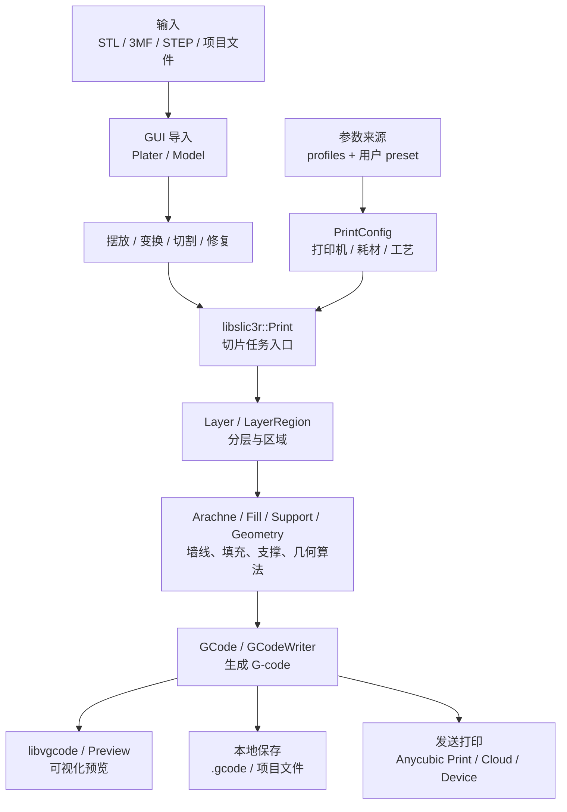
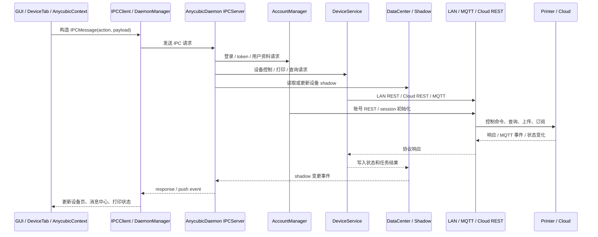
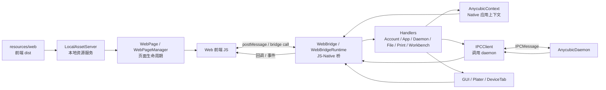
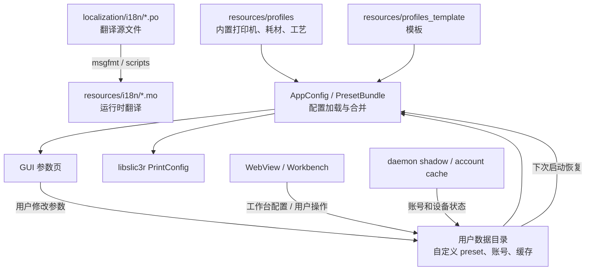
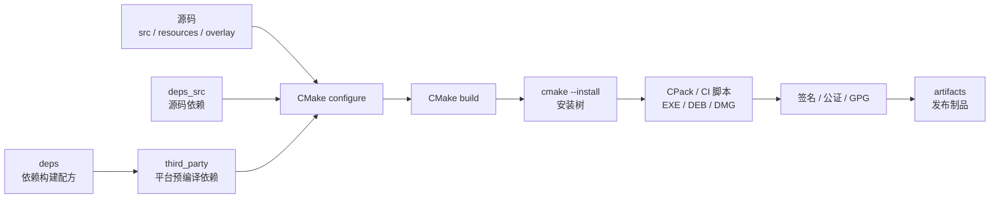

# AnycubicSlicerNext 项目架构说明

本文档基于当前仓库结构和 CMake 构建入口整理，用于快速理解 `AnycubicSlicerNext` 的代码分层、目录职责和主要功能模块。

## 1. 项目定位

`AnycubicSlicerNext` 是基于 OrcaSlicer / Slic3r 架构演进的 Anycubic 定制切片器。项目核心由四部分组成：

- 切片核心：几何处理、参数系统、路径规划、G-code 生成。
- 桌面应用：基于 wxWidgets 的跨平台 GUI。
- Anycubic 业务：登录、云服务、设备通信、WebView、打印历史、消息中心等。
- 构建与交付：CMake、平台依赖、overlay 定制、CI/CD 打包。

整体分层如下：

```text
运行资源层：resources / localization / profiles / web
业务应用层：slic3r GUI + Anycubic 业务模块 + WebView
核心能力层：libslic3r 切片核心 + libvgcode 预览
基础设施层：deps / deps_src / third_party / overlay / CMake / scripts / tests
```

## 2. 顶层目录

```text
AnycubicSlicerNext
├─ CMakeLists.txt              顶层构建、依赖、资源安装、CPack 打包
├─ version.inc                 产品版本信息
├─ src/                        主源码目录
├─ resources/                  运行资源、profiles、图片、字体、web、i18n
├─ localization/               翻译源文件
├─ deps/                       第三方依赖构建配方
├─ deps_src/                   随源码一起编译的第三方源码
├─ third_party/                平台预编译依赖
├─ overlay/                    Anycubic 构建注入层
├─ tests/                      测试代码
├─ scripts/                    构建、打包、gettext、profile 脚本
├─ docs/                       项目文档
├─ tools/                      辅助工具
└─ Wl_Report/                  独立 CrashReporter 工程
```

## 3. 构建入口

### 3.1 顶层 CMake

入口文件：`CMakeLists.txt`

主要职责：

- 设置项目名、版本、构建选项和平台策略。
- 配置 `SLIC3R_GUI`、`SLIC3R_STATIC`、`ENABLE_COMM_DAEMON` 等构建开关。
- 处理 `uv`、Python、资源路径、i18n、CPack 打包配置。
- 加载 `deps_src`。
- 进入 `src/` 编译主程序和核心库。
- 通过 `overlay/ac_overlay.cmake` 注入 Anycubic 定制逻辑。
- 安装 `resources/`、桌面文件、图标、工具等资源。

### 3.2 src/CMakeLists.txt

入口文件：`src/CMakeLists.txt`

主要职责：

- 编译 `libslic3r` 切片核心库。
- 在启用 GUI 时编译 `glad`、`libvgcode`、`slic3r`。
- 查找并配置 wxWidgets。
- 编译 `AnycubicDaemon` 守护进程。
- 生成主程序目标，最终输出名为 `AnycubicSlicerNext`。
- 配置 Windows/macOS/Linux 的平台链接参数、RPATH、bundle 信息等。

## 4. src 目录

```text
src/
├─ libslic3r/               切片核心库
├─ slic3r/                  GUI、配置、Anycubic 应用层
├─ AnycubicDaemon/          后台通信守护进程
├─ libvgcode/               G-code 可视化/预览
├─ glad/                    OpenGL loader
├─ crashpad/                崩溃收集相关
└─ dev-utils/               平台资源、工具、profile validator
```

### 4.1 libslic3r

目录：`src/libslic3r`

这是项目的切片核心层，负责从模型、配置、材料和打印机参数生成打印路径与 G-code。

主要模块：

- `Algorithm/`：通用算法。
- `Arachne/`：Arachne 墙线/路径相关算法。
- `Fill/`：填充算法。
- `Support/`：支撑生成。
- `GCode/`、`GCode.cpp`、`GCodeWriter.cpp`：G-code 生成、读取和输出。
- `Geometry/`：几何计算。
- `Format/`：文件格式解析。
- `SLA/`：SLA 相关逻辑。
- `Optimize/`：路径和几何优化。
- `AnycubicLib/`：Anycubic 相关核心扩展。
- `Print.cpp`、`PrintConfig.cpp`：打印流程和参数系统的关键入口。

### 4.2 slic3r

目录：`src/slic3r`

应用层代码，包含 GUI、配置、插件、通用工具和 Anycubic 业务模块。

```text
src/slic3r/
├─ GUI/        wxWidgets 桌面界面
├─ Anycubic/   Anycubic 业务集成
├─ Config/     应用配置
├─ Utils/      通用工具
└─ plugin/     插件相关
```

### 4.3 slic3r/GUI

目录：`src/slic3r/GUI`

基于 wxWidgets 的主界面层。

主要功能：

- 主窗口、菜单、工具栏、状态栏。
- 3D/2D 视图、模型摆放、预览。
- 打印机、耗材、工艺参数编辑。
- 设备页、任务页、打印发送。
- 校准向导、弹窗、控件、暗色模式。
- G-code 预览和可视化入口。

典型文件和目录：

- `GUI_App.*`：应用启动和 GUI 生命周期。
- `MainFrame.*`：主窗口。
- `3DScene.*`、`2DBed.*`、`3DBed.*`：场景和热床视图。
- `DeviceTab/`、`DeviceCore/`：设备相关界面。
- `Printer/`：打印机相关 UI。
- `Jobs/`：后台任务。
- `Gizmos/`：3D 操作工具。
- `Widgets/`：通用控件。

### 4.4 slic3r/Anycubic

目录：`src/slic3r/Anycubic`

Anycubic 定制业务层。

主要模块：

- `Cloud/`：云服务相关。
- `Login/`：登录和账号。
- `IPC/`：GUI 与 daemon 通信协议。
- `WebView/`：内嵌 Web 页面能力。
- `Print/`：Anycubic 打印业务。
- `PrintHistory/`：打印历史。
- `StorageManagement/`：存储管理。
- `Updater/`：更新相关。
- `Widgets/`、`ACDialog/`、`GUI/`：Anycubic 定制 UI。
- `Plugins/`：插件扩展。

根目录下的 `AnycubicContext.*`、`AnycubicEvent.*` 是应用上下文和事件连接的重要入口。

### 4.5 AnycubicDaemon

目录：`src/AnycubicDaemon`

无界面的后台守护进程。它与 GUI 解耦，承担长连接、网络通信、设备发现和云端转发等职责。

主要模块：

- `account/`：账号相关。
- `business/`：业务流程。
- `discovery/`：设备发现。
- `http/`：HTTP / REST。
- `mqtt/`、`mqtt_client/`：MQTT 通信。
- `network/`：网络基础能力。
- `shadow/`：设备 shadow / 数据状态。
- `arbitration/`：业务仲裁。
- `core/`：daemon 核心。
- `utils/`：工具函数。

GUI 与 daemon 通常通过 `src/slic3r/Anycubic/IPC` 下的协议进行通信。

### 4.6 libvgcode

目录：`src/libvgcode`

负责 G-code 可视化和预览能力，服务于 GUI 的切片结果查看、路径预览等功能。

### 4.7 dev-utils

目录：`src/dev-utils`

开发和平台辅助工具。

典型用途：

- Windows RC / manifest。
- macOS Info.plist。
- Linux desktop 文件。
- profile validator 工具。
- 其他构建期辅助代码。

## 5. 资源目录

目录：`resources`

运行时资源集中存放在这里。

主要子目录：

- `profiles/`：打印机、耗材、工艺配置。
- `profiles_template/`：profile 模板。
- `printers/`：打印机相关资源。
- `i18n/`：编译后的多语言 `.mo`。
- `images/`：图标、图片。
- `fonts/`：字体。
- `shaders/`：OpenGL shader。
- `web/`：内嵌 Web 页面资源。
- `cloud/`：云服务相关资源。
- `cert/`：证书。
- `data/`：运行数据。
- `tooltip/`、`dailytip/`：提示文本资源。

## 6. 本地化

目录：`localization`

翻译源文件位于：

```text
localization/i18n/<lang>/OrcaSlicer_<lang>.po
```

构建或脚本会将 `.po` 编译为 `.mo`，输出到：

```text
resources/i18n/<lang>/OrcaSlicer.mo
```

常用脚本：

- `scripts/run_gettext.bat`
- `scripts/run_gettext.sh`

## 7. 依赖体系

### 7.1 deps

目录：`deps`

第三方库构建配方，包含 Boost、wxWidgets、OpenCV、OCCT、TBB、OpenSSL、CURL、PNG、ZLIB、python3 等。

这些文件通常描述如何下载、patch、配置和编译依赖。

### 7.2 deps_src

目录：`deps_src`

随工程源码一起参与编译的第三方源码或 header-only 依赖。顶层 CMake 会先 `add_subdirectory(deps_src)`。

### 7.3 third_party

目录：`third_party`

平台预编译依赖，按平台组织：

```text
third_party/
├─ Win/
├─ Linux/
├─ Mac/
└─ package/
```

CI 通常通过 `CMAKE_PREFIX_PATH` 指向这里，例如：

- Windows：`third_party/Win`
- Linux：`third_party/Linux`
- macOS：`third_party/Mac/<arch>`

## 8. overlay 定制层

目录：`overlay`

`overlay` 是 Anycubic 定制逻辑的构建注入层。它的设计目标是减少对上游 CMake 文件的大规模侵入。

主要文件：

- `ac_overlay.cmake`：总入口。
- `ac_slic3r_gui.cmake`：GUI 定制源文件、链接和 include 注入。
- `ac_libslic3r_sources.cmake`：核心库源文件注入。
- `ac_libslic3r_includes.cmake`：核心库 include 注入。
- `ac_crashpad.cmake`：Crashpad 相关构建集成。
- `ac_wl_report.cmake`：Wl_Report CrashReporter 集成。

顶层 CMake 在 `add_subdirectory(src)` 之后调用：

```cmake
include("${CMAKE_CURRENT_SOURCE_DIR}/overlay/ac_overlay.cmake")
ac_overlay_apply()
```

## 9. 测试目录

目录：`tests`

主要测试模块：

- `libslic3r/`：切片核心测试。
- `fff_print/`：FDM 打印测试。
- `sla_print/`：SLA 打印测试。
- `anycubic_ipc/`：Anycubic IPC 测试。
- `webview/`：WebView 相关测试。
- `slic3rutils/`：工具测试。
- `catch2/`：测试框架。

常用命令：

```bash
cd build
ctest --output-on-failure
```

## 10. scripts 目录

目录：`scripts`

常见用途：

- gettext 翻译处理。
- profile 检查和打包。
- Linux / Flatpak / MSIX 打包辅助。
- Python stub 生成。
- 资源优化。
- 第三方依赖路径修复和搬迁。

## 11. 主要运行链路

### 11.1 启动链路

```text
AnycubicSlicerNext executable
  -> GUI_App
  -> MainFrame
  -> GUI / AnycubicContext 初始化
  -> 加载 resources、profiles、i18n
  -> 初始化设备、云服务、WebView、后台任务
```

### 11.2 切片链路

```text
模型导入
  -> 参数/profile 解析
  -> libslic3r Print / PrintConfig
  -> 几何处理、摆放、切割、支撑、填充
  -> G-code 生成
  -> libvgcode / GUI 预览
  -> 保存、发送或上传
```

### 11.3 设备通信链路

```text
GUI / Anycubic 模块
  -> IPC
  -> AnycubicDaemon
  -> 设备发现 / MQTT / HTTP / 云端 REST
  -> 状态回传 GUI
```

### 11.4 打包链路

```text
CMake configure
  -> deps / third_party / deps_src
  -> src/libslic3r
  -> src/slic3r GUI
  -> AnycubicDaemon
  -> resources 安装
  -> CPack / 平台脚本
  -> Windows EXE / Linux DEB / macOS DMG
```

## 12. 主要功能点

- 模型导入、摆放、变换、切割、修复。
- FDM / SLA 切片。
- 打印机、耗材、工艺 profile 管理。
- 支撑、填充、路径规划、G-code 生成。
- G-code 预览和可视化。
- 多语言界面。
- Anycubic 登录、云服务和设备管理。
- LAN / 云端通信、MQTT / REST 转发。
- 内嵌 WebView 工作台。
- 打印历史、消息中心、存储管理。
- CrashReporter / Crashpad 崩溃收集。
- Windows / Linux / macOS 跨平台构建和打包。

## 13. 修改代码时的定位建议

- 切片算法、G-code、打印参数：优先看 `src/libslic3r`。
- GUI 页面、弹窗、控件：优先看 `src/slic3r/GUI`。
- Anycubic 云服务、登录、设备、WebView：优先看 `src/slic3r/Anycubic`。
- 后台通信和设备长连接：优先看 `src/AnycubicDaemon`。
- 资源、profile、图片、web：优先看 `resources`。
- 翻译：优先看 `localization/i18n`。
- 依赖构建问题：优先看 `deps`、`third_party`、`deps_src`。
- Anycubic 定制构建注入：优先看 `overlay`。
- 测试：优先看 `tests`。

## 14. 模块数据与消息交付图

本节用 Mermaid 图描述主程序、切片核心、Anycubic 业务模块、daemon、WebView、资源和构建系统之间的数据与消息流。建议阅读代码时先看总览图，再按具体链路进入对应目录。

### 14.1 全链路总览图

```mermaid
flowchart LR
    User["用户 / 操作系统"]
    Installer["安装包<br/>Windows EXE / Linux DEB / macOS DMG"]
    App["AnycubicSlicerNext 主程序<br/>src/OrcaSlicer.cpp"]

    subgraph Build["构建与交付层"]
        CMake["CMakeLists.txt<br/>src/CMakeLists.txt"]
        Overlay["overlay<br/>Anycubic 构建注入"]
        Deps["deps / deps_src<br/>依赖源码与构建配方"]
        ThirdParty["third_party<br/>平台预编译依赖"]
        ResourcesBuild["resources 安装<br/>CPack / CI 脚本"]
    end

    subgraph RuntimeResources["运行资源层"]
        Profiles["profiles / profiles_template<br/>打印机、耗材、工艺配置"]
        I18N["resources/i18n<br/>多语言 mo 文件"]
        Images["images / fonts / shaders<br/>UI 与渲染资源"]
        WebAssets["resources/web<br/>内嵌前端资源"]
        Certs["cert / cloud / data<br/>证书、云配置、运行数据"]
    end

    subgraph GUI["桌面应用层 src/slic3r"]
        GUIApp["GUI_App / MainFrame<br/>应用生命周期与主窗口"]
        Plater["Plater / 3DScene / 2DBed<br/>模型导入、摆放、编辑"]
        ConfigUI["Preset / Config / Printer UI<br/>参数编辑"]
        PreviewUI["Preview / libvgcode UI<br/>G-code 预览"]
        DeviceUI["DeviceTab / DeviceCore<br/>设备页、任务页"]
        AnycubicCtx["AnycubicContext / AnycubicEvent<br/>Anycubic 应用上下文"]
        WebView["Anycubic WebView<br/>WebPage / WebBridge / Handlers"]
    end

    subgraph Core["切片核心层 src/libslic3r"]
        ModelIO["Format / Model<br/>STL、3MF、AMF 等模型数据"]
        PrintConfig["PrintConfig / PresetBundle<br/>参数系统"]
        Geometry["Geometry / Arachne / Optimize<br/>几何与路径算法"]
        FillSupport["Fill / Support / SLA<br/>填充、支撑、SLA"]
        PrintFlow["Print / Layer / LayerRegion<br/>切片流程"]
        GCode["GCode / GCodeWriter<br/>G-code 生成"]
    end

    subgraph AnycubicBiz["Anycubic 业务层 src/slic3r/Anycubic"]
        Login["Login / Account<br/>登录状态"]
        CloudUI["Cloud / Print / PrintHistory<br/>云打印与历史"]
        Storage["StorageManagement<br/>存储管理"]
        Updater["Updater<br/>更新"]
        IPCClient["IPCClient / DaemonManager<br/>GUI 侧 IPC 客户端"]
        ShadowCache["IncrementalShadowCache<br/>设备状态缓存"]
    end

    subgraph Daemon["后台通信层 src/AnycubicDaemon"]
        IPCServer["core/ipc_server<br/>daemon IPC 服务"]
        AccountMgr["account_manager<br/>账号会话"]
        DeviceService["business/device_service<br/>设备业务调度"]
        DataCenter["shadow/data_center_manager<br/>设备 shadow 数据中心"]
        Discovery["discovery / network<br/>LAN 发现与 LAN API"]
        CloudSession["network/cloud_session_manager<br/>云会话"]
        MQTT["mqtt / mqtt_client<br/>MQTT 长连接"]
        HTTP["http/cloud_* / lan_ctrl<br/>云端 REST / LAN 控制"]
        Dispatcher["core/event_dispatcher<br/>事件分发"]
    end

    subgraph External["外部系统"]
        Printer["Anycubic 打印机<br/>LAN / MQTT / REST"]
        Cloud["Anycubic Cloud<br/>账号、设备、消息、素材"]
        FS["本地文件系统<br/>模型、G-code、配置、缓存"]
    end

    User -->|"启动 / 操作"| App
    Installer -->|"安装程序和资源"| App
    CMake --> Overlay
    CMake --> Deps
    CMake --> ThirdParty
    Overlay --> App
    Deps --> App
    ThirdParty --> App
    ResourcesBuild --> Installer

    App --> GUIApp
    RuntimeResources --> GUIApp
    Profiles --> PrintConfig
    I18N --> GUIApp
    Images --> GUIApp
    WebAssets --> WebView
    Certs --> AnycubicCtx

    GUIApp --> Plater
    GUIApp --> ConfigUI
    GUIApp --> PreviewUI
    GUIApp --> DeviceUI
    GUIApp --> AnycubicCtx

    Plater -->|"模型数据"| ModelIO
    ConfigUI -->|"参数选择"| PrintConfig
    ModelIO --> PrintFlow
    PrintConfig --> PrintFlow
    PrintFlow --> Geometry
    Geometry --> FillSupport
    FillSupport --> GCode
    GCode -->|"G-code / toolpath"| PreviewUI
    GCode -->|"保存文件"| FS
    PreviewUI -->|"发送打印任务"| CloudUI

    AnycubicCtx --> Login
    AnycubicCtx --> CloudUI
    AnycubicCtx --> Storage
    AnycubicCtx --> Updater
    DeviceUI --> IPCClient
    CloudUI --> IPCClient
    Login --> IPCClient
    WebView -->|"JS bridge 请求"| AnycubicCtx
    WebView -->|"daemon handler 请求"| IPCClient

    IPCClient <-->|"IPCMessage<br/>请求 / 响应 / 事件"| IPCServer
    IPCServer --> AccountMgr
    IPCServer --> DeviceService
    IPCServer --> DataCenter
    AccountMgr --> CloudSession
    DeviceService --> Discovery
    DeviceService --> CloudSession
    DeviceService --> HTTP
    DeviceService --> MQTT
    DataCenter --> Dispatcher
    MQTT --> Dispatcher
    HTTP --> Dispatcher
    Discovery --> Dispatcher
    Dispatcher -->|"设备状态 / 账号事件 / 消息"| IPCServer
    IPCServer -->|"push event"| IPCClient
    IPCClient --> ShadowCache
    ShadowCache --> DeviceUI

    Discovery <-->|"SSDP / LAN API"| Printer
    HTTP <-->|"REST"| Printer
    MQTT <-->|"MQTT topic"| Cloud
    HTTP <-->|"Cloud REST"| Cloud
    CloudSession <-->|"账号 token / 会话"| Cloud
    CloudUI -->|"上传 G-code / 项目 / 任务"| Cloud
    CloudUI -->|"本地任务文件"| FS
```



### 14.2 切片数据流



阅读入口建议：

- 模型和项目导入：`src/libslic3r/Format`、`src/slic3r/GUI/Plater*`
- 参数系统：`src/libslic3r/PrintConfig.cpp`
- 切片流程：`src/libslic3r/Print.cpp`
- G-code：`src/libslic3r/GCode.cpp`、`src/libslic3r/GCodeWriter.cpp`
- 预览：`src/libvgcode`、`src/slic3r/GUI/Preview*`

### 14.3 GUI 与 AnycubicDaemon 消息流



核心代码位置：

- GUI 侧 IPC：`src/slic3r/Anycubic/IPC/IPCClient.*`
- daemon 管理：`src/slic3r/Anycubic/IPC/DaemonManager.*`
- IPC 协议：`src/slic3r/Anycubic/IPC/ipc_protocol.*`
- daemon IPC 服务：`src/AnycubicDaemon/core/ipc_server.*`
- 设备业务：`src/AnycubicDaemon/business/device_service.*`
- 账号业务：`src/AnycubicDaemon/account/account_manager.*`
- shadow 数据中心：`src/AnycubicDaemon/shadow/data_center_manager.*`

### 14.4 WebView 与 Native 桥接消息流



核心代码位置：

- WebView 总入口：`src/slic3r/Anycubic/WebView/WebPage.*`
- 页面管理：`src/slic3r/Anycubic/WebView/WebPageManager.*`
- JS-Native 桥：`src/slic3r/Anycubic/WebView/WebBridge.*`
- 本地资源服务：`src/slic3r/Anycubic/WebView/LocalAssetServer.*`
- 业务 Handler：`src/slic3r/Anycubic/WebView/Handlers`

### 14.5 资源、配置与运行数据流



### 14.6 构建与交付数据流



对应目录：

- 构建入口：`CMakeLists.txt`、`src/CMakeLists.txt`
- 依赖配方：`deps`
- 预编译依赖：`third_party`
- Anycubic 注入：`overlay`
- CI/CD 脚本：Jenkins pipeline 文件、`build_release*.sh`、`build_release*.bat`

