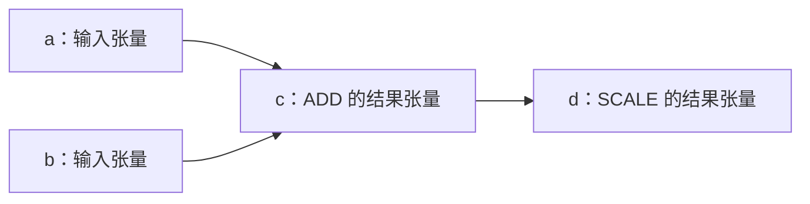

# ggml_tensor 与 ggml_cgraph 详解

本文说明 `ggml_tensor` 的各个成员、张量内存布局，以及它与 `ggml_cgraph` 的区别。内容依据当前仓库源码整理，核对日期为 2026-10-04。

主要源码入口：

- [`include/ggml.h`](../include/ggml.h)：`ggml_tensor`、张量标记和公共接口。
- [`src/ggml-impl.h`](../src/ggml-impl.h)：`ggml_cgraph`、哈希集合和内部辅助函数。
- [`src/ggml.c`](../src/ggml.c)：创建张量、构建算子和构建计算图。
- [`src/ggml-backend.cpp`](../src/ggml-backend.cpp)：后端缓冲区与张量数据访问。
- [`src/ggml-cpu/ggml-cpu.c`](../src/ggml-cpu/ggml-cpu.c)：CPU 计算图执行。

## 1. 核心区别

**`ggml_tensor` 描述一个张量，包括它的数据类型、形状、内存布局、数据位置，以及产生它的运算和输入依赖。`ggml_cgraph` 组织一组相互依赖的 tensor，形成可以交给后端执行的计算图。**

因此，tensor 同时是数据的描述对象和计算图中的节点对象。计算图保存这些对象的指针，并补充节点顺序、去重信息、使用次数和梯度关系。

例如：

```c
struct ggml_tensor * c = ggml_add(ctx, a, b);
struct ggml_tensor * d = ggml_scale(ctx, c, 2.0f);
```

它描述的计算是：

```text
c = a + b
d = 2 × c
```

数据流如下，图中的每个节点都是一个 `ggml_tensor`：



图中的箭头表示数据流。结构体中的 `src` 指针反向指向来源，例如 `c->src[0] == a`、`c->src[1] == b`、`d->src[0] == c`。

| 对比项 | `ggml_tensor` | `ggml_cgraph` |
|---|---|---|
| 描述范围 | 一个张量及其局部计算关系 | 一组张量构成的计算图 |
| 数据布局 | 保存 `type`、`ne`、`nb` | 通过 tensor 指针访问布局 |
| 数据位置 | 保存 `buffer`、`data`、视图来源 | 保存 tensor 指针，不复制其数据 |
| 运算依赖 | 保存 `op`、`src`、`op_params` | 遍历依赖并组织节点顺序 |
| 梯度关系 | 当前版本没有 `grad` 成员 | 保存 `grads`、`grad_accs` |
| 典型创建接口 | `ggml_new_tensor_*()`、张量算子接口 | `ggml_new_graph()`、`ggml_new_graph_custom()` |

## 2. ggml_tensor 定义与成员总览

当前结构体定义如下，省略了原始注释：

```c
struct ggml_tensor {
    enum ggml_type type;

    int64_t ne[GGML_MAX_DIMS];
    size_t  nb[GGML_MAX_DIMS];
    void * data;
    struct ggml_backend_buffer * buffer;

    enum ggml_op op;
    int32_t op_params[GGML_MAX_OP_PARAMS / sizeof(int32_t)];
    struct ggml_tensor * src[GGML_MAX_SRC];

    struct ggml_tensor * view_src;
    size_t               view_offs;

    int32_t flags;
    char name[GGML_MAX_NAME];
    void * extra;
    char padding[8];
};
```

当前宏定义为：

```c
#define GGML_MAX_DIMS       4
#define GGML_MAX_SRC        10
#define GGML_MAX_OP_PARAMS  64
```

`GGML_MAX_NAME` 默认是 64，可以通过宏定义覆盖。

| 成员 | 含义 |
|---|---|
| `type` | 数据的存储类型，如 F32、F16、Q4_0 等 |
| `buffer` | 关联的后端缓冲区对象，描述存储资源及访问方式 |
| `ne[4]` | 每个维度的逻辑元素数量，即 shape |
| `nb[4]` | 每个维度的字节步长，即 stride |
| `op` | 产生这个张量的运算类型 |
| `op_params[16]` | 运算附加参数，共 64 字节，布局由算子决定 |
| `flags` | 张量角色和计算标记，可按位组合 |
| `src[10]` | 当前运算依赖的来源 tensor 指针 |
| `view_src` | 当前张量共享数据的底层来源 tensor |
| `view_offs` | 相对 `view_src->data` 的字节偏移 |
| `data` | 当前张量数据的起始地址或后端表示的地址 |
| `name` | 张量名称，用于调试、日志和查找 |
| `extra` | 后端使用的扩展信息，具体含义由后端决定 |
| `padding[8]` | 结构体布局的填充空间，与张量数值无关 |

可以把这些成员按用途理解：

```text
数据如何解释：type、ne、nb
数据如何存放：buffer、data、view_src、view_offs
结果如何产生：op、src、op_params
角色及辅助信息：flags、name、extra、padding
```

## 3. type、ne、nb：数据类型、形状与内存布局

### 3.1 type：数据的存储格式

`type` 决定数据如何存储和解释。例如：

| 类型 | 存储方式 |
|---|---|
| `GGML_TYPE_F32` | 每个元素为一个 32 位浮点数 |
| `GGML_TYPE_F16` | 每个元素为一个 16 位浮点数 |
| `GGML_TYPE_I32` | 每个元素为一个 32 位整数 |
| `GGML_TYPE_Q4_0` | 多个逻辑元素打包成量化块 |

因此，读取 `data` 时必须考虑 `type`。只有对应的 F32 数据才适合解释为 `float`；量化数据需要按量化块格式解析。

### 3.2 ne：逻辑形状

例如：

```c
struct ggml_tensor * a =
    ggml_new_tensor_2d(ctx, GGML_TYPE_F32, 4, 3);
```

它的形状为：

```text
ne = [4, 3, 1, 1]
```

对于普通二维矩阵，可以理解为 3 行、每行 4 个元素：

```text
第 0 行：a00  a01  a02  a03
第 1 行：a10  a11  a12  a13
第 2 行：a20  a21  a22  a23
```

ggml 把最内层维度放在 `ne[0]`，因此：

```text
ggml 的维度表示：ne = [4, 3, 1, 1]
常见的 行×列 表示：3 × 4
```

新建低维张量时，剩余维度初始化为 1。逻辑元素总数为：

```c
ne[0] * ne[1] * ne[2] * ne[3]
```

可以使用 `ggml_nelements(a)` 获取。`ne[2]`、`ne[3]` 的业务含义由具体算子决定，例如批次、通道、注意力头等，结构体本身没有统一规定。

### 3.3 nb：字节步长

对上面的连续 F32 张量，一个元素占 4 字节：

```text
ne = [4, 3, 1, 1]
nb = [4, 16, 48, 48]
```

| 成员 | 数值 | 含义 |
|---|---:|---|
| `nb[0]` | 4 | 第 0 维索引增加 1，地址前进 4 字节 |
| `nb[1]` | 16 | 第 1 维索引增加 1，地址前进一行 |
| `nb[2]` | 48 | 第 2 维索引增加 1，地址前进一个二维平面 |
| `nb[3]` | 48 | 第 3 维索引增加 1，地址前进一个三维块 |

对于 F32 这类每个逻辑元素独立存储的类型，四维元素的地址为：

```c
char * addr = (char *) a->data
            + i0 * a->nb[0]
            + i1 * a->nb[1]
            + i2 * a->nb[2]
            + i3 * a->nb[3];

float value = *(float *) addr;
```

例如，第 1 行、第 2 列的字节偏移为：

```text
i0 = 2，i1 = 1
偏移 = 2 × 4 + 1 × 16 = 24 字节
```

**shape 相同，stride 可以不同。** 张量可以连续存储，也可以是带有行间空隙的视图，或经过转置、维度置换。

### 3.4 转置为什么不必复制数据

执行：

```c
struct ggml_tensor * t = ggml_transpose(ctx, a);
```

当前实现交换前两个维度的 `ne` 和 `nb`，并共享原数据：

```text
a：ne = [4, 3, 1, 1]，nb = [4, 16, 48, 48]
t：ne = [3, 4, 1, 1]，nb = [16, 4, 48, 48]
```

沿 `t` 的第 0 维移动时，要跳过原矩阵的一行，所以步长为 16 字节。转置通过改变解释数据的方式完成，不需要搬动矩阵元素。

因此，不能普遍假设下面的表达式等同于按逻辑顺序访问第 `i` 个元素：

```c
((float *) tensor->data)[i]
```

它要求数据类型、连续性和索引方式都匹配。可以使用 `ggml_is_contiguous()` 判断张量是否具有连续布局。

### 3.5 量化类型的 nb[0] 表示一个块的字节数

新建连续张量时，当前 stride 初始化公式为：

```c
nb[0] = ggml_type_size(type);
nb[1] = nb[0] * (ne[0] / ggml_blck_size(type));
nb[2] = nb[1] * ne[1];
nb[3] = nb[2] * ne[2];
```

对 F32：

```text
ggml_type_size(F32) = 4 字节
ggml_blck_size(F32) = 1 个元素
```

对 Q4_0，一个量化块表示 32 个逻辑元素，占 18 字节：

```text
2 字节缩放因子 + 16 字节打包的 4-bit 数值
```

因此，一个连续 Q4_0 张量如果形状为 `[64, 2, 1, 1]`，其布局为：

```text
nb[0] = 18
nb[1] = 18 × (64 / 32) = 36
nb[2] = 36 × 2 = 72
nb[3] = 72
```

这里 `nb[0]` 表示一个量化块的字节数。获取块内某个逻辑元素还需要解析量化编码和缩放因子，不能直接套用 F32 的逐元素寻址公式。

Q4_0 的块定义为 `block_q4_0`，位于 [`src/ggml-common.h`](../src/ggml-common.h)。

## 4. op、src、op_params：结果如何产生

### 4.1 op 和 src

对于：

```c
struct ggml_tensor * c = ggml_add(ctx, a, b);
```

当前实现的核心操作是：

```c
// 创建与 a 类型、形状一致的结果 tensor
struct ggml_tensor * result = ggml_dup_tensor(ctx, a);

// 记录产生结果的运算和输入
result->op     = GGML_OP_ADD;
result->src[0] = a;
result->src[1] = b;
```

`ggml_dup_tensor()` 创建同类型、同形状的张量，不会复制 `a` 的数值。

**`ggml_add()` 返回时，只是创建了结果张量并记录了运算关系，不代表已经完成了数值加法。** 即使已经分配 `data`，它也不代表结果已经有效。实际计算发生在计算图执行阶段。

`src` 的索引含义由算子规定：

- 加法：`src[0]`、`src[1]` 分别为两个输入。
- 缩放：`src[0]` 为被缩放的张量。
- 其他算子：可能需要更多输入 tensor。

剩余不用的槽位通常为 `NULL`。`GGML_OP_NONE` 表示没有生成这个张量的运算，常见于输入、常量和模型权重。

### 4.2 op_params

`op_params` 保存没有作为 tensor 输入提供的附加参数。例如：

```c
struct ggml_tensor * d = ggml_scale(ctx, c, 2.0f);
```

当前实现保存两个浮点参数：

```c
float params[2] = { 2.0f, 0.0f };
```

并记录：

```c
d->op     = GGML_OP_SCALE;
d->src[0] = c;
```

虽然成员声明为 `int32_t op_params[16]`，它本质上是一块 64 字节的参数存储区，使用 `int32_t` 数组主要是为了对齐。内容可能是整数、浮点数或算子专用的参数结构，必须按对应算子的规则解释。

## 5. flags：张量角色和计算标记

`flags` 可以按位组合：

| 标记 | 值 | 含义 | 常见设置方式 |
|---|---:|---|---|
| `GGML_TENSOR_FLAG_INPUT` | 1 | 计算图输入 | `ggml_set_input(t)` |
| `GGML_TENSOR_FLAG_OUTPUT` | 2 | 需要保留的计算图输出 | `ggml_set_output(t)` |
| `GGML_TENSOR_FLAG_PARAM` | 4 | 可训练参数 | `ggml_set_param(t)` |
| `GGML_TENSOR_FLAG_LOSS` | 8 | 优化使用的损失张量 | `ggml_set_loss(t)` |
| `GGML_TENSOR_FLAG_COMPUTE` | 16 | 需要计算的张量 | 通常由构图过程设置 |

同一个 tensor 可以同时具有多个标记。判断标记时使用按位与：

```c
if (tensor->flags & GGML_TENSOR_FLAG_INPUT) {
    // 是输入
}
```

需要区分以下含义：

- `INPUT` 是输入角色，可以表示每次推理提供的数据；`PARAM` 表示训练过程中需要优化的变量。
- `OUTPUT` 会影响分配器对存储空间的复用，避免需要保留的结果被覆盖。当前 `ggml_set_output()` 还会沿 `view_src` 标记底层来源。
- `COMPUTE` 表示需要执行，不表示已经计算完成。
- 设置 `OUTPUT` 不会自动构图，仍需调用 `ggml_build_forward_expand()`。

## 6. src 与 view_src：计算依赖和存储共享

**`src` 描述计算依赖，`view_src` 描述底层数据的共享关系。**

普通加法：

```c
struct ggml_tensor * c = ggml_add(ctx, a, b);
```

通常有：

```text
c->src[0] = a
c->src[1] = b
c->view_src = NULL
```

计算 `c` 需要读取 `a`、`b`，而 `c` 有自己的结果存储。

### 6.1 视图与偏移

假设 `a` 是足够大的 F32 张量：

```c
struct ggml_tensor * v =
    ggml_view_1d(ctx, a, 4, 2 * sizeof(float));
```

这表示从 `a` 的第 2 个元素开始，观察 4 个元素：

```text
a 的数据：[0] [1] [2] [3] [4] [5] [6] ...
v 的数据：        [2] [3] [4] [5]
```

这里：

```c
v->op        = GGML_OP_VIEW;
v->src[0]    = a;
v->view_src  = a;
v->view_offs = 2 * sizeof(float);
```

数据地址建立后：

```c
v->data = (char *) a->data + v->view_offs;
```

因此，访问 `v->data` 时不要再加一次 `view_offs`，否则会重复偏移。视图与底层张量共享数据，通过视图修改数据，也会修改底层对应的存储内容。

### 6.2 嵌套视图

例如，`base` 为足够大的 F32 张量：

```c
struct ggml_tensor * v1 =
    ggml_view_1d(ctx, base, 6, 2 * sizeof(float));
struct ggml_tensor * v2 =
    ggml_view_1d(ctx, v1, 3, 1 * sizeof(float));
```

当前创建实现会把存储来源归并到底层 tensor：

```text
v2->src[0]    = v1
v2->view_src  = base
v2->view_offs = 3 × sizeof(float)
```

所以：

```text
计算依赖：v2 → v1
共享存储：v2 → base
```

### 6.3 原地运算

`view_src != NULL` 不一定意味着 `op == GGML_OP_VIEW`。例如：

```c
struct ggml_tensor * c = ggml_add_inplace(ctx, a, b);
```

它仍是一个 `GGML_OP_ADD` 结果 tensor，但共享 `a` 的存储，执行后会修改共享的数据。

**新建 tensor 描述对象，不一定新建数据空间。**

## 7. buffer、data 与内存生命周期

### 7.1 buffer 和 data 的区别

```text
buffer：数据所在的后端缓冲区，以及访问它的方法
data：  当前 tensor 在该存储中的数据起点
```

一个 buffer 可以容纳多个 tensor：

```text
backend buffer
┌────────────────────────────────────────┐
│ tensor a 的数据 │ tensor b 的数据 │ ... │
└────────────────────────────────────────┘
       ↑                 ↑
     a->data           b->data
```

多个视图还可以指向相同或重叠的数据区域。

### 7.2 描述信息与数据可以分开分配

例如：

```c
struct ggml_init_params params = {
    .mem_size   = 1024 * 1024, // 按描述对象实际需求设置
    .mem_buffer = NULL,
    .no_alloc   = true,
};
```

上面是配置示意，`mem_size` 需要按描述对象实际需求设置。`no_alloc = true` 时，新建普通 tensor 主要分配描述信息，数据通常由后续后端分配器安排。此时 `data == NULL` 可以是正常的构建状态。

如果使用 context 内存池直接分配 CPU 数据，则可能：

```text
buffer == NULL
data   != NULL
```

因此，不能仅通过 `buffer` 是否为空判断 tensor 有没有数据。

`sizeof(struct ggml_tensor)` 只计算描述对象大小，不包含它所指向的数据。逻辑元素数量可以用 `ggml_nelements()` 获取，数据字节范围可以用 `ggml_nbytes()` 获取；对于量化或非连续布局，不能普遍用“元素数 × sizeof(float)”计算。

### 7.3 设备后端的数据访问

使用设备后端时，`data` 不一定是 CPU 可以直接解引用的普通地址。通常通过以下接口读写已经分配的后端张量：

```c
ggml_backend_tensor_set(tensor, host_data, offset, size);
ggml_backend_tensor_get(tensor, host_data, offset, size);
```

其中 `offset`、`size` 的单位都是字节。这些接口需要张量已经关联并分配了后端缓冲区，不能直接用于只有 context 数据、`buffer == NULL` 的张量。

### 7.4 生命周期

`ggml_context` 管理其中创建的 tensor 描述对象、cgraph 及其管理数组。使用 context 直接分配的数据也位于这个内存池中，释放 context 后这些对象和数据都不能继续访问。

由后端分配的数据，其生命周期还取决于后端缓冲区的所有者。计算图保存 tensor 指针，并不会让 tensor 或其数据自动延长生命周期。

### 7.5 name、extra、padding

- `name` 用于日志、调试、图展示和按名称查找，通常通过 `ggml_set_name()` 设置。它不是自动保证唯一的 ID。
- `extra` 是后端扩展信息，不能统一理解为张量数据或算子参数。
- `padding` 是结构体本身的填充，与 `nb` 描述的张量数据布局是两回事。

## 8. ggml_cgraph 的成员与构图规则

### 8.1 成员总览

`ggml_cgraph` 的定义位于内部头文件 `src/ggml-impl.h`。公共头文件提供前向声明和访问接口，应用代码通常通过接口操作计算图。

| 成员 | 含义 |
|---|---|
| `size` | 图预留的节点容量；`nodes`、`leafs` 各有相应容量 |
| `n_nodes` | 当前 `nodes` 数组中使用的数量 |
| `n_leafs` | 当前 `leafs` 数组中使用的数量 |
| `nodes` | 运算结果 tensor 和可训练参数等节点的指针数组 |
| `grads` | tensor 对应的梯度张量指针 |
| `grad_accs` | 梯度累加器张量指针 |
| `leafs` | 通常是没有生成算子的非训练参数 tensor |
| `use_counts` | 每个 tensor 被其他节点作为来源使用的次数 |
| `visited_hash_set` | 已访问 tensor 的哈希集合，用于去重和查找 |
| `order` | 递归访问 `src` 时的先后顺序 |
| `uid` | 可选的图身份标记；0 表示未设置 |

`nodes`、`leafs` 各按 `size` 预留指针数组；哈希表容量另行计算。梯度和使用次数数组按哈希槽位组织，实际容量不能简单等同于 `n_nodes`。

### 8.2 nodes 和 leafs 的划分

当前前向构图使用的分类条件是：

```c
if (node->op == GGML_OP_NONE &&
    !(node->flags & GGML_TENSOR_FLAG_PARAM)) {
    // 放入 leafs
} else {
    // 放入 nodes
}
```

因此：

| tensor 情况 | 通常归属 |
|---|---|
| 普通输入，`op == NONE` | `leafs` |
| 常量或未标记为可训练参数的权重 | `leafs` |
| 标记为 `PARAM` 的可训练权重，即使 `op == NONE` | `nodes` |
| 加法、矩阵乘法等运算结果 | `nodes` |
| VIEW、RESHAPE、TRANSPOSE 等结果 | `nodes` |

头文件将 `leafs` 描述为常量数据。这里更准确的理解是：它们的值由外部提供，图执行时不会通过生成算子计算它们。输入张量仍可以在两次执行之间由调用者更新。

同样，`nodes` 中的每个 tensor 也不一定需要执行数值计算。CPU 实现会跳过 `NONE`、`VIEW`、`RESHAPE`、`TRANSPOSE`、`PERMUTE` 这类空操作，并检查 `COMPUTE` 标记。

### 8.3 从结果出发收集依赖

例如：

```c
struct ggml_tensor * c = ggml_add(ctx, a, b);
struct ggml_tensor * d = ggml_scale(ctx, c, 2.0f);

struct ggml_cgraph * g = ggml_new_graph(ctx);
ggml_build_forward_expand(g, d);
```

构图过程沿 `src` 递归访问，先收集来源，再收集当前节点。默认遍历顺序下，在 `a`、`b` 没有标记为 `PARAM` 的情况下，得到：

```text
leafs = [a, b]
nodes = [c, d]
n_leafs = 2
n_nodes = 2
```

执行时先计算 `c`，再计算 `d`，保证使用一个结果之前，它的依赖已经准备好。

`visited_hash_set` 避免将同一个 tensor 重复收集。`ggml_build_forward_expand()` 可以在现有图上追加其他输出的依赖，共享依赖会被去重。

当前版本还提供 `ggml_build_forward_order()`，用于添加 tensor 和依赖而不立即标记它们需要计算；当这些 tensor 后续从需要计算的节点被访问时，再设置计算标记。

### 8.4 order 的含义

`order` 控制访问各个来源槽位的先后顺序：

```text
LEFT_TO_RIGHT：从前面的 src 槽位开始访问
RIGHT_TO_LEFT：从后面的 src 槽位开始访问
```

它不是前向传播或反向传播的开关。两种遍历方式仍然需要保证依赖先于使用它的节点。

### 8.5 梯度和使用次数的索引方式

当前版本中：

```text
nodes[i]：按节点数组下标索引

grads[i]、grad_accs[i]、use_counts[i]：按哈希表槽位索引
```

不能假设 `grads[i]` 就是 `nodes[i]` 的梯度。获取某个 tensor 的梯度应使用：

```c
struct ggml_tensor * grad =
    ggml_graph_get_grad(g, tensor);

struct ggml_tensor * grad_acc =
    ggml_graph_get_grad_acc(g, tensor);
```

当前 `ggml_tensor` 本身没有 `grad` 成员，梯度关系由 cgraph 管理。

默认的 `ggml_new_graph(ctx)` 不预留梯度数组。需要梯度功能时，可以使用：

```c
struct ggml_cgraph * g =
    ggml_new_graph_custom(ctx, capacity, true);
```

`true` 只预留梯度管理空间；仍需设置可训练参数、损失，并通过 `ggml_build_backward_expand()` 构建反向计算。梯度张量本身也需要经过计算图执行才能得到数值。

`use_counts` 记录来源引用次数。例如 `ggml_add(ctx, x, x)` 使用了 `x` 两次，计数会增加两次。它可以辅助算子融合判断，不是控制 tensor 生命周期的对象引用计数。

`uid` 是可选的图身份标记，不是自动计算的内容哈希。按照结构体注释，两个匹配的非零值可以用于识别相同图；默认值 0 应被忽略。

## 9. 完整执行流程与 CPU 示例

### 9.1 从描述运算到执行运算

```text
创建输入 tensor
    ↓
调用 ggml_add、ggml_scale 等接口
创建结果 tensor，并记录 op / src / op_params
    ↓
调用 ggml_build_forward_expand
通过 src 收集依赖，填充 cgraph
    ↓
分配尚未分配的 tensor 数据，准备执行资源
    ↓
调用 graph compute 接口
根据图中的依赖顺序执行运算
    ↓
读取结果 tensor 的数据
```

数据分配的具体时机取决于使用方式。context 直接分配模式可以在新建 tensor 时分配数据；后端分配模式通常先构建描述，再规划和分配数据空间。

### 9.2 计算 d = 2 × (a + b)

下面使用 context 直接分配 CPU 数据。示例需要工程提供的 ggml 核心库与 CPU 后端；这里给出源代码和预期结果。

```c
#include "ggml.h"
#include "ggml-cpu.h"

#include <stdio.h>
#include <string.h>

int main(void) {
    struct ggml_init_params params = {
        .mem_size   = 1024 * 1024,
        .mem_buffer = NULL,
        .no_alloc   = false,
    };

    struct ggml_context * ctx = ggml_init(params);
    if (ctx == NULL) {
        return 1;
    }

    // 1. 输入 tensor：没有生成算子
    struct ggml_tensor * a =
        ggml_new_tensor_1d(ctx, GGML_TYPE_F32, 4);
    struct ggml_tensor * b =
        ggml_new_tensor_1d(ctx, GGML_TYPE_F32, 4);

    ggml_set_name(a, "a");
    ggml_set_name(b, "b");
    ggml_set_input(a);
    ggml_set_input(b);

    const float av[4] = { 1, 2, 3, 4 };
    const float bv[4] = { 10, 20, 30, 40 };

    memcpy(a->data, av, sizeof(av));
    memcpy(b->data, bv, sizeof(bv));

    // 2. 创建结果 tensor，记录运算关系
    // 此时尚未完成数值计算
    struct ggml_tensor * c = ggml_add(ctx, a, b);
    struct ggml_tensor * d = ggml_scale(ctx, c, 2.0f);

    ggml_set_name(c, "c");
    ggml_set_name(d, "d");
    ggml_set_output(d);

    // 3. 从最终结果出发，收集计算依赖
    struct ggml_cgraph * g = ggml_new_graph(ctx);
    ggml_build_forward_expand(g, d);

    // 4. 执行计算图
    enum ggml_status status =
        ggml_graph_compute_with_ctx(ctx, g, 4);

    if (status != GGML_STATUS_SUCCESS) {
        ggml_free(ctx);
        return 1;
    }

    // 5. 读取结果 tensor
    const float * result = (const float *) d->data;
    for (int i = 0; i < 4; ++i) {
        printf("%.0f ", result[i]);
    }
    printf("\n");

    ggml_free(ctx);
    return 0;
}
```

预期输出：

```text
22 44 66 88
```

这个示例中的对象关系如下：

```text
a、b：保存输入数据，op 为 NONE
c：保存 ADD 运算信息及其结果数据
d：保存 SCALE 运算信息及其结果数据
g：保存这些 tensor 的引用、分类、顺序和辅助信息
```

### 9.3 与 context、cplan、backend 的区别

| 对象 | 负责的事情 |
|---|---|
| `ggml_tensor` | 一个张量的类型、形状、布局、数据地址、运算和依赖 |
| `ggml_cgraph` | 一组张量节点的组织、遍历顺序、去重和梯度关系 |
| `ggml_context` | 分配 tensor、cgraph 等对象的内存池；配置允许时也分配张量数据 |
| `ggml_cplan` | CPU 执行所需的线程数、临时工作区、线程池和中止回调等配置 |
| 后端及调度器 | 在具体设备上执行图，管理设备资源、图分配和必要的数据传输 |

`ggml_graph_compute_with_ctx()` 帮助准备 CPU 计算计划和工作区；直接使用 `ggml_graph_compute()` 时，需要先调用 `ggml_graph_plan()`，并在需要时为 `work_data` 分配空间。相关定义位于 [`include/ggml-cpu.h`](../include/ggml-cpu.h)。

## 10. 常见误解与源码阅读顺序

### 10.1 常见误解

| 容易产生的误解 | 当前代码的实际含义 |
|---|---|
| tensor 只保存数值 | 它还保存类型、布局、生成算子和来源依赖 |
| 调用 `ggml_add()` 就完成加法 | 它创建结果描述，实际计算在执行图时发生 |
| `ne` 可以直接推导所有张量的 `nb` | 转置、视图、维度置换和行间填充可能改变步长 |
| `nb[0]` 总是一个逻辑元素的大小 | 量化类型中，它通常是一个量化块的大小 |
| `src` 与 `view_src` 含义相同 | 前者描述计算依赖，后者描述共享存储 |
| 新建 tensor 一定分配新数据 | 视图和原地运算可以共享已有存储 |
| `buffer == NULL` 表示没有数据 | context 直接分配模式下，`data` 仍可有效 |
| `data != NULL` 表示计算结果已经有效 | 地址已分配与数值已计算是两个阶段 |
| `nodes` 中全部都是非空算子 | 可训练参数也可能进入 `nodes`，且 `op == NONE` |
| `leafs` 的值永远不能变化 | 调用者可以在不同执行之间更新输入数据 |
| `grads[i]` 对应 `nodes[i]` | 前者按哈希槽位索引，后者按节点数组下标索引 |
| `COMPUTE` 表示已经计算完成 | 它表示该张量需要计算 |
| `use_counts` 是生命周期引用计数 | 它记录图中来源使用次数 |
| `ggml_cgraph` 自动拥有并保持所有 tensor 存活 | 它保存指针，相关对象和数据必须由其所有者保持有效 |

### 10.2 源码阅读顺序

| 顺序 | 源码位置 | 重点符号 | 阅读目的 |
|---|---|---|---|
| 1 | `include/ggml.h` | `ggml_tensor`、`ggml_tensor_flag` | 了解张量字段和角色 |
| 2 | `src/ggml.c` | `ggml_new_tensor_impl()` | 了解默认形状、stride、数据分配和视图归并 |
| 3 | `src/ggml.c` | `ggml_add_impl()`、`ggml_scale_impl()` | 了解算子如何写入结果 tensor |
| 4 | `src/ggml-impl.h` | `ggml_cgraph`、`ggml_hash_set` | 了解图的管理结构 |
| 5 | `src/ggml.c` | `ggml_visit_parents_graph()`、`ggml_build_forward_expand()` | 了解递归构图、去重和节点分类 |
| 6 | `src/ggml.c` | `ggml_new_graph_custom()`、`ggml_graph_get_grad()` | 了解图数组分配及梯度索引 |
| 7 | `src/ggml-backend.cpp` | `ggml_backend_tensor_alloc()`、`ggml_backend_view_init()`、张量 set/get 接口 | 了解后端数据位置和访问方式 |
| 8 | `src/ggml-cpu/ggml-cpu.c` | `ggml_graph_compute_with_ctx()`、`ggml_compute_forward()` 及调用处 | 了解计算计划与实际执行 |
