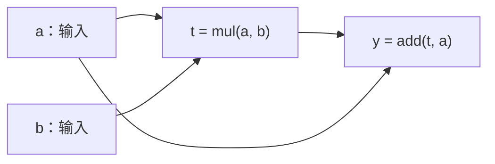

# ggml_visit_parents_graph 函数详解

本文结合当前仓库源码，说明 `ggml_visit_parents_graph()` 如何递归构建计算图。核对日期为 2026-10-06。

主要源码入口：

- [`src/ggml.c`](../src/ggml.c)：`ggml_visit_parents_graph()` 及前向图构建接口。
- [`src/ggml-impl.h`](../src/ggml-impl.h)：计算图、哈希集合、位图与引用计数辅助函数。
- [`include/ggml.h`](../include/ggml.h)：张量定义、张量标记和公共接口。
- [`examples/simple/simple-backend.cpp`](../examples/simple/simple-backend.cpp)：矩阵乘法的建图和执行示例。
- [ggml_tensor 与 ggml_cgraph 详解](ggml_tensor与ggml_cgraph详解.md)：相关数据结构的学习笔记。

## 1. 函数的作用

```c
static size_t ggml_visit_parents_graph(
        struct ggml_cgraph * cgraph,
        struct ggml_tensor * node,
        bool compute);
```

**从张量 `node` 出发，递归访问它的输入依赖，把这些张量加入计算图，并保证依赖节点排在使用它们的节点之前。**

这里的 `parents` 指 `node->src[]` 保存的输入来源。函数还负责：

- 通过哈希集合去重，同一个张量对象只登记一次。
- 根据 `compute` 设置需要计算的节点标记。
- 统计各张量被作为输入引用的次数。
- 将张量分类加入 `leafs[]` 或 `nodes[]`。
- 为没有名字的张量生成默认名字。

该函数组织的是图结构、节点顺序和相关元数据。实际数值运算由后端执行接口完成。

## 2. 参数、返回值和相关数据结构

### 2.1 参数与返回值

| 项目 | 含义 |
|---|---|
| `cgraph` | 要构建或扩展的计算图 |
| `node` | 当前访问的张量，最外层通常传入最终结果张量 |
| `compute` | 是否为具有运算操作的节点设置 `GGML_TENSOR_FLAG_COMPUTE` 标记 |
| 返回值 | 当前张量在 `visited_hash_set` 中的槽位下标 |

**返回值是哈希表下标，不是 `cgraph->nodes[]` 下标。**

例如，下面两个下标分别属于不同数组，不能混用：

```c
cgraph->nodes[node_index];           // 运算节点数组的下标
cgraph->use_counts[node_hash_pos];   // 张量在哈希表中的槽位下标
```

### 2.2 本函数使用的计算图成员

| 成员 | 作用 |
|---|---|
| `visited_hash_set` | 记录已经访问过的张量，包括运算节点和叶子张量 |
| `use_counts` | 记录输入引用次数，按哈希槽位索引 |
| `nodes`、`n_nodes` | 节点数组和当前节点数量 |
| `leafs`、`n_leafs` | 叶子张量数组和当前叶子数量 |
| `size` | `nodes[]`、`leafs[]` 等数组的容量上限 |
| `order` | 控制输入依赖的访问方向 |

`cgraph->size` 与 `visited_hash_set.size` 属于不同的数据结构：前者用于检查节点、叶子数组容量，后者用于哈希表定位和探测。

### 2.3 哈希集合与位图的配合

```c
struct ggml_hash_set {
    size_t size;
    ggml_bitset_t * used;
    struct ggml_tensor ** keys;
};
```

| 成员 | 含义 |
|---|---|
| `size` | 哈希表的槽位数量 |
| `used` | 槽位占用标记位图，第 `i` 位表示槽位 `i` 是否有效 |
| `keys` | 张量指针数组，`keys[i]` 保存槽位 `i` 的张量对象地址 |

只有 `ggml_bitset_get(used, i)` 为 `true` 时，`keys[i]` 才表示集合中的有效元素。

`ggml_hash_find()` 根据张量指针查找槽位：找到张量时返回已有槽位；张量不存在但还有空位时返回可插入的槽位。它本身不会修改集合。

## 3. 按执行顺序解析代码

### 3.1 设置当前节点的计算标记

```c
if (node->op != GGML_OP_NONE && compute) {
    node->flags |= GGML_TENSOR_FLAG_COMPUTE;
}
```

两个条件同时满足时才设置标记：

1. `node->op != GGML_OP_NONE`：当前张量具有运算操作。
2. `compute == true`：本次访问要求将该依赖链标记为需要计算。

例如：

```c
struct ggml_tensor * result = ggml_mul_mat(ctx, a, b);
```

`result` 是矩阵乘法的结果张量，具有运算操作；普通输入 `a`、`b` 的 `op` 通常是 `GGML_OP_NONE`，不会在这里设置计算标记。

`compute == false` 时仍然会访问依赖、登记张量和组织节点顺序，只是不主动设置计算标记。已有的 `COMPUTE` 标记也不会被清除。

### 3.2 查找槽位，处理已经访问过的张量

```c
const size_t node_hash_pos = ggml_hash_find(&cgraph->visited_hash_set, node);
GGML_ASSERT(node_hash_pos != GGML_HASHSET_FULL);
```

查找结果分为三种情况：

| 情况 | `ggml_hash_find()` 的结果 | 后续处理 |
|---|---|---|
| 张量已存在 | 张量所在的槽位 | 检查标记后进入已访问分支 |
| 张量不存在且有空位 | 可插入的空槽位 | 继续首次访问流程 |
| 张量不存在且表已满 | `GGML_HASHSET_FULL` | 触发断言 |

接下来读取槽位的占用标记：

```c
if (ggml_bitset_get(cgraph->visited_hash_set.used, node_hash_pos)) {
    // already visited
    ...
    return node_hash_pos;
}
```

`ggml_hash_find()` 已经处理了哈希冲突和指针匹配，因此返回槽位被占用时，说明当前张量已访问过，不需要再次加入 `nodes[]` 或 `leafs[]`。

不过，已访问节点仍可能需要补充计算标记：

```c
if (compute) {
    for (int i = 0; i < GGML_MAX_SRC; ++i) {
        struct ggml_tensor * src = node->src[i];
        if (src && ((src->flags & GGML_TENSOR_FLAG_COMPUTE) == 0)) {
            ggml_visit_parents_graph(cgraph, src, true);
        }
    }
}
```

例如，某条依赖链最初没有计算标记：

```text
第一次访问：compute = false → 张量已经加入图，但未主动设置计算标记
第二次访问：compute = true  → 为当前运算节点和所需依赖补充计算标记
```

当前节点的标记已在函数开头设置，这个循环继续向没有计算标记的输入依赖传播。

完成后直接返回，不会重复登记节点，也不会重新统计当前节点的输入引用。普通叶子张量的 `op` 为 `GGML_OP_NONE`，即使以 `compute = true` 访问，也不会因此获得计算标记。

### 3.3 首次访问时登记到哈希集合

```c
cgraph->visited_hash_set.keys[node_hash_pos] = node;
ggml_bitset_set(cgraph->visited_hash_set.used, node_hash_pos);
cgraph->use_counts[node_hash_pos] = 0;
```

三行代码分别完成：

```text
keys[槽位]       = 当前张量指针
used 的对应位   = 1，表示槽位已占用
use_counts[槽位] = 0，初始化输入引用次数
```

哈希集合按张量对象的地址去重。即使两个张量的数据相同，只要对象地址不同，就会分别登记。

这里的引用计数先初始化为 `0`，表示当前尚未记录其他节点对它的输入引用。调用者在递归返回后负责增加该计数。

需要区分两个登记时机：

- **递归之前**：登记到哈希集合，标记已经访问。
- **递归之后**：加入 `nodes[]` 或 `leafs[]`。

### 3.4 递归访问输入依赖，统计引用次数

```c
for (int i = 0; i < GGML_MAX_SRC; ++i) {
    const int k =
        (cgraph->order == GGML_CGRAPH_EVAL_ORDER_LEFT_TO_RIGHT) ? i :
        (cgraph->order == GGML_CGRAPH_EVAL_ORDER_RIGHT_TO_LEFT) ? (GGML_MAX_SRC-1-i) :
        /* unknown order, just fall back to using i */ i;

    struct ggml_tensor * src = node->src[k];
    if (src) {
        const size_t src_hash_pos = ggml_visit_parents_graph(cgraph, src, compute);
        cgraph->use_counts[src_hash_pos]++;
    }
}
```

`node->src[]` 保存当前操作的输入来源。例如：

```c
struct ggml_tensor * result = ggml_add(ctx, a, b);
```

对应：

```text
result->src[0] = a
result->src[1] = b
```

`cgraph->order` 决定先访问哪个输入：

| 顺序 | 访问方向 |
|---|---|
| `GGML_CGRAPH_EVAL_ORDER_LEFT_TO_RIGHT` | 从 `src[0]` 向后 |
| `GGML_CGRAPH_EVAL_ORDER_RIGHT_TO_LEFT` | 从最后一个 `src` 向前 |
| 其他值 | 默认从 `src[0]` 向后 |

为空的 `src` 会被跳过。无论采用哪个方向，都先访问依赖，再把当前节点加入图。

递归返回值 `src_hash_pos` 是输入张量的哈希槽位：

```c
cgraph->use_counts[src_hash_pos]++;
```

这表示当前节点将该张量作为输入使用了一次。即使输入张量已经访问过，这次输入引用仍然需要计数。

`use_counts` 统计的是输入引用次数。例如 `add(a, a)` 的两个输入都指向 `a`，计数会增加两次，而不是只增加一次。这些信息可用于判断算子能否融合等优化。

### 3.5 将当前张量加入叶子数组或节点数组

所有输入依赖处理完毕后，才分类登记当前张量：

```c
if (node->op == GGML_OP_NONE && !(node->flags & GGML_TENSOR_FLAG_PARAM)) {
    GGML_ASSERT(cgraph->n_leafs < cgraph->size);

    if (strlen(node->name) == 0) {
        ggml_format_name(node, "leaf_%d", cgraph->n_leafs);
    }

    cgraph->leafs[cgraph->n_leafs] = node;
    cgraph->n_leafs++;
} else {
    GGML_ASSERT(cgraph->n_nodes < cgraph->size);

    if (strlen(node->name) == 0) {
        ggml_format_name(node, "node_%d", cgraph->n_nodes);
    }

    cgraph->nodes[cgraph->n_nodes] = node;
    cgraph->n_nodes++;
}
```

| 条件 | 加入位置 |
|---|---|
| 没有运算操作，并且不是可训练参数 | `cgraph->leafs[]` |
| 有运算操作，或者是可训练参数 | `cgraph->nodes[]` |

两个容易混淆的细节：

- **叶子张量可以是外部输入。** 比如矩阵乘法示例中的 `a`、`b`，它们的数值可以由外部写入。
- **可训练参数即使 `op == GGML_OP_NONE`，也会进入 `nodes[]`。** 这样可以参与梯度相关处理。

加入之前会检查数组容量，该函数不会自动扩容。只有张量没有名字时，才自动生成 `leaf_0`、`node_0` 等名字，已有名字会保留。

图中保存的是已有张量的指针，这一步不会复制张量的数值数据。

最后返回当前张量的哈希槽位：

```c
return node_hash_pos;
```

## 4. 完整遍历示例：共享输入只登记一次

考虑以下计算：

```c
struct ggml_tensor * t = ggml_mul(ctx, a, b);
struct ggml_tensor * y = ggml_add(ctx, t, a);

ggml_build_forward_expand(cgraph, y);
```

即：

```text
t = a * b
y = t + a
```

假设 `a`、`b` 都是没有参数标记的普通输入，计算图为空，采用从左到右的访问顺序，并且初始没有计算标记。

依赖关系如下，箭头表示数据流向：



递归访问从 `y` 开始，沿 `src[]` 向输入来源追溯：

```text
访问 y：设置计算标记，登记哈希集合
  访问 t：设置计算标记，登记哈希集合
    访问 a：登记哈希集合，加入 leafs[]
    返回 t：a 的引用次数变为 1
    访问 b：登记哈希集合，加入 leafs[]
    返回 t：b 的引用次数变为 1
  t 的输入处理完毕：将 t 加入 nodes[]
  返回 y：t 的引用次数变为 1
  再访问 a：已经访问，返回原来的哈希槽位
  返回 y：a 的引用次数变为 2
y 的输入处理完毕：将 y 加入 nodes[]
```

最终得到：

```text
leafs[] = [a, b]
nodes[] = [t, y]
n_leafs = 2
n_nodes = 2
```

引用次数按各自的哈希槽位存储：

| 张量 | 引用次数 | 原因 |
|---|---:|---|
| `a` | 2 | 分别作为 `t` 和 `y` 的输入 |
| `b` | 1 | 作为 `t` 的输入 |
| `t` | 1 | 作为 `y` 的输入 |
| `y` | 0 | 当前图中没有其他节点将它作为输入 |

`a` 虽然被使用两次，但只会在 `leafs[]` 中登记一次。`t` 先于 `y` 加入 `nodes[]`，因此计算 `y` 之前可以先计算它依赖的 `t`。

这种深度优先、在递归返回后登记节点的方式称为**后序遍历**。对于计算图中的有向无环依赖，它形成拓扑顺序：依赖节点在前，使用依赖结果的节点在后。

## 5. 为什么已访问节点仍要传播计算标记

构建顺序和设置计算标记是两项工作。当前源码提供了不同的入口：

| 接口 | 传入内部构图函数的 `compute` | 行为 |
|---|---|---|
| `ggml_build_forward_expand()` | `true` | 加入张量及其依赖，并设置运算节点的计算标记 |
| `ggml_build_forward_order()` | `false` | 加入张量及其依赖，组织顺序，不主动设置计算标记 |
| `ggml_build_forward_select()` | 被选中的结果为 `true`，其他结果为 `false` | 组织所有候选结果的依赖，标记选中结果所需的计算路径 |

如果一条共享依赖链先以 `compute = false` 加入图，之后又成为需要计算的结果的依赖，它已经出现在哈希集合中，但仍需要设置计算标记。

因此，已访问分支需要继续向输入依赖传播 `compute = true`。这个分支只补充标记，不再次加入数组，也不重复统计已有节点的输入引用。

## 6. 对照 simple-backend.cpp 阅读

示例中的关键代码是：

```c
struct ggml_tensor * result = ggml_mul_mat(ctx, model.a, model.b);
ggml_build_forward_expand(gf, result);
```

调用链为：

```text
ggml_build_forward_expand(gf, result)
  → ggml_build_forward_impl(gf, result, true, true)
    → ggml_visit_parents_graph(gf, result, true)
```

从结果张量开始递归，访问两个矩阵输入。构建结束后：

```text
gf->leafs[] = [model.a, model.b]   // 从左到右访问时
gf->nodes[] = [result]
```

`result` 被标记为需要计算；`model.a`、`model.b` 作为普通输入进入叶子数组，两者的输入引用次数都是 `1`。

随后示例分配图所需的后端内存，写入输入数据，调用执行接口：

```cpp
ggml_backend_sched_alloc_graph(model.sched, gf);

ggml_backend_tensor_set(model.a, matrix_A, 0, ggml_nbytes(model.a));
ggml_backend_tensor_set(model.b, matrix_B, 0, ggml_nbytes(model.b));

ggml_backend_sched_graph_compute(model.sched, gf);
```

其中 `ggml_backend_sched_graph_compute()` 才真正执行图中的矩阵乘法。随后通过 `ggml_backend_tensor_get()` 读取结果。

## 7. 阅读时重点区分的概念

| 概念 | 应如何理解 |
|---|---|
| 已访问 | 张量已登记到当前图的哈希集合中 |
| 需要计算 | 具有运算操作的张量设置了 `COMPUTE` 标记 |
| 哈希槽位 | 用于访问 `keys[]`、`used` 和 `use_counts[]` |
| 节点数组下标 | 用于访问 `nodes[]`，对应构图产生的节点顺序 |
| 输入引用次数 | 每个非空 `src[]` 引用计一次，同一张量可以被多次引用 |
| 叶子张量 | 没有运算操作且没有参数标记，可以是外部输入 |
| 建图 | 组织已有张量的依赖、顺序、标记和引用次数 |
| 执行 | 后端根据图结构和计算标记执行数值运算 |
