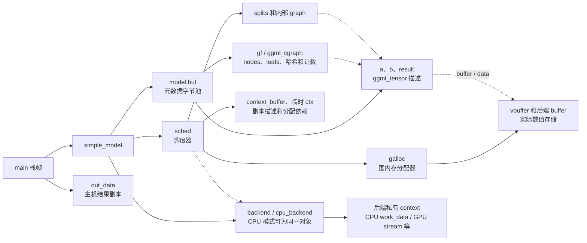
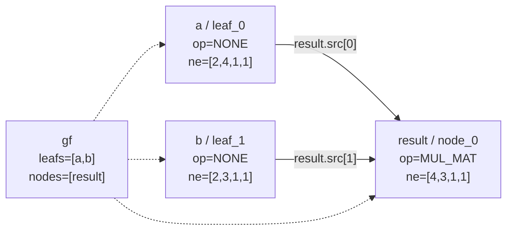
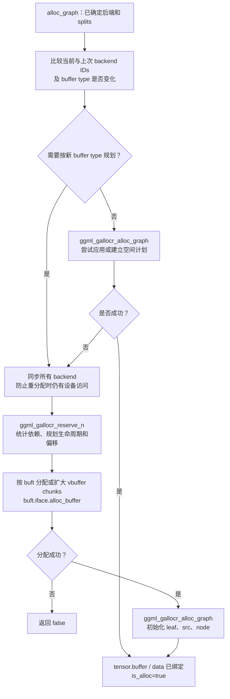
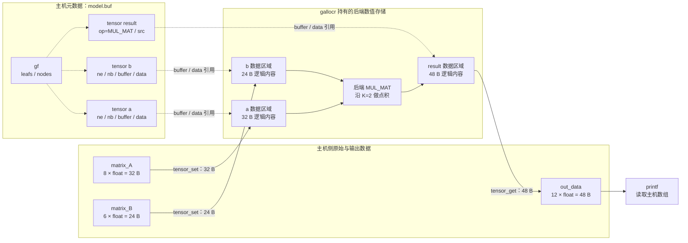
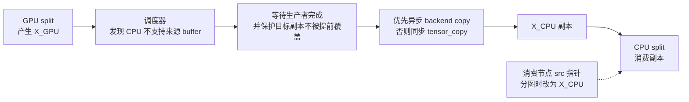
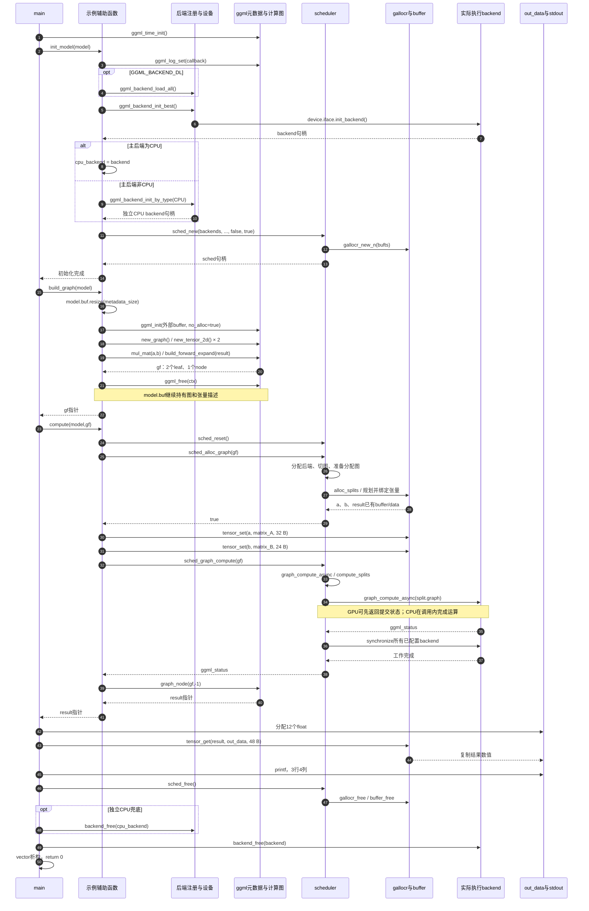
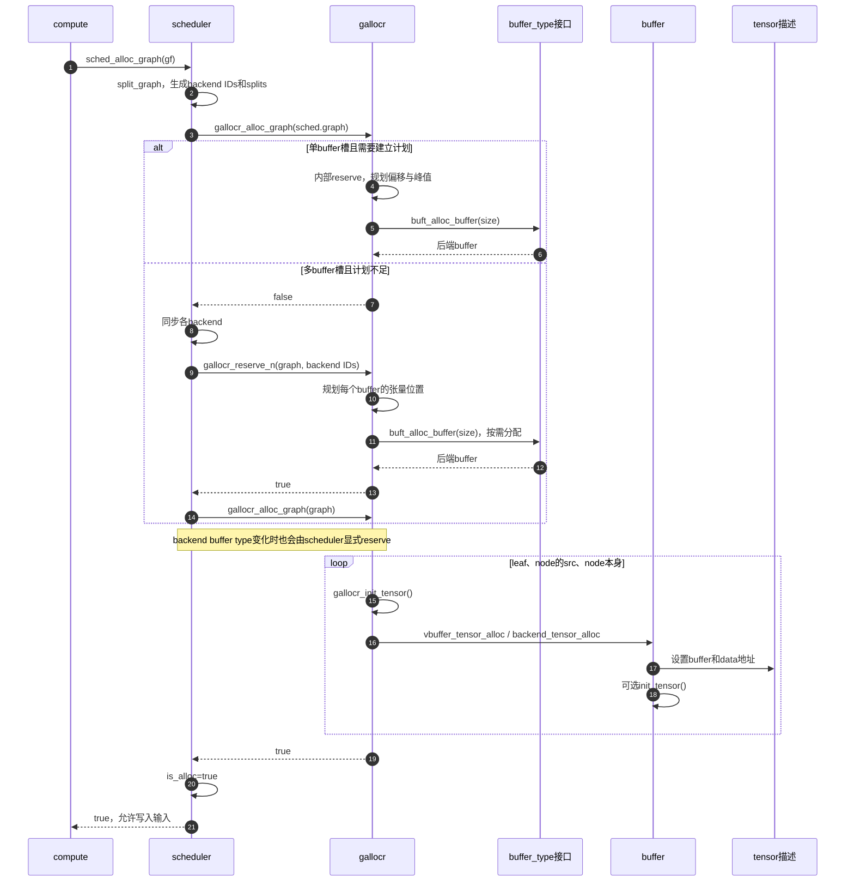
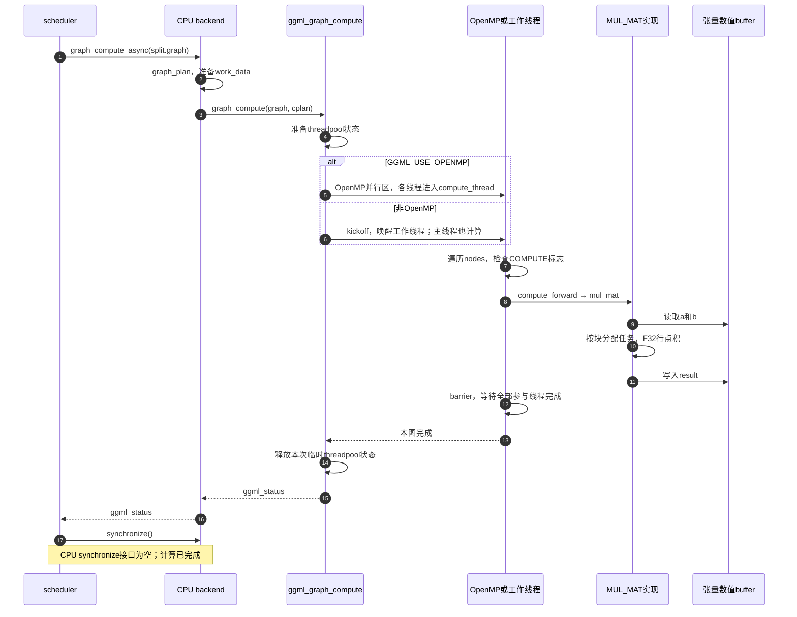
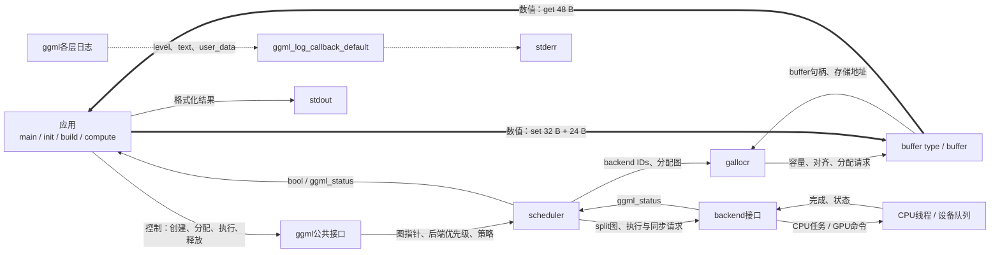

# simple-backend.cpp 全链路分析：运行链路、数据流、时序与消息流

整理日期：2026-10-20。分析入口：[main()](../examples/simple/simple-backend.cpp#L136)。源码基线：当前工作区，Git HEAD `93bb5203`；函数行为以实际实现为依据。

本例完成一次 F32 矩阵乘法：**初始化后端与调度器 → 构建计算图 → 为图分配后端内存 → 写入两个输入 → 调度执行 → 同步 → 读回并打印结果 → 释放资源**。

本文覆盖入口能触达的公共接口、注册与设备选择、计算图构建、调度器分图、图内存规划、后端分派、数值计算、数据传输和生命周期。CPU 路径已经在本机编译运行；CUDA、Metal 及通用多后端路径由当前源码追踪得到，具体设备内核的选择仍取决于构建选项和硬件。

文中的“模型”指 `simple_model` 保存的运行资源与张量；输入来自源码中的数组，本例没有模型文件加载、分词、推理服务或网络请求。文中的“消息”指进程内调用参数、返回值、回调和设备提交/完成信号。

所有图使用 Mermaid，可在支持 Mermaid 的 Markdown 预览器中查看。源码链接采用相对于本文的路径和 `#L行号`；行号对应本次整理时的工作区版本。

## 目录

1. [本例算什么：输入、形状与输出](#s01)
2. [全链路总览图](#s02)
3. [从 main 展开的主要调用树](#s03)
4. [核心对象与职责边界](#s04)
5. [初始化：注册、设备选择和调度器创建](#s05)
6. [建图：元数据分配、依赖关系与图展开](#s06)
7. [分配：后端归属、分图、内存规划与绑定](#s07)
8. [执行：调度器到 CPU/CUDA/Metal](#s08)
9. [数据流：数组、张量存储与结果回读](#s09)
10. [时序图：整体、分配与 CPU 执行](#s10)
11. [消息流：调用、返回、回调与同步](#s11)
12. [生命周期、重复计算和错误路径](#s12)
13. [本机验证与调试定位](#s13)
14. [源码导航与关联文档](#s14)

<a id="s01"></a>
## 1. 本例算什么：输入、形状与输出

### 1.1 输入数组与数学表示

源码位置：[矩阵定义](../examples/simple/simple-backend.cpp#L32)、[乘法节点创建](../examples/simple/simple-backend.cpp#L99)。

```text
matrix_A：4 行 × 2 列               matrix_B：3 行 × 2 列
A = [ 2  8 ]                       Bs = [ 10  5 ]
    [ 5  1 ]                            [  9  9 ]
    [ 4  2 ]                            [  5  4 ]
    [ 8  6 ]
```

这里用 `Bs` 表示源码中实际存放的 `matrix_B`。若按通常的行列矩阵乘法写法，另定义 `B0 = Bsᵀ`，则 `A × B0` 为 4 行 3 列；本程序打印的是其转置：

```text
R = Bs × Aᵀ = (A × B0)ᵀ
  = [ 60  55  50  110 ]
    [ 90  54  54  126 ]
    [ 42  29  28   64 ]
```

`ggml_mul_mat(ctx, a, b)` 的两个输入沿 `ne[0]` 做点积。本例可以直接理解为：`a` 的每一行与 `b` 的每一行做长度为 2 的点积。

```text
R[j][i] = Σ(k=0..1) A[i][k] × Bs[j][k]

R[0][0] = 2×10 + 8×5 = 60
R[0][1] = 5×10 + 1×5 = 55
R[2][3] = 8×5  + 6×4 = 64
```

### 1.2 ne、nb 和数据量

`ne[]` 的顺序从最内层维度开始。对本例连续二维 F32 张量，`ne[0]` 是一行的列数，`ne[1]` 是行数；其余维度均为 1。`nb[]` 表示跨过一个对应维度元素的字节步长。

| 张量 | 通常的行 × 列 | `ne[0..3]` | `nb[0..3]`，单位 byte | 元素数 | `ggml_nbytes()` |
|---|---|---|---|---:|---:|
| `model.a` | 4 × 2 | `[2,4,1,1]` | `[4,8,32,32]` | 8 | 32 B |
| `model.b` | 3 × 2 | `[2,3,1,1]` | `[4,8,24,24]` | 6 | 24 B |
| `result` | 3 × 4 | `[4,3,1,1]` | `[4,16,48,48]` | 12 | 48 B |

因此 `printf("mul mat (%d x %d)...", ne[0], ne[1])` 显示 `4 x 3`，对应列数 4、行数 3。循环以 `j * ne[0] + i` 访问 `out_data`。

**本例没有调用 `ggml_transpose()`，也没有额外的转置节点。** 输出与常规矩阵乘法结果之间的转置关系来自输入布局及 `ggml_mul_mat()` 的维度语义。

形状构造依据：[ggml_mul_mat()](../src/ggml.c#L3362)。步长初始化依据：[ggml_new_tensor_impl()](../src/ggml.c#L1847)。示例的数学说明见 [examples/simple/README.md](../examples/simple/README.md)。

<a id="s02"></a>
## 2. 全链路总览图

下图实线描述当前示例的控制顺序；虚线表示数据写入与读取。主后端可能为 GPU、集成 GPU 或 CPU，调度器最终按算子支持情况确定实际执行后端。

```mermaid
flowchart TB
    START([main]) --> TIME["ggml_time_init<br/>初始化计时设施"]
    TIME --> INIT["init_model<br/>设置日志回调"]
    INIT --> DL{"编译启用 GGML_BACKEND_DL？"}
    DL -->|是| LOAD["ggml_backend_load_all<br/>加载并注册后端插件"]
    DL -->|否| REG["使用已链接后端<br/>注册表按需初始化"]
    LOAD --> BEST["ggml_backend_init_best<br/>GPU → IGPU → CPU"]
    REG --> BEST
    BEST --> ISCPU{"主后端是 CPU？"}
    ISCPU -->|是| SAME["cpu_backend = backend<br/>只传入 1 个后端"]
    ISCPU -->|否| FALLBACK["创建独立 CPU 后端<br/>传入 主后端、CPU 共 2 个"]
    SAME --> SCHED["ggml_backend_sched_new<br/>创建调度状态和 gallocr"]
    FALLBACK --> SCHED
    SCHED --> META["build_graph<br/>model.buf 保存图和张量描述"]
    META --> CTX["ggml_init<br/>外部 mem_buffer，no_alloc=true"]
    CTX --> DAG["创建 a、b、result<br/>result.op = MUL_MAT"]
    DAG --> EXPAND["ggml_build_forward_expand<br/>2 个 leaf + 1 个 node"]
    EXPAND --> FREECTX["ggml_free(ctx)<br/>外部 model.buf 继续存活"]
    FREECTX --> RESET["compute<br/>ggml_backend_sched_reset"]
    RESET --> SPLIT["ggml_backend_sched_alloc_graph<br/>分配后端、切分图、建立副本依赖"]
    SPLIT --> ALLOC["gallocr 规划并分配 buffer<br/>绑定 tensor.buffer 和 tensor.data"]
    ALLOC --> SET["tensor_set(a, 32 B)<br/>tensor_set(b, 24 B)"]
    A[(matrix_A)] -.-> SET
    B[(matrix_B)] -.-> SET
    SET --> SUBMIT["sched_graph_compute<br/>内部调用 compute_async"]
    SUBMIT --> RUN["compute_splits<br/>按需复制输入，提交 split"]
    RUN --> IFACE["backend.iface.graph_compute"]
    IFACE -->|CPU后端| CPU["CPU<br/>plan → workers → MUL_MAT → 点积"]
    IFACE -->|非CPU后端| GPU["CUDA / Metal / 其他后端<br/>提交设备运算"]
    CPU --> SYNC["sched_synchronize<br/>遍历所有后端等待完成"]
    GPU --> SYNC
    SYNC --> RESULT["ggml_graph_node(gf, -1)<br/>返回结果张量指针"]
    RESULT --> GET["tensor_get(result, 48 B)<br/>写入 out_data"]
    GET -.-> OUT[(out_data: 12 个 float)]
    GET --> PRINT["printf<br/>按 3 行 4 列输出"]
    PRINT --> FREES["sched_free<br/>释放图计算 buffer 和调度资源"]
    FREES --> FREEB["释放各独立 backend<br/>避免 CPU 别名重复释放"]
    FREEB --> END(["返回 0<br/>局部 vector 自动析构"])
```



主路径中 `build_graph()` 只描述计算，`alloc_graph()` 准备可存放数值的空间，`tensor_set()` 填入数值，`graph_compute()` 才触发运算。

<a id="s03"></a>
## 3. 从 main 展开的主要调用树

标记约定：`[条件]` 为满足对应条件时才经过的路径；`→ iface` 为通过函数指针选择具体实现。下列树省略基础容器、内存分配和断言函数，保留影响计算、数据与资源的调用。

```text
main()                                                simple-backend.cpp:136
├─ ggml_time_init()
├─ simple_model model                                 成员指针初值为空
├─ init_model(model)                                  simple-backend.cpp:55
│  ├─ ggml_log_set(ggml_log_callback_default, nullptr)
│  ├─ [GGML_BACKEND_DL] ggml_backend_load_all()
│  │  └─ load_all_from_path → load_best → 加载/注册插件
│  ├─ ggml_backend_init_best()
│  │  ├─ ggml_backend_dev_by_type(GPU / IGPU / CPU)
│  │  │  └─ get_reg() → registry → 注册后端与设备
│  │  └─ ggml_backend_dev_init(dev, nullptr)
│  │     └─ → device.iface.init_backend
│  ├─ [主后端为 CPU] cpu_backend = backend
│  ├─ [主后端非 CPU] ggml_backend_init_by_type(CPU, nullptr)
│  └─ ggml_backend_sched_new(..., false, true)
│     ├─ 保存 backends 和默认 bufts
│     ├─ 创建哈希表、后端编号表、副本表、split 容器和临时空间
│     ├─ ggml_gallocr_new_n(bufts, n_backends)
│     └─ ggml_backend_sched_reset()
├─ build_graph(model)                                 simple-backend.cpp:82
│  ├─ model.buf.resize(元数据容量)
│  ├─ ggml_init({..., model.buf.data(), true})
│  ├─ ggml_new_graph() → ggml_new_graph_custom(..., 2048, false)
│  ├─ ggml_new_tensor_2d() × 2
│  │  └─ ggml_new_tensor() → ggml_new_tensor_impl()
│  ├─ ggml_mul_mat(ctx, a, b)
│  │  └─ 创建 result，设置 op、src 和 shape
│  ├─ ggml_build_forward_expand(gf, result)
│  │  └─ ggml_build_forward_impl()
│  │     └─ ggml_visit_parents_graph() → 递归 a、b、result
│  └─ ggml_free(ctx)                                  释放 context 控制对象
├─ compute(model, gf)                                 simple-backend.cpp:114
│  ├─ ggml_backend_sched_reset(sched)
│  ├─ ggml_backend_sched_alloc_graph(sched, gf)
│  │  ├─ ggml_backend_sched_split_graph()
│  │  │  ├─ 5 轮后端分配/分图处理
│  │  │  ├─ [按需] 创建跨后端副本、重写 src
│  │  │  ├─ ggml_backend_graph_optimize()              可选后端优化
│  │  │  └─ 构造 sched->graph，供分配器使用
│  │  └─ ggml_backend_sched_alloc_splits()
│  │     ├─ ggml_gallocr_alloc_graph()
│  │     └─ [需重新规划] synchronize → reserve_n → alloc_graph
│  ├─ ggml_backend_tensor_set(a, matrix_A, 0, 32)
│  │  └─ → a.buffer.iface.set_tensor
│  ├─ ggml_backend_tensor_set(b, matrix_B, 0, 24)
│  │  └─ → b.buffer.iface.set_tensor
│  ├─ ggml_backend_sched_graph_compute(sched, gf)
│  │  ├─ ggml_backend_sched_graph_compute_async()
│  │  │  └─ ggml_backend_sched_compute_splits()
│  │  │     ├─ [跨后端且 buffer 不兼容] 同步/复制 split 输入
│  │  │     └─ ggml_backend_graph_compute_async(backend, split_graph)
│  │  │        └─ → backend.iface.graph_compute
│  │  └─ ggml_backend_sched_synchronize()
│  │     └─ 对每个 backend 调用 ggml_backend_synchronize()
│  └─ ggml_graph_node(gf, -1)                          借用已有 result 指针
├─ out_data.resize(ggml_nelements(result))             12 个 float
├─ ggml_backend_tensor_get(result, out_data.data(), 0, 48)
│  └─ → result.buffer.iface.get_tensor
├─ printf()                                           stdout
├─ ggml_backend_sched_free(sched)
│  ├─ event_free、ggml_gallocr_free()、临时 context 释放
│  └─ 释放哈希表、编号表、副本表、split、临时空间等
├─ [cpu_backend != backend] ggml_backend_free(cpu_backend)
├─ ggml_backend_free(backend) → backend.iface.free
└─ return 0 → out_data 和 model.buf 自动析构
```

这里存在三个不同的“graph”：应用构建的 `gf`、调度器内部供内存分配使用的 `sched->graph`、以及交给后端执行的 `split->graph`。它们不是三份彼此独立的数值数据。

<a id="s04"></a>
## 4. 核心对象与职责边界

### 4.1 对象职责表

| 对象 | 保存内容 | 谁创建/持有 | 对本例的意义 |
|---|---|---|---|
| `simple_model` | 两个输入指针、后端句柄、调度器句柄、元数据 vector | `main()` 局部变量 | 聚合本次计算所需资源 |
| `model.buf` | `ggml_object`、图结构及其指针数组、3 个张量描述等 | `std::vector<uint8_t>` | 原始图及其张量描述的底层存储 |
| `ggml_context *ctx` | 元数据池位置、大小、对象链、所有权标记 | `ggml_init()` | 在 `model.buf` 中顺序创建图与张量 |
| `ggml_tensor a/b/result` | 类型、shape、stride、op、src、buffer、data | 元数据位于 `model.buf` | 既描述数据，也描述运算依赖 |
| `ggml_cgraph *gf` | `nodes`、`leafs`、访问哈希表、使用计数、遍历顺序 | `ggml_new_graph()` | 依赖顺序已展开的原始图 |
| `ggml_backend_t` | 设备、函数接口、后端私有 context | 对应 device 的 `init_backend` | 执行图、同步、管理后端运行状态 |
| `ggml_backend_dev_t` | 设备属性、算子与 buffer 支持查询、初始化接口 | 后端注册系统 | 表示可使用的设备能力 |
| `ggml_backend_buffer_type_t` | 分配、对齐、所需空间、host 属性等接口 | 后端提供 | 描述“按什么规则分配哪类存储” |
| `ggml_backend_buffer_t` | 已分配存储的接口、buffer type、大小、私有 context | gallocr 经 buffer type 分配 | 保存张量的实际数值 |
| `ggml_backend_sched_t` | 后端优先级、归属表、副本表、splits、内部图、gallocr | `init_model()` | 决定在哪里算、何时复制及如何提交 |
| `ggml_gallocr_t` | 各 buffer 的空间规划、张量偏移、复用信息、实际 buffer | scheduler 创建并持有 | 决定张量数值存放位置 |
| CPU `ggml_cplan` | 线程数、工作空间需求、线程池引用和中止配置 | CPU 图执行入口 | CPU 实际运算计划，与 `ggml_cgraph` 不同 |
| CPU `work_data` | 算子临时工作空间 | CPU backend context | 与图中 a/b/result 的存储分别管理 |
| `out_data` | 已读回的 12 个 F32 结果 | `main()` 的 vector | 提供给打印循环使用的主机副本 |

`tensor->buffer` 表示存储归属；`tensor->data` 表示该后端地址空间中的数据位置。即使 `data` 的类型为 `void *`，也不能据此认为 CPU 可以直接解引用 GPU 存储。

### 4.2 所有权与引用图

图中“持有”表示生命周期责任；虚线表示引用。`gf->nodes[0]` 与 `compute()` 返回的 `result` 指向同一个张量描述。



`sched_free()` 释放调度器持有的 buffer 和辅助资源，**不会代替应用调用 `ggml_backend_free()`**。`model.buf` 的析构也不会代替调度器释放数值存储。

<a id="s05"></a>
## 5. 初始化：注册、设备选择和调度器创建

对应入口：[init_model()](../examples/simple/simple-backend.cpp#L55)。

### 5.1 日志安装与后端注册

1. `ggml_log_set(ggml_log_callback_default, nullptr)` 安装日志回调。
2. 日志回调忽略 `level` 和 `user_data`，将文字写入 `stderr` 并刷新。
3. 编译定义 `GGML_BACKEND_DL` 存在时，调用 `ggml_backend_load_all()` 显式加载插件。
4. 已链接后端由 `ggml_backend_registry` 构造过程按编译宏注册；注册一个 backend 时会把其提供的设备加入设备表。注册表经 `get_reg()` 按需获取。

“注册 backend”“枚举 device”“初始化执行 backend”是不同阶段。设备出现在注册表中，不表示应用已经创建了该设备的执行 context。

依据：[注册表与设备登记](../src/ggml-backend-reg.cpp#L115)、[动态加载入口](../src/ggml-backend-reg.cpp#L574)。

### 5.2 主后端选择

当前实现中的 `ggml_backend_init_best()` 按以下顺序查找设备：

```text
第一个 GPU 类型设备
  ↓ 若不存在
第一个 IGPU 类型设备
  ↓ 若不存在
第一个 CPU 类型设备
  ↓
ggml_backend_dev_init(dev, nullptr)
  ↓
device->iface.init_backend(device, params)
```

注意以下边界：

- `best` 按设备类型和注册顺序选择，没有对设备运行性能进行测速排序。
- 它不等价于“固定选择 CUDA”；Metal、Vulkan 等后端提供的设备也可能被选中。
- 当前函数不会遍历使用全部 GPU，也不会自动把其他所有已注册后端加入调度器。
- “按类型找不到设备时继续找下一类型”和“设备初始化失败后重试”是两回事：当前函数在选中 device 后直接返回初始化结果，没有在初始化失败后重试 CPU。
- 实现包含 IGPU 路径；头文件的简略注释未完整写出此分支，应以实现为准。

依据：[init_best 与 init_by_type](../src/ggml-backend-reg.cpp#L374)、[device 初始化分派](../src/ggml-backend.cpp#L610)。

### 5.3 CPU 兜底及别名关系

| 主后端类型 | `cpu_backend` | 调度器后端列表 | 释放策略 |
|---|---|---|---|
| CPU | 直接引用 `model.backend` | `{CPU}`，`n_backends=1` | 只释放一次 backend |
| 非 CPU | 通过 `init_by_type(CPU, nullptr)` 单独创建 | `{主后端, CPU}`，`n_backends=2` | 先释放独立 CPU，再释放主后端 |

调度器构造要求最后一个 backend 是 CPU。CPU 兜底表示不受主后端支持的算子有机会被分配到 CPU；它不是遇到任意 GPU 执行错误后自动重新计算的异常恢复机制。

### 5.4 sched_new 的六个参数

```cpp
ggml_backend_sched_new(
    backends,                 // 本例为 {CPU} 或 {主后端, CPU}
    nullptr,                  // 各 backend 使用默认 buffer type
    n_backends,               // 1 或 2
    GGML_DEFAULT_GRAPH_SIZE,  // 当前宏值为 2048
    false,                    // parallel
    true);                    // op_offload
```

| 参数 | 本例效果 | 容易混淆的点 |
|---|---|---|
| `backends` | 小下标优先，CPU 放最后 | 栈上数组传入后，调度器保存其中句柄，不依赖数组本身继续存活 |
| `bufts=nullptr` | 用 `ggml_backend_get_default_buffer_type()` 获取每个默认类型 | 此时确定存储策略，不表示所有张量数据已经分配 |
| `n_backends` | 由句柄是否相同决定为 1 或 2 | 不能把相同 CPU 句柄重复当作两个后端 |
| `graph_size=2048` | 为图调度准备哈希、映射及辅助空间 | 是容量参数，原图实际计算节点只有 1 个 |
| `parallel=false` | `n_copies=1`，本例不创建多副本轮换事件 | 不会关闭 CPU 的多线程计算，也不禁止 GPU 内部异步提交 |
| `op_offload=true` | 允许满足策略的算子卸载到更高优先级后端 | 不会强迫所有算子上 GPU，也不保证小矩阵使用 GPU 更快 |

### 5.5 构造期间真正准备的内容

`ggml_backend_sched_new()` 依次完成：

1. 校验后端数量及最后一个后端为 CPU。
2. 创建 scheduler，读取 `GGML_SCHED_DEBUG`、`GGML_SCHED_DEBUG_REALLOC` 等调试配置。
3. 建立 tensor 指针哈希表，以及 `hv_tensor_backend_ids`、`hv_tensor_copies` 映射。
4. 准备当前/上次 node、leaf 的 backend ID 数组。
5. 分配调度器私有 `context_buffer`，准备 split 容器和图输入列表。
6. 保存 backends、选择默认 bufts 并检查兼容性。
7. 仅当 `n_copies>1` 时创建各副本槽对应事件；本例不经过此分支。
8. 创建 gallocr，记录 buffer type、对齐等规划规则；实际图数值 buffer 延后分配。
9. 保存 `op_offload`，调用 reset，返回调度器。

reset 后 `is_reset=true`、`is_alloc=false`。源码依据：[sched_new](../src/ggml-backend.cpp#L1863)、[gallocr_new_n](../src/ggml-alloc.c#L498)。

<a id="s06"></a>
## 6. 建图：元数据分配、依赖关系与图展开

对应入口：[build_graph()](../examples/simple/simple-backend.cpp#L82)。

### 6.1 元数据池和 no_alloc

```cpp
buf_size = ggml_tensor_overhead() * GGML_DEFAULT_GRAPH_SIZE
         + ggml_graph_overhead();
model.buf.resize(buf_size);
ggml_init({buf_size, model.buf.data(), true});
```

这里为张量描述和图相关结构预留容量。`ggml_tensor_overhead()` 包括张量对象及其管理开销，`ggml_graph_overhead()` 包括图结构及默认容量下的内部数组等开销。

`no_alloc=true` 的含义是：创建张量时不在该 context 池中为张量数值分配空间。图、张量描述和图内部数组仍然需要元数据空间。

对于本例三个非 view 张量，建图完成但尚未分配后端存储时：

```text
a.buffer      = nullptr     a.data      = nullptr
b.buffer      = nullptr     b.data      = nullptr
result.buffer = nullptr     result.data = nullptr
```

它们此时已有合法 shape、stride、类型及依赖关系，但还不能调用 `tensor_set()` 写入数值。

依据：[ggml_init](../src/ggml.c#L1613)、[张量创建与 no_alloc](../src/ggml.c#L1784)。

### 6.2 图和三个张量的创建

`ggml_new_graph(ctx)` 创建默认容量为 2048、`grads=false` 的图。这里不建立反向传播图或梯度数组。

`ggml_new_tensor_2d()` 通过 `ggml_new_tensor()` 到达 `ggml_new_tensor_impl()`，在外部元数据池中创建张量描述，初始化 `op=NONE`、`flags=0`、`src[]=nullptr`，再设置 `ne[]` 和 `nb[]`。

`ggml_mul_mat(ctx, a, b)` 检查维度兼容性及输入布局，创建 F32 结果张量并记录：

```text
result.ne     = [a.ne[1], b.ne[1], b.ne[2], b.ne[3]] = [4,3,1,1]
result.op     = GGML_OP_MUL_MAT
result.src[0] = model.a
result.src[1] = model.b
```

**结果张量同时就是乘法计算节点。** 本例没有再额外创建一个独立的 MatMul 对象。



### 6.3 build_forward_expand 如何整理依赖

```text
ggml_build_forward_expand(gf, result)
  → ggml_build_forward_impl(gf, result, expand=true, compute=true)
    → ggml_visit_parents_graph(gf, result, true)
      → 访问 a → 加入 leafs[0]
      → 访问 b → 加入 leafs[1]
      → 将 result 加入 nodes[0]
```

递归过程用张量指针去重，先访问输入依赖，再登记依赖它们的运算节点；同时对需要计算的运算节点设置 `GGML_TENSOR_FLAG_COMPUTE`，按哈希槽位记录输入使用次数。

| 字段 | 本例建图结束时的状态 |
|---|---|
| `gf->n_leafs` | 2 |
| `gf->leafs[0/1]` | `a / b` |
| `gf->n_nodes` | 1 |
| `gf->nodes[0]` | `result` |
| 自动名称 | `a=leaf_0`、`b=leaf_1`、`result=node_0` |
| `a/b` flags | 未设置 `INPUT`、`OUTPUT`、`PARAM` 标志 |
| `result` flags | 设置 `COMPUTE` 标志，未显式设置 `OUTPUT` |
| 原图 `use_counts[a/b/result]` | 按各自哈希槽位分别为 `1 / 1 / 0` |

这里的 `a`、`b` 是业务意义上的输入，但程序没有调用 `ggml_set_input()`。调度器的 `INPUT` 标记分支不能仅因它们来自外部数组而视为已经触发。

依据：[visit_parents_graph](../src/ggml.c#L7270)、[build_forward_impl](../src/ggml.c#L7358)、[new_graph_custom](../src/ggml.c#L7552)。

### 6.4 为什么 free(ctx) 后还能使用 gf

传入 `mem_buffer=model.buf.data()` 后，`ggml_init()` 令 `ctx->mem_buffer_owned=false`。`ggml_free(ctx)` 只释放 context 控制对象，不会释放外部池。

```text
释放前：ctx → model.buf.data() → gf、a、b、result
释放后：     model.buf.data() → gf、a、b、result 仍存活
```

这些指针可用的前提是 `model.buf` 持续存活，其内存未重新分配、未被覆盖。本例 `build_graph()` 返回后没有再 resize 该 vector，因此前提成立。

这不是所有 `ggml_free()` 用法的共同保证。如果 `ggml_init()` 自己分配并持有内存池，free 时会一并释放池内的图与张量描述。依据：[mem_buffer_owned 的设置](../src/ggml.c#L1634)、[ggml_free](../src/ggml.c#L1662)。

<a id="s07"></a>
## 7. 分配：后端归属、分图、内存规划与绑定

入口顺序：[compute() 的 reset 和 alloc](../examples/simple/simple-backend.cpp#L114)。

### 7.1 reset 的实际作用

`ggml_backend_sched_reset()` 清理调度归属/副本映射等状态，令 `is_alloc=false`；若当前已处于 reset 状态，则跳过重复清空部分。本例构造时已经 reset，首次 `compute()` 再 reset 是安全的。

reset 不是把输入数值填零的接口，也不是释放所有底层缓存以归还内存的接口。旧图在 reset 后的使用限制见第 12 节。

### 7.2 alloc_graph 的外层过程

`ggml_backend_sched_alloc_graph()` 校验容量和当前未分配状态，确定本次副本槽，随后执行：

```text
split_graph(sched, gf)
  → alloc_splits(sched)
    → 成功：is_alloc=true，返回 true
    → 失败：返回 false
```

由于本例 `n_copies=1`，`cur_copy` 和下一次副本槽都为 0。

### 7.3 split_graph 的五轮处理

源码：[ggml_backend_sched_split_graph](../src/ggml-backend.cpp#L1066)。分图前重建调度器私有临时 context，并更新图 UID。

| 轮次 | 源码起点 | 处理内容 | 本例的结果 |
|---|---|---|---|
| Pass 1 | 1087 | 根据已分配 tensor/view 的存储、显式输入标记、权重位置等决定初始归属，保留用户分配 | 新图没有预分配数据、没有 INPUT 标记、没有权重 buffer，a/b/result 仍未归属 |
| Pass 2 | 1124 | 上下扩展已有后端归属；先扩展非 CPU 归属，再扩展其余归属，检查算子支持 | 本例没有已有归属可扩展 |
| Pass 3 | 1204 | 未归属节点选择支持输入最多的候选后端；已归属节点尝试升级到更高优先级且兼容的后端 | result 的输入均未分配，候选支持数相同，支持该算子的最前后端优先 |
| Pass 4 | 1265 | 根据消费节点和 view 来源补齐输入的后端归属，处理仍未分配的节点 | a、b 跟随 result，三者放在同一后端 |
| Pass 5 | 1297 | 按节点后端和传输需要切分图；发现不兼容来源时创建副本并改写 `src` | 本例得到 1 个 split；无跨后端输入副本 |

因此，在主后端支持本例 F32 MUL_MAT 且初始化成功的条件下：

```text
GPU/IGPU + CPU：a、b、result → 主后端 → 1 个 split
CPU：          a、b、result → CPU    → 1 个 split
```

如果主后端不支持该乘法，CPU 可在归属选择时被采用。本例只有 1 个运算节点，即使准备了两个 backend，也不意味着 GPU 和 CPU 各算一部分。

跨后端复制的条件是**来源 backend 不同，且消费 backend 不支持来源 buffer type**。后端不同但能兼容使用相同存储时，可以不创建副本。

### 7.4 原图、split 图和分配图的关系

Pass 5 之后还会：

1. 为各 split 创建 `ggml_graph_view()`，覆盖其节点区间。
2. 调用可选 `ggml_backend_graph_optimize()`，后端可调整执行顺序并报告额外存活依赖。
3. 构造 `sched->graph`，加入原始节点/叶子，以及有需要时创建的输入副本、view 依赖、额外存活依赖节点。
4. 为分配图准备 `node_backend_ids`、`leaf_backend_ids`，为各 split 设置 UID。

`split->n_inputs` 记录的是需要调度器搬运的跨后端输入，不等于算子的 `src[]` 数量。本例日志显示 `0 inputs`，但 MUL_MAT 仍然有 a、b 两个操作数。

三个图的用途：

| 图 | 主要用途 | 本例基本内容 |
|---|---|---|
| `gf` | 应用表达计算和取得最终结果 | 2 leaf + 1 MUL_MAT node |
| `sched->graph` | gallocr 内存规划，包括必要辅助依赖 | 当前简单 CPU 路径仍是同一组张量 |
| `split->graph` | 后端图执行接口接收的节点视图 | 1 个 MUL_MAT node，源为 a/b |

这些结构共享原始 tensor 指针；调度器所谓“图副本”主要是图的组织与辅助描述，不是把输入数值整体复制一遍。

### 7.5 alloc_splits 与 gallocr：从空间计划到实际 buffer



gallocr 的工作可分为两个层次：

- **规划**：结合图顺序、张量所需空间、对齐、后续使用与 view 引用，计算各张量所属 buffer、chunk 和 offset。释放某个张量的规划占用意味着后续可以复用该区间，不等于立即释放一块设备内存。
- **落实**：按规划的峰值需求准备 `vbuffer` 的 backend buffer chunks，再把张量描述中的 `buffer/data` 绑定到对应区域。绑定链是 `ggml_gallocr_init_tensor → ggml_vbuffer_tensor_alloc → ggml_backend_tensor_alloc`。

`ggml_backend_tensor_alloc()` 设置 `tensor->buffer`、`tensor->data`，并调用可选 buffer `init_tensor`。至此 a/b/result 才有可访问的后端数值空间，数值内容尚未由输入数组填充。

实际源码对首次分配还有一处差异：

- 只有一个 buffer type 槽时，`ggml_gallocr_alloc_graph()` 可以自行调用 reserve 建立计划；本机 CPU 日志经过此路径。
- 多 buffer 槽首次计划不足时，它返回 false，让 scheduler 使用带 backend IDs 的 `reserve_n()` 再尝试；buffer type 改变也会进入 scheduler 的重新规划流程。

逻辑数据总量为 `32+24+48=104 B`，实际 buffer 大小还受到对齐、后端 padding 和分配策略影响，不能直接用 104 B 表示真实设备分配量。`sched_new()` 准备的调度元数据和 CPU 工作空间也不包含在这 104 B 中。

依据：[alloc_splits](../src/ggml-backend.cpp#L1591)、[gallocr 规划与 reserve](../src/ggml-alloc.c#L825)、[alloc_graph](../src/ggml-alloc.c#L1052)、[绑定 tensor](../src/ggml-backend.cpp#L2210)。

<a id="s08"></a>
## 8. 执行：调度器到 CPU/CUDA/Metal

### 8.1 同步入口内部使用异步接口

```text
ggml_backend_sched_graph_compute(sched, gf)
  ├─ err = ggml_backend_sched_graph_compute_async(sched, gf)
  │   ├─ [尚未分配] 必要时 reset / alloc_graph
  │   └─ ggml_backend_sched_compute_splits(sched)
  ├─ ggml_backend_sched_synchronize(sched)
  └─ return err
```

本例已显式 alloc，因此 compute_async 跳过自动分配，直接执行 splits。外层接口会遍历调度器中的所有 backend 同步，返回前等待所提交的工作完成。

`ggml_backend_graph_compute_async()` 的公共实现只是调用 `backend->iface.graph_compute(backend, cgraph)`。异步接口是否立即返回取决于后端：CPU 在调用内完成计算；GPU 一般在提交后返回，再由同步接口等待。

注意：本例 scheduler 直接调用 `ggml_backend_graph_compute_async()`；它没有先调用单后端的同步包装函数 `ggml_backend_graph_compute()`。两套接口分别存在。

### 8.2 compute_splits 的执行规则

每个 split 依次执行：

1. 找到 split 的实际 backend。
2. 若切换 backend 且该 split 无需复制输入，仍按需同步上一 backend，避免共享分配区域尚在使用时被复用。
3. 对每个待搬运输入找到来源 tensor、来源 backend 和目标副本。
4. 用户 `INPUT` 标记的输入要求及时完成复制，避免调用方提前改写；普通中间张量优先尝试后端异步复制，不支持时同步并执行通用复制。
5. 默认直接提交整个 split 图；若设置 eval callback，则按需要观察的节点分段提交并同步。
6. 有 event 时记录 split 完成事件，供后续依赖或副本轮换使用。
7. 返回状态，继续下一 split。

本例为 1 个 split、0 个跨后端输入、无 eval callback、无多副本 event，实际主要工作就是提交该 MUL_MAT 图。

通用实现中另有 MoE `MUL_MAT_ID` 权重按 expert 选择性复制的分支。本例没有该算子、权重 buffer 和 expert IDs，不经过此分支。

依据：[compute_splits](../src/ggml-backend.cpp#L1646)、[同步包装与异步入口](../src/ggml-backend.cpp#L2087)。

### 8.3 CPU：从 graph_compute 到长度为 2 的点积

```text
backend.iface.graph_compute
  → ggml_backend_cpu_graph_compute(backend, split_graph)     ggml-cpu.cpp:170
    ├─ ggml_graph_plan(cgraph, n_threads, threadpool)         ggml-cpu.c:2815
    ├─ 按 cplan.work_size 准备/复用 cpu_ctx->work_data
    ├─ 设置 abort_callback / use_ref 等计划属性
    └─ ggml_graph_compute(cgraph, &cplan)                    ggml-cpu.c:3399
      ├─ 无外部 threadpool：准备本次临时 threadpool 状态
      ├─ OpenMP 构建：进入 OpenMP 并行区
      ├─ 非 OpenMP 构建：kickoff 唤醒工作线程，主线程也参与计算
      └─ ggml_graph_compute_thread()                        ggml-cpu.c:3109
        ├─ 遍历需要计算的图节点，尝试适用的融合
        └─ ggml_compute_forward(params, node)
          ├─ 跳过 NONE / 空 tensor；检查 extra-buffer 专用实现
          └─ switch (GGML_OP_MUL_MAT)
            → ggml_compute_forward_mul_mat()               ggml-cpu.c:1255
              ├─ 检查 shape、stride 和点积类型
              ├─ [构建/类型适用] 优化 GEMM / IQ 等分支
              └─ 通用分块路径：
                ggml_compute_forward_mul_mat_one_chunk()   ggml-cpu.c:1165
                  → type_traits_cpu[F32].vec_dot
                    → ggml_vec_dot_f32()                   vec.cpp:11
                  → 将结果写入 result->data
```

CPU 后端初始化默认 `n_threads=GGML_DEFAULT_N_THREADS`，当前宏值为 4，`threadpool=nullptr`。本例未调用线程数或线程池设置接口。

本机配置 `GGML_OPENMP=ON`、`GGML_LLAMAFILE=OFF`；所以应将“线程池状态”和“显式创建并唤醒一批原生工作线程”区分开：本机线程并行由 OpenMP 分支负责，非 OpenMP 才走 `ggml_graph_compute_kickoff()` 分支。

F32 的点积输入类型仍为 F32。通用路径无需先把本例 b 转成量化数据；以 a 的 4 行和 b 的 3 行组合得到 12 个长度为 2 的点积。底层向量指令实现随编译目标而变化。

CPU 接口的 `synchronize` 函数指针为 NULL，因为 `ggml_backend_cpu_graph_compute()` 返回时本次 CPU 运算已完成；公共同步函数对空接口跳过调用。

### 8.4 CUDA 条件路径

```text
backend.iface.graph_compute
  → ggml_backend_cuda_graph_compute()
    → ggml_cuda_graph_evaluate_and_capture()
      → 直接求值节点，或按条件捕获/复用 CUDA Graph
        → ggml_cuda_compute_forward()
          → GGML_OP_MUL_MAT
            → ggml_cuda_mul_mat(ctx, a, b, result)
              → 根据 dtype、shape、stride、GPU 能力选择浮点专用内核或 cuBLAS

sched_synchronize
  → ggml_backend_cuda_synchronize()
    → cudaStreamSynchronize(cuda_ctx->stream())
```

输入/输出 buffer 的同步访问使用 `cudaMemcpyAsync(..., cudaStreamPerThread)` 后立即同步该传输 stream：a 写入 32 B、b 写入 24 B、结果读回 48 B。

当前 CUDA Graph 逻辑要求预热与属性稳定。本例只计算一次，不能因为函数名含 `capture` 就推断实际已经执行 CUDA Graph 捕获/回放。也不能仅凭 `MUL_MAT` 就固定断言使用 cuBLAS；内核选择还要看设备能力与形状判断。

依据：[CUDA buffer 传输](../src/ggml-cuda/ggml-cuda.cu#L785)、[乘法路由](../src/ggml-cuda/ggml-cuda.cu#L1824)、[算子分派](../src/ggml-cuda/ggml-cuda.cu#L2260)、[CUDA 图入口](../src/ggml-cuda/ggml-cuda.cu#L4425)。

### 8.5 Metal 条件路径

```text
backend.iface.graph_compute
  → ggml_backend_metal_graph_compute()
    → ggml_metal_graph_compute()
      → 为图节点创建并编码 Metal command buffer
        → MUL_MAT 分派到 ggml_metal_op_mul_mat()
          → 按类型、维度、设备能力选择并编码运算内核
      → 提交 command buffer

sched_synchronize
  → ggml_backend_metal_synchronize()
    → ggml_metal_synchronize()
```

Metal buffer 访问需要区分 shared 与 private：shared 存储的 set/get 通过 `memcpy` 访问主机可见区域；private 存储通过 blit command buffer 复制并等待完成。因此“使用 GPU”不必然等于“每次访问都跨独立显存执行 H2D/D2H”。

依据：[Metal graph 适配入口](../src/ggml-metal/ggml-metal.cpp#L544)、[命令编码与提交](../src/ggml-metal/ggml-metal-context.m#L474)、[乘法编码](../src/ggml-metal/ggml-metal-ops.cpp#L2416)、[shared/private 传输](../src/ggml-metal/ggml-metal-device.m#L2324)。

### 8.6 其他后端的接入位置

主后端也可能来自其他已编译/已加载的 GPU 实现。应用入口不包含针对每个后端的 if/else；注册系统提供 device，调度器查询 `supports_op/supports_buft`，最终通过统一 `graph_compute` 和 buffer `set/get` 接口分派。

本例仅将“选中的主后端 + CPU”交给调度器。其他已注册后端内部的全部驱动细节不属于这一次计算必经的调用链。

<a id="s09"></a>
## 9. 数据流：数组、张量存储与结果回读

### 9.1 三类空间必须区分



建图和调度时主要传递 tensor 指针及元数据；set/get 和必要的跨后端 copy 才传输数值内容。

### 9.2 每次传输的接口与实际含义

| 次序 | 调用 | 来源 → 目标 | 传输量 | 完成后状态 |
|---|---|---|---:|---|
| 1 | `tensor_set(model.a, matrix_A, 0, nbytes(a))` | 全局主机数组 → a 所属 buffer | 32 B | a 可供算子读取 |
| 2 | `tensor_set(model.b, matrix_B, 0, nbytes(b))` | 全局主机数组 → b 所属 buffer | 24 B | b 可供算子读取 |
| 3 | 后端 MUL_MAT | a/b 数据区域 → result 数据区域 | 读取两个输入，产生 48 B 输出 | 算子完成后结果有效 |
| 4 | `tensor_get(result, out_data.data(), 0, nbytes(result))` | result 所属 buffer → 主机 vector | 48 B | 打印无需再访问设备内存 |

set/get 入口先检查 tensor、buffer、data 与字节范围，再调用 `buffer->iface.set_tensor/get_tensor`。它们根据 tensor 的实际 buffer 选择数据访问实现，而不是根据 `model.backend` 这个变量直接做假设。

| 实际 buffer | set | get |
|---|---|---|
| CPU host buffer | 主机 `memcpy` 写入独立计算区域 | 主机 `memcpy` 到 out_data |
| CUDA device buffer | HostToDevice 复制并等待传输完成 | DeviceToHost 复制并等待传输完成 |
| Metal shared buffer | 主机可见存储上的 `memcpy` | 主机可见存储上的 `memcpy` |
| Metal private buffer | blit 编码、提交并等待 | blit 编码、提交并等待 |

即使使用 CPU 后端，`matrix_A` 与 `a->data` 也不是同一数组。本例用 set 复制数据，没有用外部指针零拷贝绑定。

### 9.3 通用跨后端数据流，属于条件分支

以下以“GPU 计算节点产生 X，后续 CPU 节点消费 X”为例，说明调度器具备的能力；本例没有后续 CPU 算子，因此不实际经过这条路径。



通用 `ggml_backend_tensor_copy()` 的降级次序为：来源为 host 时调用目标 set；目标为 host 时调用来源 get；否则尝试 buffer 专用 copy；仍不可用则经临时主机内存 get→set 中转。

调度器普通跨后端复制路径会直接尝试 `split_backend->iface.cpy_tensor_async`，失败后自己处理同步并调用 `ggml_backend_tensor_copy()`；不能把这段实现误写成必经公共 `ggml_backend_tensor_copy_async()` 包装函数。

依据：[tensor_set/get](../src/ggml-backend.cpp#L335)、[通用 copy](../src/ggml-backend.cpp#L488)、[调度器复制分支](../src/ggml-backend.cpp#L1671)。

<a id="s10"></a>
## 10. 时序图：整体、分配与 CPU 执行

### 10.1 整体成功路径

本图中的 backend 为调度器最终分配给 MUL_MAT 的执行后端；GPU 情况下 CPU 兜底仍会保存在调度器中。



### 10.2 分配的内部时序



### 10.3 CPU 工作线程与算子时序



<a id="s11"></a>
## 11. 消息流：调用、返回、回调与同步

### 11.1 控制、数据、状态、日志四类消息



这是一条同步应用调用链和后端执行链。CPU 工作通知、GPU command buffer/stream 提交属于底层执行机制；示例自身没有定义消息队列、消息 ID、订阅发布或网络协议。

### 11.2 按发生顺序列出的消息契约

| 编号 | 发送方 → 接收方 | 请求/载荷 | 返回或完成信号 | 本例是否经过 |
|---|---|---|---|---|
| M01 | main → ggml | `ggml_time_init()` | 无返回值；计时设施可用 | 是 |
| M02 | init_model → 日志系统 | 回调函数指针、`user_data=nullptr` | 回调被安装 | 是 |
| M03 | init_model → 插件加载系统 | `load_all()` | 注册可加载 backend/device，可能产生日志 | 仅 DL 构建 |
| M04 | init_model → 注册表 | 查询 GPU/IGPU/CPU 类型设备 | `device*` 或 nullptr | 是，按需逐级查询 |
| M05 | device → 具体后端 | `init_backend(device, nullptr)` | `backend*` 或 nullptr | 是 |
| M06 | init_model → CPU device | 创建 CPU 兜底 | 独立 CPU backend 句柄 | 主后端非 CPU 时 |
| M07 | init_model → scheduler | backend 句柄数组、容量、策略 | `sched*` | 是 |
| M08 | scheduler → backend/device | 默认 buft、`supports_buft` 查询 | buft 句柄、bool | 是 |
| M09 | scheduler → gallocr | buft 数组、槽数 | 分配器句柄；尚无本图数值 | 是 |
| M10 | build_graph → context | 外部元数据池地址、容量、no_alloc | context 指针 | 是 |
| M11 | build_graph → 图构建 API | 创建 a/b/result；result 依赖 a/b | tensor/graph 指针；无数值计算 | 是 |
| M12 | build_graph → 遍历器 | 根 result、expand=true、compute=true | 填充 nodes/leafs、标志、使用计数 | 是 |
| M13 | compute → scheduler | reset；alloc_graph(gf) | 分配成功 bool | 是，但示例忽略 bool |
| M14 | scheduler → device | `supports_op(node)`、buffer 兼容查询 | bool；决定 node 放置 | 是 |
| M15 | scheduler → gallocr/buft | 分配图、backend IDs、所需空间 | 后端 buffer，绑定 data/buffer | 是 |
| M16 | compute → a 的 buffer | `tensor_set(a, matrix_A, 0, 32)` | void；同步数据写入完成 | 是 |
| M17 | compute → b 的 buffer | `tensor_set(b, matrix_B, 0, 24)` | void；同步数据写入完成 | 是 |
| M18 | compute → scheduler | `graph_compute(gf)` | `ggml_status` | 是，但示例忽略状态 |
| M19 | scheduler → 目标 backend | 来源 tensor、目标副本、复制请求 | 异步复制成功 bool 或同步复制完成 | 仅跨后端且存储不兼容 |
| M20 | scheduler → 执行 backend | `graph_compute_async(split.graph)` | `ggml_status`，GPU 可仅表示提交成功 | 是 |
| M21 | backend → 执行设施 | CPU 任务范围 / GPU 命令与地址 | CPU barrier / GPU 完成信号 | 按实际后端 |
| M22 | scheduler → 各 backend | `synchronize()` | 完成等待；CPU 可为空操作 | 是 |
| M23 | compute → 图访问 API | `graph_node(gf,-1)` | 已有 result tensor 指针 | 是 |
| M24 | main → result 的 buffer | `tensor_get(result, out_data, 0, 48)` | out_data 已含结果 | 是 |
| M25 | main → stdout | 形状说明及 12 个浮点数 | 控制台文本 | 是 |
| M26 | main → scheduler/backend | free 调用 | 相关资源被释放 | 是，成功退出路径 |
| L01 | 任意 ggml 层 → 日志回调 | `level, text, user_data` | `fputs/fflush(stderr)` | 有日志时，具体输出取决于构建和日志级别 |

### 11.3 两种回调与同步点

| 机制 | 本例配置 | 作用与触发位置 |
|---|---|---|
| 日志 callback | 已设置 | 接收诊断文本，写 stderr，不参与算子调度 |
| scheduler eval callback | 未设置 | 设置后先以 `ask=true` 查询是否需要观察节点；计算并同步后以 `ask=false` 交付节点供观察 |
| CPU abort callback | 未设置 | 配置后可在计算中请求中止，返回 `GGML_STATUS_ABORTED` |
| scheduler 多副本 event | 未创建 | `parallel=false` → `n_copies=1`，跳过事件创建 |
| CPU barrier | 后端内部存在 | 协调工作线程的任务与完成，不依赖 scheduler 多副本事件 |
| GPU stream/command completion | GPU 路径存在 | 等待后端任务完成，确保后续读取和释放安全 |

`ggml_backend_sched_graph_compute()` 已同步完成计算；`tensor_get()` 才负责将数值复制到主机输出数组。这两个步骤的目的不同，不能将读回结果当作唯一计算同步点。

<a id="s12"></a>
## 12. 生命周期、重复计算和错误路径

### 12.1 一次成功运行中的状态变化

| 阶段 | 图/张量描述 | `buffer/data` | 输入/结果状态 | 调度器状态 |
|---|---|---|---|---|
| `simple_model model` | a/b 为空，尚无图 | 尚无 | 全局数组已初始化 | sched 为空 |
| `init_model()` 完成 | 尚未创建原图 | 尚未分配本图数值 | 输入仍仅在全局数组 | `is_reset=true,is_alloc=false` |
| `build_graph()` 完成 | `model.buf` 内已有 gf/a/b/result | 三者均为空 | 仅记录运算，无结果 | 未改变图分配状态 |
| `alloc_graph()` 成功 | 描述继续有效 | 已绑定后端 buffer 和地址 | 空间存在，输入尚未 set | `is_reset=false,is_alloc=true` |
| 两次 `tensor_set()` 完成 | shape/依赖不变 | 已绑定 | a/b 数值就绪 | 已分配 |
| 同步 `graph_compute()` 返回成功 | 描述有效 | 已绑定 | result 数值有效 | 通常仍 `is_alloc=true` |
| `tensor_get()` 完成 | 描述有效 | 已绑定 | out_data 有独立结果副本 | 已分配 |
| `sched_free()` 完成 | 原始描述仍占据 model.buf | 指向已释放数值存储，禁止访问 | out_data 仍可读 | sched 句柄失效 |
| backend 释放、函数返回 | model.buf 析构后描述失效 | 后端运行资源释放 | out_data 随后析构 | 所有局部资源结束 |

`ggml_graph_node(gf,-1)` 是借用返回值：不分配新 tensor、不复制数据、不转移所有权。它依赖原图元数据和后端数值存储的生命周期。

### 12.2 为什么按这个顺序释放

```text
计算完成并同步
  → 读回并使用结果
  → sched_free：释放计算buffer、临时元数据和调度结构
  → free独立CPU后端（若有）
  → free主后端
  → vector析构：out_data、model.buf
```

先释放 scheduler 能使其在 backend 仍有效时释放 buffer 和相关事件。`cpu_backend==backend` 时跳过 CPU 的单独释放，以免同一对象释放两次。

本例的 scheduler free 本身没有先调用 scheduler synchronize；成功路径已经在同步 compute 中完成等待。若改成异步执行，需要由调用方确保释放前待处理操作已结束。

### 12.3 重复计算时的限制

同一张已成功分配的图可以多次计算：完成前一次任务后更新输入，再调用 `ggml_backend_sched_graph_compute()`，读取结果；无需每次 reset。

但是当前 `compute()` 辅助函数把 reset 包含在函数内部，不能把它直接当作“可对同一已分配图任意重复调用”的通用接口。公开 API 明确要求：reset 在语义上撤销旧张量分配，旧 tensor 可能留下悬空数据指针，正确用法是丢弃已撤销分配的旧张量并创建新张量。

另外，本例将元数据存放在 `model.buf`，重新 `resize()` 或重建图还可能覆盖/搬迁原来的描述。因此应区分：

- **保持同一图和同一分配做多次计算**：同步完成后更新输入并 compute，不 reset。
- **切换图或改变后端分配**：按 API 要求 reset，使用新建、尚未分配的图/张量描述，并保证描述池的生命周期正确。

依据：[调度器示例用法与重复计算](../include/ggml-backend.h#L289)、[reset 契约](../include/ggml-backend.h#L348)。

### 12.4 失败、返回值和当前示例的处理边界

| 失败位置 | 底层行为 | 当前 simple-backend.cpp 的处理 |
|---|---|---|
| 找不到可用主设备或初始化返回空 | `init_best()` 返回 nullptr | `GGML_ASSERT(model.backend != nullptr)` 终止 |
| CPU 兜底不可用 | CPU 初始化返回 nullptr | `GGML_ASSERT(model.cpu_backend != nullptr)` 终止 |
| 调度器不满足数量/末尾 CPU 要求 | 构造断言失败 | 终止，无恢复分支 |
| 元数据池不足、shape 不合法 | 内部断言/abort | 终止，无恢复分支 |
| graph buffer 分配失败 | `sched_alloc_graph()` 返回 false | 返回值被忽略；随后的 set 可能因未分配触发断言 |
| 自动分配失败 | `sched_graph_compute_async()` 返回 `GGML_STATUS_ALLOC_FAILED` | 外层状态在示例中被忽略 |
| 后端运算失败或中止 | 后端/调度器返回非 SUCCESS，部分设备错误由检查宏终止 | 示例未校验状态，无法保证失败后 result 有效 |
| set/get 访问未分配或超出范围 | 公共入口断言 | 终止 |
| 正常成功路径 | result 被读回、打印 | 按顺序释放资源并返回 0 |

状态枚举为 `ALLOC_FAILED=-2`、`FAILED=-1`、`SUCCESS=0`、`ABORTED=1`。GPU 异步错误也可能在后续同步检查中暴露，不能把“提交接口返回成功”视为整个设备执行已经成功完成。

本文时序图展示成功路径；错误行为如上表。该示例未为所有失败路径提供应用层资源清理和错误返回，不能根据 `main()` 最后写着 `return 0` 就推断任意失败都会安全退出。本次整理仅新增分析文档，不修改示例代码。

<a id="s13"></a>
## 13. 本机验证与调试定位

### 13.1 本次验证条件

本次使用工作区已有 `build-debug` 配置，构建并运行 CPU 示例：

```text
平台：Windows
CMake generator：Visual Studio 17 2022
配置：Debug
GGML_BUILD_EXAMPLES=ON
GGML_CPU=ON
GGML_CUDA=OFF
GGML_METAL=OFF
GGML_BLAS=OFF
GGML_BACKEND_DL=OFF
GGML_OPENMP=ON
GGML_LLAMAFILE=OFF
```

PowerShell 复现命令：

```powershell
cmake --build build-debug --config Debug --target simple-backend --parallel 4
$env:GGML_SCHED_DEBUG = '2'
& '.\build-debug\bin\Debug\simple-backend.exe'
Remove-Item Env:\GGML_SCHED_DEBUG
```

这里 `Remove-Item Env:` 仅清除当前 PowerShell 会话中设置的调试环境变量。实际可执行路径由现有构建配置决定；从空目录开始构建时，应先运行适合本机工具链的 CMake 配置命令。

### 13.2 运行结果及解释

2026-10-20 构建目标成功，程序退出码为 0。调度日志与输出中的关键内容如下：

```text
register_backend: registered backend CPU (1 devices)
register_device: registered device CPU (Intel(R) Core(TM) i5-14400)

## SPLIT #0: CPU # 0 inputs
node #  0 (   MUL_MAT): node_0 ... [CPU] ... leaf_0 [CPU] leaf_1 [CPU]

ggml_gallocr_needs_realloc: graph has different number of nodes
ggml_gallocr_alloc_graph: reallocating buffers automatically

mul mat (4 x 3) (transposed result):
[ 60.00 55.00 50.00 110.00
 90.00 54.00 54.00 126.00
 42.00 29.00 28.00 64.00 ]
```

上面 node 行省略部分对齐、大小和状态字段，保留实际节点与归属。首次运行时分配器尚无本图计划，日志中的 `different number of nodes` 和 `reallocating buffers automatically` 对应正常建立初始计划，不能单凭这些文字认定程序出错。

可直接从日志验证：CPU 是本次实际设备；只有 1 个 split；MUL_MAT 和 a/b 均在 CPU；`0 inputs` 仅表示无跨后端搬运输入；结果为 12 个预期值。

本次另用独立脚本按第 1 节的公式计算全部点积，并逐项比对程序输出，12 个数值全部一致。CUDA 和 Metal 未在本机执行，本文对应路径属于源码分析，未提供 GPU 性能或具体内核命中结论。

### 13.3 建议断点和观察值

| 断点位置 | 主要观察内容 | 正常预期 |
|---|---|---|
| `init_model()` 返回前 | 两个 backend 句柄、设备类型、n_backends | CPU 模式两个句柄相同，数量为 1 |
| `ggml_backend_sched_new()` 返回前 | `n_copies`、bufts、is_reset、is_alloc | `1 / 默认buft / true / false` |
| `build_graph()` 图展开后 | `n_nodes/n_leafs`、names、src、shape、buffer/data | `1/2`；原始数值指针为空 |
| `ggml_free(ctx)` 前 | `mem_buffer_owned` | false |
| `ggml_backend_sched_split_graph()` 结束 | split 数、后端 IDs、待复制输入数 | 本例 1 split，0 跨后端输入 |
| `ggml_backend_tensor_alloc()` | tensor、buffer、addr | 为 a/b/result 绑定有效地址 |
| `compute()` 两次 set 之后 | a/b 数值、各自 nbytes | 与源码数组相同，32 B / 24 B |
| `ggml_backend_cpu_graph_compute()` | `cplan.n_threads`、work_size、threadpool | 默认请求 4 线程，线程池引用由计划决定 |
| `ggml_compute_forward_mul_mat()` | `dst->src[]`、type、ne/nb | F32；a=[2,4]，b=[2,3]，dst=[4,3] |
| `ggml_compute_forward_mul_mat_one_chunk()` | chunk 区间与 vec_dot | 计算相应 a 行和 b 行的点积 |
| `ggml_backend_sched_graph_compute()` 返回前 | 返回状态及同步位置 | SUCCESS；设备工作完成 |
| `tensor_get()` 后 | out_data 的 12 个数 | 第 1 节的 3×4 结果 |
| `sched_free()` 与 backend_free | 释放顺序及 backend 别名 | buffer 先释放，独立 backend 各释放一次 |

GPU 路径应通过 `tensor_get()` 或对应设备调试工具检查数值，不能直接在 CPU 调试器中把设备地址按普通主机数组读取。

<a id="s14"></a>
## 14. 源码导航与关联文档

### 14.1 源码索引

| 层次 | 文件与定位 | 阅读重点 |
|---|---|---|
| 示例对象 | [simple-backend.cpp:19](../examples/simple/simple-backend.cpp#L19) | `simple_model` 成员与别名 |
| 示例初始化 | [simple-backend.cpp:55](../examples/simple/simple-backend.cpp#L55) | 日志、加载、选后端、CPU 兜底、建 scheduler |
| 示例建图 | [simple-backend.cpp:82](../examples/simple/simple-backend.cpp#L82) | 外部池、no_alloc、a/b/result |
| 示例计算 | [simple-backend.cpp:114](../examples/simple/simple-backend.cpp#L114) | reset→alloc→set→compute→result |
| 程序入口 | [simple-backend.cpp:136](../examples/simple/simple-backend.cpp#L136) | 全部运行及释放顺序 |
| 构建目标 | [examples/simple/CMakeLists.txt](../examples/simple/CMakeLists.txt) | simple-backend 链接 ggml |
| 公共张量结构 | [include/ggml.h:721](../include/ggml.h#L721) | ne、nb、op、src、buffer、data |
| 调度器 API 契约 | [include/ggml-backend.h:266](../include/ggml-backend.h#L266) | 后端优先级、重复计算、reset 限制 |
| 后端接口结构 | [ggml-backend-impl.h:121](../src/ggml-backend-impl.h#L121) | graph_compute、synchronize、copy、优化接口 |
| 图内部结构 | [ggml-impl.h:356](../src/ggml-impl.h#L356) | nodes、leafs、hash、use_counts |
| 注册与选择 | [ggml-backend-reg.cpp:115](../src/ggml-backend-reg.cpp#L115)、[382](../src/ggml-backend-reg.cpp#L382) | 编译注册、设备枚举、GPU→IGPU→CPU |
| 插件加载 | [ggml-backend-reg.cpp:574](../src/ggml-backend-reg.cpp#L574) | load_all、逐类插件查找 |
| context 生命周期 | [ggml.c:1613](../src/ggml.c#L1613)、[1662](../src/ggml.c#L1662) | 外部池所有权与释放行为 |
| 张量与乘法构造 | [ggml.c:1784](../src/ggml.c#L1784)、[3362](../src/ggml.c#L3362) | no_alloc、stride、shape、op/src |
| 依赖展开 | [ggml.c:7270](../src/ggml.c#L7270)、[7391](../src/ggml.c#L7391) | 指针去重、依赖优先、计算标记 |
| 图内存布局 | [ggml.c:7552](../src/ggml.c#L7552) | cgraph 本体与内部数组 |
| 取得输出 | [ggml.c:7734](../src/ggml.c#L7734) | 负数下标返回 nodes 尾部 |
| tensor 数据访问 | [ggml-backend.cpp:335](../src/ggml-backend.cpp#L335) | set/get 检查与 buffer 接口 |
| 图执行公共分派 | [ggml-backend.cpp:455](../src/ggml-backend.cpp#L455) | 单后端同步/异步接口 |
| 通用张量复制 | [ggml-backend.cpp:488](../src/ggml-backend.cpp#L488) | host、device、临时主机中转 |
| 调度器结构与归属 | [ggml-backend.cpp:786](../src/ggml-backend.cpp#L786)、[921](../src/ggml-backend.cpp#L921) | 映射、buffer、权重和输入策略 |
| 五轮分图 | [ggml-backend.cpp:1066](../src/ggml-backend.cpp#L1066) | 放置、扩展、升级、补齐、分图 |
| 优化与分配依赖 | [ggml-backend.cpp:1442](../src/ggml-backend.cpp#L1442) | split view、优化钩子、内部 graph |
| 分配与执行 splits | [ggml-backend.cpp:1591](../src/ggml-backend.cpp#L1591)、[1646](../src/ggml-backend.cpp#L1646) | 规划重试、数据复制、提交、状态 |
| scheduler 创建与释放 | [ggml-backend.cpp:1863](../src/ggml-backend.cpp#L1863)、[1996](../src/ggml-backend.cpp#L1996) | 持有资源与清理范围 |
| scheduler 状态入口 | [ggml-backend.cpp:2025](../src/ggml-backend.cpp#L2025)、[2068](../src/ggml-backend.cpp#L2068)、[2087](../src/ggml-backend.cpp#L2087) | reset、alloc、compute、sync |
| tensor 地址绑定 | [ggml-backend.cpp:2210](../src/ggml-backend.cpp#L2210) | 设置 buffer/data 与 init_tensor |
| CPU buffer | [ggml-backend.cpp:2455](../src/ggml-backend.cpp#L2455)、[2523](../src/ggml-backend.cpp#L2523) | 主机 memcpy 与对齐分配 |
| 图内存分配器 | [ggml-alloc.c:498](../src/ggml-alloc.c#L498)、[825](../src/ggml-alloc.c#L825)、[1052](../src/ggml-alloc.c#L1052) | 创建、规划、分配与绑定 |
| CPU 图入口 | [ggml-cpu.cpp:170](../src/ggml-cpu/ggml-cpu.cpp#L170)、[217](../src/ggml-cpu/ggml-cpu.cpp#L217) | cplan、work_data、默认线程参数 |
| CPU 计划与运行 | [ggml-cpu.c:2815](../src/ggml-cpu/ggml-cpu.c#L2815)、[3399](../src/ggml-cpu/ggml-cpu.c#L3399) | 工作量规划、OpenMP/线程池 |
| CPU 算子分派 | [ggml-cpu.c:1744](../src/ggml-cpu/ggml-cpu.c#L1744)、[1869](../src/ggml-cpu/ggml-cpu.c#L1869) | extra-buffer、op switch |
| CPU 乘法及点积 | [ggml-cpu.c:1255](../src/ggml-cpu/ggml-cpu.c#L1255)、[1165](../src/ggml-cpu/ggml-cpu.c#L1165)、[vec.cpp:11](../src/ggml-cpu/vec.cpp#L11) | chunk、F32 vec_dot、结果写回 |
| CUDA 执行 | [ggml-cuda.cu:4425](../src/ggml-cuda/ggml-cuda.cu#L4425)、[1824](../src/ggml-cuda/ggml-cuda.cu#L1824) | 图提交、预热和矩阵乘法选择 |
| Metal 执行 | [ggml-metal-context.m:474](../src/ggml-metal/ggml-metal-context.m#L474)、[ggml-metal-ops.cpp:2416](../src/ggml-metal/ggml-metal-ops.cpp#L2416) | command buffer 与算子编码 |

### 14.2 关联文档

- [simple_model 成员类型递归展开图](simple_model-struct-map.md)：查看成员类型、接口结构体和结构关系。
- [ggml_backend_sched_new 管理空间详解](ggml_backend_sched_new管理空间详解.md)：进一步理解构造期间准备的空间。
- [ggml_tensor 与 ggml_cgraph 详解](ggml_tensor与ggml_cgraph详解.md)：补充张量与图结构阅读。
- [ggml_visit_parents_graph 详解](ggml_visit_parents_graph详解.md)：进一步理解依赖展开、去重与使用计数。

阅读时可先沿第 2 节总览图和第 3 节调用树定位阶段，再对照第 9 节追踪数值位置；遇到执行先后和完成条件问题，使用第 10、11 节的时序与消息契约定位。
