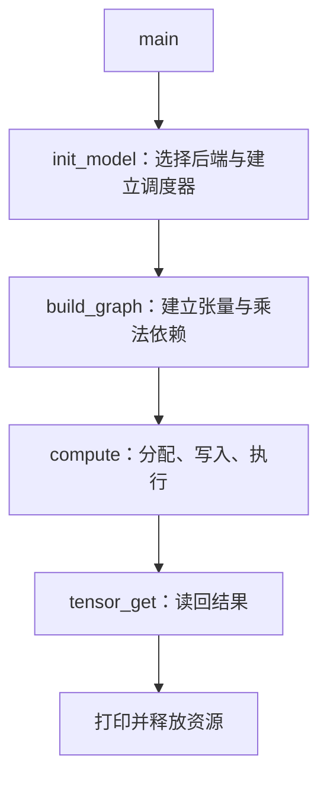
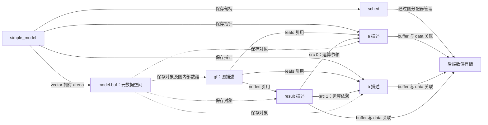

# 用 simple-backend.cpp 练习高效阅读源码

适用入口：[`examples/simple/simple-backend.cpp`](../examples/simple/simple-backend.cpp)。整理日期：2026-11-16。实现说明以本次工作区源码为准；后续版本请按函数名重新定位。本文是学习与执行手册，已有的[全链路分析](simple-backend全链路分析.md)可作为深入查询资料。本文不修改示例源码。

## 1. 先改变阅读单位：从“一行”变成“一个可验证的问题”

你目前做的“查函数 → 用自己的话解释 → 画图”很有价值。效率低通常出在：还没有主线就进入细节，遇到调用就继续往下钻，把理解一个入口变成理解整个库。

建议把一次阅读的基本单位改成：**提出问题 → 写下预测 → 查最少的相关源码 → 用运行或调试验证 → 合上源码复述**。

例如，不从“`ggml_mul_mat` 每行什么意思”开始，而从“调用后是否已经算出 60？”开始。先预测，再查实现中的 `op`、`src[]` 和返回值；发现它只构造输出张量并记录依赖，然后在执行接口前后观察结果。一次阅读就建立了“描述计算”和“执行计算”的区别。

判断进展的标准也随之改变：不是今天解释了多少行，而是能否预测行为、找到证据、独立完成一个小修改。

## 2. 本例的学习终点

第一轮只要求你做到以下六件事：

1. 不看源码，说出从输入数组到输出数组的过程。
2. 算出输入、输出的形状和一个输出元素。
3. 区分 tensor 元数据、计算图、数值存储、后端、调度器。
4. 解释为什么创建乘法节点没有执行乘法。
5. 解释 `ggml_free(ctx)` 后为何还能使用图，以及它的有效条件。
6. 修改一个输入，提前预测输出变化，再运行验证。

暂时不要求读懂 SIMD、线程池、CUDA 内核、所有分图规则和分配器空闲块算法。把这些记录为后续专题；它们不会阻止你理解本例的输入输出契约。

## 3. 第一遍：只读 main 和四个阶段

先看 `main()`，再看 `init_model()`、`build_graph()`、`compute()` 的函数体。此时不跳入每个库函数。



把库函数先压缩成一句话：

| 阶段 | 输入 | 产物或状态变化 | 本轮需要追问的事 |
|---|---|---|---|
| 初始化 | 编译进来或动态加载的后端 | `backend`、`cpu_backend`、`sched` | 实际选择了什么设备？ |
| 建图 | 形状与运算表达式 | `a`、`b`、`result`、`gf` 的元数据 | 有数据存储了吗？ |
| 分配 | `gf`、`sched` | 张量绑定到后端存储 | 哪些指针或字段变了？ |
| 写入 | `matrix_A/B` | 后端输入数据 | 写入了多少字节？ |
| 执行 | 已分配并填充的图 | 输出数值 | 返回时是否完成？ |
| 读回 | 结果张量 | `out_data` | 如何解释一维数组？ |
| 清理 | 已使用的资源 | 调度器与后端释放 | 是否存在别名而重复释放？ |

**这一遍的产物：一段 100～200 字的主线解释。** 能写出后再继续；不要在第一遍画完整库调用图。

## 4. 第二遍：先用数学确定程序应该做什么

实际数组按普通行列表示为：

```text
A（4×2）          B（3×2，指实际存储的 matrix_B）
2 8               10 5
5 1                9 9
4 2                5 4
8 6
```

本例 `ggml_mul_mat(ctx, a, b)` 的结果按打印方式解释为 `R = B × Aᵀ`：

```text
R（3×4）
60 55 50 110
90 54 54 126
42 29 28  64
```

用一个公式贯通数组、shape 与索引：

```text
R[j][i] = Σ_k B[j][k] * A[i][k]
R[0][0] = 10*2 + 5*8 = 60
out_data[j*4+i] 对应 R[j][i]
```

| 张量 | 创建参数中的前两维 | `ne[0..3]` | 连续 F32 的 `nb[0] / nb[1]` | 数值字节数 |
|---|---|---|---|---|
| a | `cols_A, rows_A` | `[2,4,1,1]` | 4 / 8 | 32 |
| b | `cols_B, rows_B` | `[2,3,1,1]` | 4 / 8 | 24 |
| result | 从 a、b 推导 | `[4,3,1,1]` | 4 / 16 | 48 |

`ne` 的单位是元素数，`nb` 的单位是字节。这里 F32、连续存储时，可用 `data + i*nb[0] + j*nb[1]` 表达元素地址偏移。不要把这个简化规则直接推广到量化类型和非连续视图。

`ne[0]` 在本例对应打印的列数。ggml 的维度顺序不能直接照搬某些框架常见的 `[rows, cols]` 写法。源码 README 中还把传统矩阵 B 定义成 2×3，那是实际 `matrix_B` 的转置；阅读时先固定自己所用的符号。

**这一遍的产物：形状表、一个手算元素、完整预期输出。** 有了这三样，后面的运行才有判断标准。

## 5. 第三遍：按职责理解数据结构

先读 [`include/ggml.h`](../include/ggml.h) 的 `ggml_tensor`、`ggml_init_params`，再按需查看 [`src/ggml-impl.h`](../src/ggml-impl.h) 的 `ggml_cgraph`。不要一次解释结构体全部字段。

| 对象 | 先掌握什么 | 容易混淆的地方 |
|---|---|---|
| `simple_model` | 保存本例使用的指针和 `buf` | 它没有封装所有资源的自动释放 |
| `ggml_context` | 在指定 arena 中组织对象分配 | context 对象与 arena 不是同一块资源 |
| `ggml_tensor` | `type/ne/nb/op/src/buffer/data` | 描述对象与它指向的数值存储分开 |
| `ggml_cgraph` | `nodes/leafs/n_nodes/n_leafs` | 图收集张量引用；不把每个张量的数值都内嵌进去 |
| `backend` | 具体后端实例与接口 | 被选中不代表图中所有节点都必然在该设备执行 |
| `sched` | 后端分派、分图、图存储与执行协调 | 不承担本例所有对象的生命周期 |

### 5.1 画结构图时，必须给边写含义



这张图刻意区分了“拥有”“保存指针”“运算依赖”“存储关联”。仅画 `model → tensor → buffer`，以后很难据此判断谁能释放谁。

本例初始建图通常是 2 个叶子 `a/b`、1 个运算节点 `result`。张量既能是输入描述，也能是运算节点的结果描述；不是另有一个完全独立的“乘法对象”保存这次运算。

### 5.2 用生命周期解决最容易卡住的代码

`build_graph()` 中：

```cpp
params0.mem_buffer = model.buf.data();
params0.no_alloc = true;
// ...建图...
ggml_free(ctx);
return gf;
```

按四步查证：

1. 查 `ggml_init()`：外部传入 `mem_buffer` 时，`mem_buffer_owned` 为 false。
2. 查 `ggml_new_tensor_impl()`：`no_alloc=true` 时不在 context arena 中为普通张量分配数值数据；张量描述仍然需要空间。
3. 查 `ggml_free()`：只有 `mem_buffer_owned` 为 true 才释放 arena，context 自身会释放。
4. 回到调用者：`model.buf` 仍活着，所以 arena 内的图和张量描述仍在。

结论的有效条件：**这些指针使用期间，`model.buf` 的底层空间必须保持有效，不能销毁或因后续 resize 等操作迁移。** 不能据此推导所有 context 都能提前释放；若 arena 由 context 自己拥有，释放后的行为不同。

`no_alloc=true` 也不表示整个程序不分配内存，只是把相关张量数值存储的分配推迟到后端流程。

## 6. 第四遍：围绕六个问题定点下钻

每个问题最多先看两层实现。仍不够时，先写下“当前卡住的精确条件”，再决定是否继续。

### 问题 A：best 后端是什么意思？

查 [`src/ggml-backend-reg.cpp`](../src/ggml-backend-reg.cpp) 的 `ggml_backend_init_best()`：当前实现按 GPU、IGPU、CPU 的顺序找设备，然后初始化选中的设备。这里没有运行性能基准，也不能理解为最适合这次微小矩阵乘法。

接着回到 `init_model()`：若选到 CPU，两个后端字段指向同一个实例，`n_backends=1`；否则再创建 CPU 后端供调度使用。最终释放时比较指针，是为了避免对同一个实例释放两次。

### 问题 B：乘法何时发生？

查 [`src/ggml.c`](../src/ggml.c) 的 `ggml_mul_mat()`，只抓以下关键语句：

```cpp
const int64_t ne[4] = { a->ne[1], b->ne[1], b->ne[2], b->ne[3] };
result->op = GGML_OP_MUL_MAT;
result->src[0] = a;
result->src[1] = b;
```

它创建结果描述、设置输出形状、记录运算及输入，没有在这里把数组做乘法。此时无需继续追踪每个初始化字段。

### 问题 C：图展开做什么？

查 `ggml_build_forward_expand()`，按需进入其调用的建图实现及依赖遍历：从 result 沿 `src[]` 收集依赖，建立可执行图的节点集合与顺序。它组织运算描述，不执行数值运算。

### 问题 D：数值存储从哪里来？

查 [`src/ggml-backend.cpp`](../src/ggml-backend.cpp) 的 `ggml_backend_sched_alloc_graph()`：先分图，再分配 splits。需要更深时才去看 `ggml_backend_sched_alloc_splits()` 与 [`src/ggml-alloc.c`](../src/ggml-alloc.c) 的 `ggml_gallocr_alloc_graph()`。

本轮只要求理解：调度器确定执行归属、组织所需图，并通过图分配器为张量绑定合适的存储。具体复用策略、对齐和碎片管理可以以后单独读。

`ggml_backend_sched_reset()` 重置调度状态，不等于把所有输入清零，也不等于重新创建后端。

### 问题 E：set/get 是否一定走 PCIe？

查看 `ggml_backend_tensor_set/get()`：根据张量关联的 buffer，分派到对应存储实现。CPU 后端可涉及主机内存复制；设备后端可能涉及设备传输。接口名本身不能证明用了独立显存或某条物理总线。

本例数据流是：`matrix_A/B → 已分配的输入存储 → 运算 → 输出存储 → out_data`。不要直接解引用设备张量的 `data` 来代替 get。

### 问题 F：执行返回时完成了吗？

当前 `ggml_backend_sched_graph_compute()` 先调用 async 版本，再调用 `ggml_backend_sched_synchronize()`。因此本例使用的接口会同步，然后返回状态。

CPU 路径需要深入时，再跟进 CPU 后端回调、`ggml_graph_compute()` 及 `GGML_OP_MUL_MAT` 的分支。CPU 内部还可能按构建与类型选择优化实现；不要把某条底层分支当成所有设备都走的固定路径。

### 6.1 用分层调用图记录证据

```text
应用层：直接调用
main
├─ init_model
│  ├─ ggml_backend_init_best
│  ├─ 必要时 ggml_backend_init_by_type(CPU)
│  └─ ggml_backend_sched_new
├─ build_graph
│  ├─ ggml_init / ggml_new_graph
│  ├─ ggml_new_tensor_2d（a、b）
│  ├─ ggml_mul_mat
│  ├─ ggml_build_forward_expand
│  └─ ggml_free（context）
├─ compute
│  ├─ ggml_backend_sched_reset
│  ├─ ggml_backend_sched_alloc_graph
│  ├─ ggml_backend_tensor_set（a、b）
│  ├─ ggml_backend_sched_graph_compute
│  └─ ggml_graph_node(gf, -1)
├─ ggml_backend_tensor_get / 打印
└─ sched_free / backend_free

分配链：直接调用中的关键部分
sched_alloc_graph → sched_split_graph → sched_alloc_splits
sched_alloc_splits → ggml_gallocr_alloc_graph（存在重试等条件分支）

执行链：前半是直接调用，后半有后端接口分派
sched_graph_compute → sched_graph_compute_async → sched_compute_splits
sched_compute_splits → 后端 graph_compute 接口 → 具体后端实现
CPU 分支：ggml_backend_cpu_graph_compute → ggml_graph_compute
CPU 内部：任务执行与算子分派 → MUL_MAT 对应实现
sched_graph_compute 随后调用 sched_synchronize
```

图上只有确定的直接调用才画成直接边；跨过多层或涉及函数指针时，明确标为“路径概览”或“接口分派”。调用树用于回答“控制从哪来到哪去”，结构图用于回答“谁引用谁”，两种图分开维护。

## 7. 第五遍：调试时观察状态变化

建议先跑 CPU Debug，降低设备与优化带来的干扰。在断点处先写预测，再单步观察；第一次不需要 step into 每个函数。

| 断点位置 | 观察内容 | 预期与解释 |
|---|---|---|
| `init_model` 结束后 | backend 名称、两个后端指针 | CPU 情况可相同；GPU 情况应有单独 CPU 实例 |
| `ggml_mul_mat` 后 | `result->op/src/ne` | 运算为 MUL_MAT，输入指向 a/b，形状 `[4,3,1,1]` |
| 图展开后、context 释放前 | `gf` 的节点与叶子 | 初始图通常为 1 节点、2 叶子 |
| `build_graph` 返回后 | `gf/a/b` 及 `model.buf.data()` | arena 仍有效，图指针可用 |
| alloc_graph 前后 | `a/b/result` 的 `buffer/data` | 普通本例张量从未绑定数值存储到已绑定 |
| 两次 set 之后 | CPU 路径输入内容 | 应与源码数组一致；设备数据通过 API 检查 |
| graph_compute 返回后 | 返回状态、结果 | 成功时运算完成；不要把分配后未初始化内容当结果 |
| tensor_get 后 | `out_data[0]` 与全部 12 项 | 第一项 60，完整值与数学预测一致 |

如果 IDE 只能看到不透明的 `ggml_cgraph` 类型，可通过 `ggml_graph_n_nodes()` 获取运算节点数；叶子数量等内部字段可进入具备内部类型定义的实现作用域观察。当前头文件没有 `ggml_graph_n_leafs()` 接口，不要凭命名规律猜测 API，也不要为了看字段给产品代码随意暴露内部头文件。

### 7.1 在当前 Windows 仓库构建与运行

PowerShell 示例，目录为仓库根目录：

```powershell
cmake --build build-debug --config Debug --target simple-backend
.\build-debug\bin\Debug\simple-backend.exe
```

若没有现成构建目录，可另建一个专用 CPU 学习目录：

```powershell
cmake -S . -B build-study -DGGML_BUILD_EXAMPLES=ON -DGGML_CUDA=OFF -DGGML_METAL=OFF -DGGML_VULKAN=OFF -DGGML_SYCL=OFF
cmake --build build-study --config Debug --target simple-backend
.\build-study\bin\Debug\simple-backend.exe
```

后一组按本机默认 Visual Studio 多配置生成器书写。若使用 Ninja 等单配置生成器，配置时加 `-DCMAKE_BUILD_TYPE=Debug`，可执行文件通常位于 `build-study/bin/`。额外启用的设备后端仍会影响 init_best，实际后端以调试观察为准。

文档整理时执行了已有 `build-debug/bin/Debug/simple-backend.exe`，输出与上述 12 个数一致。这证明已有二进制的本次数值运行结果；没有在本次重新构建，因此不能把它当成当前所有源码改动的编译验证。

## 8. 用四个小实验检验自己是否理解

在自己的练习分支或副本里进行；每次只改一处，并保留预测与实际结果。不把实验修改和日常开发改动混在一起。

### 实验一：只修改一个输入

把 `matrix_A[0]` 从 2 改成 3。先不运行，预测：A 第一行的第一个分量增加 1，对应 R 第一列分别增加 `10、9、5`。

```text
70 55 50 110
99 54 54 126
47 29 28  64
```

若你只能说“结果会变”，说明还没有掌握输入与输出索引关系。验证后恢复输入。

### 实验二：增加一个依赖节点

将建图局部改为：

```cpp
struct ggml_tensor * product = ggml_mul_mat(ctx, model.a, model.b);
struct ggml_tensor * result = ggml_add(ctx, product, product);
ggml_build_forward_expand(gf, result);
```

预测：初始图有 2 个运算节点，仍是 2 个输入叶子，最终数值全部翻倍。解释为什么不需要手动向图依次注册 a、b、product。该实验验证依赖遍历，而非某个特定后端是否融合运算。

### 实验三：保持图和分配，更新输入再计算

先研究如何在第一次分配成功后，再做“set → graph_compute → get”，第二次只改变输入，不改形状。预测数值变化，并比较两轮的 tensor 指针、存储绑定。

注意：直接再次调用当前 `compute()` 会执行 reset 和 alloc；那并不是只更新输入的实验。练习时明确区分“复用图描述”“复用已分配存储”“重复整个示例流程”。先保持同步接口，不引入异步并发。

### 实验四：给示例增加失败检查

原示例忽略了 alloc_graph 的 bool 返回值及 graph_compute 的状态。练习加入检查：分配失败停止写入和执行，计算失败停止读回并报告状态，退出前仍释放已创建资源。

不要故意制造巨量分配来触发失败。先从返回值契约、错误传播与清理路径检查代码。这个实验用于检验你是否理解阶段前提，不能仅以“正常跑出数值”代表所有路径都正确。

**每个实验记录四行：改动、预测、实际、解释。** 如果预测错误，优先修正理解模型，再读对应实现。

## 9. 如何让 AI 加快学习，而不替代自己的判断

每次提供：当前问题、自己的理解、最小源码片段、期望解释深度。要求 AI 将“源码事实”和“推断”分开，并给出文件名与函数名供你核对。

可以直接复制这些提问模板：

```text
我正在读当前工作区 simple-backend.cpp。
当前问题：build_graph 返回前释放 ctx，gf 为什么仍有效？
我的预测：ctx 不拥有 model.buf，所以释放 ctx 不释放 arena。
请从 ggml_init、ggml_new_tensor_impl、ggml_free 的实际实现核对。
给出所有权与失效条件，不展开无关后端细节；缺少源码时请说明。
```

```text
下面是一个我不懂的函数及它的直接调用点。
请解释：目的、输入前提、输出、修改状态、资源所有权、错误方式。
先在当前抽象层解释；只有影响上述契约时再展开下一层。
最后给我一个需要预测结果的题目，暂时不要给答案。
```

```text
这是我画的关系图和复述。
请只指出：与实际源码不符的边、遗漏的生命周期条件、混淆的维度。
每个问题提供实现证据，再给一个可运行或可调试的验证办法。
```

拿到解释后，合上回答，用自己的话写 3～5 句，再核对源码。AI 解释若无法落到当前版本的字段赋值、返回值或分支条件，只能算待证假设。

## 10. 给每个函数建立一张“契约卡”

只给关键函数建卡，不给日志、简单 getter 等所有函数都建卡。

```text
函数：
我要解决的问题：
输入与前提：
输出与形状：
修改了哪些状态：
谁分配、谁释放、何时失效：
错误与同步语义：
实现证据（文件 + 函数 + 关键语句）：
我的预测 / 验证结果：
暂缓问题：
```

以 `ggml_mul_mat` 为例：输入是可相乘且满足约束的 a/b；输出为 F32 结果描述；本例形状 `[4,3,1,1]`；设置 `op/src`；描述分配在 context arena；创建节点不计算数值；不满足条件可能触发断言。卡片到此已经足够支持继续理解调用者，无需立即展开内存对齐实现。

## 11. 一次 90 分钟的执行安排

这是一轮学习的建议时间盒，不是读完全部 ggml 的承诺。超时的问题记下来，下一轮单独处理。

| 时间 | 动作 | 必须留下的产物 |
|---|---|---|
| 0～10 分钟 | 跑例子、看 main、写目标 | 输入输出与阶段列表 |
| 10～25 分钟 | 手算 shape 与一个元素 | 形状表、预期结果 |
| 25～45 分钟 | 读关键类型与六个问题 | 结构图、3～6 张契约卡 |
| 45～65 分钟 | 断点比较关键状态 | 预测与观测记录 |
| 65～80 分钟 | 完成一个最小实验 | 修改、预测、实际、解释 |
| 80～90 分钟 | 合上源码复述 | 一页总结、下一轮问题 |

停止下钻的标准：你能说明函数前提、返回值、关键状态变化及所有权，并能预测当前调用者的行为。只有无法预测、观测不符、准备修改实现或定位故障时，再进入更深层。

次日用 5 分钟重画主线和所有权图，几天后换一个输入或节点重新预测。重读前先回忆，能够暴露“看着熟悉但说不出来”的部分。

## 12. 后续阅读顺序

完成本例后按问题推进，每轮选择一个主题：

1. **建图专题**：`ggml_new_tensor_impl → ggml_mul_mat → ggml_build_forward_expand`。目标：能构造并解释多节点依赖。
2. **存储专题**：`sched_alloc_graph → alloc_splits → ggml_gallocr_alloc_graph`。目标：能解释元数据与数值存储的边界、复用和失效条件。
3. **CPU 执行专题**：CPU 后端回调到 `ggml_graph_compute`，再到 MUL_MAT 分派。目标：定位实际计算入口及线程任务边界。
4. **设备专题**：只选择你实际使用的一个后端。目标：解释接口如何落到该后端以及传输、同步发生在哪里。

不要同时把 CPU、CUDA、Metal 所有路径画进第一张图。已有全链路文档可用于查路，自己的总结只保留当前能解释和验证的部分。

## 13. 以后阅读其他源码的复用清单

```markdown
# 源码学习记录：<入口 / 任务>

## 本轮问题
- 要解释的具体行为：
- 验收标准：
- 本轮暂缓内容：

## 基线
- 仓库版本 / 工作区改动：
- 构建命令与环境：
- 运行输入、预期输出、实际输出：

## 主线
- 入口 → 阶段 → 结果：
- 核心状态在各阶段如何变化：

## 数据与资源
- 核心对象及最少字段：
- 谁拥有、谁引用、谁释放：
- 指针或数据何时失效：
- 形状 / 单位 / 布局：

## 定点追踪
- 问题 → 函数契约 → 实现证据：
- 同步、错误和前提条件：
- 不确定或待验证的推断：

## 实验
- 只改的一件事：
- 运行前预测：
- 实际结果：
- 差异及修正后的解释：

## 闭卷复述
- 用自己的话说明整条链路：
- 下一轮只解决的一个问题：
```

完成检查：能闭卷讲清输入到输出；能画出带语义的依赖与所有权；能指出真实执行边界；能解释关键资源有效期；至少有一次先预测再验证的修改。达到这些条件，就可以进入下一个主题，无需等到每一行都没有疑问。
