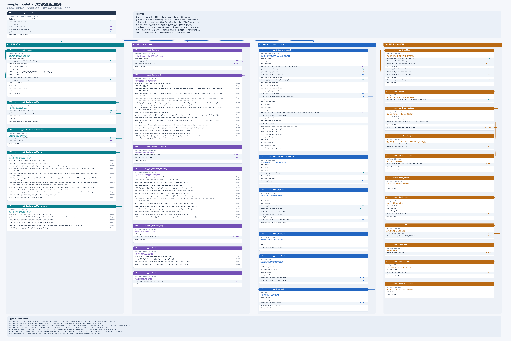

# simple_model 成员类型递归展开图

依据当前工作区源码生成，日期：2026-10-17。



[打开可无损放大的 SVG](simple_model-struct-map.svg) · [打开 PNG](simple_model-struct-map.png)

从 `simple_model` 的每个数据成员开始，穿透结构体指针 typedef、指针、指针数组和内嵌结构体，直到基础类型、枚举、无类型指针或函数指针。同一结构体只展开一次，自引用、循环与共享关系指向已有节点。图中的编号是类型编号，不是运行时对象编号。

图中实线和菱形表示按值内嵌，虚线表示结构体指针或指针数组；每个结构体成员右侧的 `→ 编号` 都对应目标卡片。同栏首次展开绘制连线，跨栏和重复引用使用编号，SVG 中可点击编号跳转。

共 **29 个具名结构体、1 个条件编译匿名结构体、57 条结构体成员关系**。

## 展开边界

- `std::vector<uint8_t> buf`：追踪到元素类型 `uint8_t`，不展开依赖编译器和标准库实现的容器内部结构。
- `void *` / `const void *`：没有可静态追踪的结构体类型。`backend->context` 的具体类型由选中的后端决定；本例通过 `ggml_backend_init_best()` 选择后端，不能统一视为 CPU 私有结构体。
- 函数指针也是成员，所有接口结构体均列出其完整签名；参数和返回值中的结构体不是该成员内嵌的子对象，不额外展开。
- 枚举是值类型终点，完整枚举定义附于文末。`int32_t flags` 仍按其声明类型展示，不改写为枚举。
- `allocated_tensors[1024]` 是 `GGML_ALLOCATOR_DEBUG` 条件编译成员，其匿名结构体也已展开。
- 指针关系不表示所有权。`backend` 与 `cpu_backend` 在选择 CPU 时可以相同；共享引用不重复生成卡片。

## 结构体索引

| 编号 | 类型 | 源码 |
|---|---|---|
| [M01](#m01) | `simple_model` | [examples/simple/simple-backend.cpp:19](../examples/simple/simple-backend.cpp#L19) |
| [T01](#t01) | `ggml_tensor` | [include/ggml.h:721](../include/ggml.h#L721) |
| [T02](#t02) | `ggml_backend_buffer` | [src/ggml-backend-impl.h:69](../src/ggml-backend-impl.h#L69) |
| [T03](#t03) | `ggml_backend_buffer_type` | [src/ggml-backend-impl.h:31](../src/ggml-backend-impl.h#L31) |
| [T04](#t04) | `ggml_backend_buffer_i` | [src/ggml-backend-impl.h:46](../src/ggml-backend-impl.h#L46) |
| [T05](#t05) | `ggml_backend_buffer_type_i` | [src/ggml-backend-impl.h:17](../src/ggml-backend-impl.h#L17) |
| [B01](#b01) | `ggml_backend` | [src/ggml-backend-impl.h:158](../src/ggml-backend-impl.h#L158) |
| [B02](#b02) | `ggml_backend_i` | [src/ggml-backend-impl.h:121](../src/ggml-backend-impl.h#L121) |
| [B03](#b03) | `ggml_backend_device` | [src/ggml-backend-impl.h:220](../src/ggml-backend-impl.h#L220) |
| [B04](#b04) | `ggml_backend_device_i` | [src/ggml-backend-impl.h:176](../src/ggml-backend-impl.h#L176) |
| [B05](#b05) | `ggml_backend_reg` | [src/ggml-backend-impl.h:242](../src/ggml-backend-impl.h#L242) |
| [B06](#b06) | `ggml_backend_reg_i` | [src/ggml-backend-impl.h:230](../src/ggml-backend-impl.h#L230) |
| [B07](#b07) | `ggml_backend_event` | [src/ggml-backend-impl.h:165](../src/ggml-backend-impl.h#L165) |
| [S01](#s01) | `ggml_backend_sched` | [src/ggml-backend.cpp:786](../src/ggml-backend.cpp#L786) |
| [S02](#s02) | `ggml_backend_sched_split` | [src/ggml-backend.cpp:775](../src/ggml-backend.cpp#L775) |
| [S03](#s03) | `ggml_cgraph` | [src/ggml-impl.h:356](../src/ggml-impl.h#L356) |
| [S04](#s04) | `ggml_hash_set` | [src/ggml-impl.h:250](../src/ggml-impl.h#L250) |
| [S05](#s05) | `ggml_context` | [src/ggml.c:973](../src/ggml.c#L973) |
| [S06](#s06) | `ggml_object` | [src/ggml.c:958](../src/ggml.c#L958) |
| [A01](#a01) | `ggml_gallocr` | [src/ggml-alloc.c:482](../src/ggml-alloc.c#L482) |
| [A02](#a02) | `vbuffer` | [src/ggml-alloc.c:398](../src/ggml-alloc.c#L398) |
| [A03](#a03) | `ggml_dyn_tallocr` | [src/ggml-alloc.c:121](../src/ggml-alloc.c#L121) |
| [A04](#a04) | `匿名结构体 allocated_tensors[]` | [src/ggml-alloc.c:129](../src/ggml-alloc.c#L129) |
| [A05](#a05) | `tallocr_chunk` | [src/ggml-alloc.c:115](../src/ggml-alloc.c#L115) |
| [A06](#a06) | `free_block` | [src/ggml-alloc.c:110](../src/ggml-alloc.c#L110) |
| [A07](#a07) | `hash_node` | [src/ggml-alloc.c:459](../src/ggml-alloc.c#L459) |
| [A08](#a08) | `node_alloc` | [src/ggml-alloc.c:477](../src/ggml-alloc.c#L477) |
| [A09](#a09) | `leaf_alloc` | [src/ggml-alloc.c:473](../src/ggml-alloc.c#L473) |
| [A10](#a10) | `tensor_alloc` | [src/ggml-alloc.c:467](../src/ggml-alloc.c#L467) |
| [A11](#a11) | `buffer_address` | [src/ggml-alloc.c:99](../src/ggml-alloc.c#L99) |

## 指针别名与基础别名

```c
typedef struct ggml_backend_buffer * ggml_backend_buffer_t;
typedef struct ggml_backend_buffer_type * ggml_backend_buffer_type_t;
typedef struct ggml_backend_device * ggml_backend_dev_t;
typedef struct ggml_backend_event * ggml_backend_event_t;
typedef struct ggml_backend_reg * ggml_backend_reg_t;
typedef struct ggml_backend_sched * ggml_backend_sched_t;
typedef struct ggml_backend * ggml_backend_t;
typedef struct ggml_gallocr * ggml_gallocr_t;
typedef uint32_t ggml_bitset_t;
typedef uint8_t ggml_guid[16];
typedef ggml_guid * ggml_guid_t;  // uint8_t (*)[16]，指向整个数组
typedef void * ggml_backend_graph_plan_t;
typedef bool (*ggml_backend_sched_eval_callback)(struct ggml_tensor * t, bool ask, void * user_data);
```

## 完整结构体与每条成员关系

<a id="m01"></a>
### M01 · simple_model

递归起点 · examples/simple/simple-backend.cpp。

源码：[examples/simple/simple-backend.cpp:19](../examples/simple/simple-backend.cpp#L19)

```cpp
struct simple_model {
    struct ggml_tensor * a {};
    struct ggml_tensor * b {};

    // the backend to perform the computation (CPU, CUDA, METAL)
    ggml_backend_t backend {};
    ggml_backend_t cpu_backend {};
    ggml_backend_sched_t sched {};

    // storage for the graph and tensors
    std::vector<uint8_t> buf;
};
```

| 成员 | 声明 | 继续展开 | 关系 |
|---|---|---|---|
| `a` | `struct ggml_tensor * a {};` | [T01 · ggml_tensor](#t01) | 指针引用 |
| `b` | `struct ggml_tensor * b {};` | [T01 · ggml_tensor](#t01) | 指针引用 |
| `backend` | `ggml_backend_t backend {};` | [B01 · ggml_backend](#b01) | 指针引用 |
| `cpu_backend` | `ggml_backend_t cpu_backend {};` | [B01 · ggml_backend](#b01) | 指针引用 |
| `sched` | `ggml_backend_sched_t sched {};` | [S01 · ggml_backend_sched](#s01) | 指针引用 |

<a id="t01"></a>
### T01 · ggml_tensor

张量描述、运算依赖与视图来源。

源码：[include/ggml.h:721](../include/ggml.h#L721)

```cpp
    struct ggml_tensor {
        enum ggml_type type;       // Tensor 的数据类型，Tensor 中元素的存储格式

        struct ggml_backend_buffer * buffer;    // Tensor 的数据到底由谁管理 （cpu RAM / CUDA VRAM / Metal Buffer)
        // ne[0] = 4, ne[1] = 3, 3 行 4 列
        int64_t ne[GGML_MAX_DIMS]; // number of elements， tensor 的 shape, ne[0] 通常对应内存中最连续的那个维度，单位是元素个数
        
        /*
        block 数量 = ne[0] / block_size, 
        */
        size_t  nb[GGML_MAX_DIMS]; // stride in bytes: 单位是字节
                                   // nb[0] = ggml_type_size(type)
                                   // nb[1] = nb[0]   * (ne[0] / ggml_blck_size(type)) + padding
                                   // nb[i] = nb[i-1] * ne[i-1]
        
        // compute data 描述计算
        enum ggml_op op;           // 算子的类型

        

        // op params - allocated as int32_t for alignment
        int32_t op_params[GGML_MAX_OP_PARAMS / sizeof(int32_t)];    // 算子的额外参数
        
        int32_t flags;             // 位标志，可以用于表示(input/outupt/param/loss/...)

        struct ggml_tensor * src[GGML_MAX_SRC]; // 当前 Tensor 是由哪些 Tensor 计算出来的。

        // source tensor and offset for views 描述 View / 内存关系  
        // view: 创建一个新的 Tensor 描述，但是不重新分配数据，而是共享另一个 Tensor 的底层内存。
        // (尽量改变 metadata，而不是移动真正的数据。)
        struct ggml_tensor * view_src;
        size_t               view_offs;

        // 辅助信息  
        void * data;               // 执行真正的数据
        
        char name[GGML_MAX_NAME];  // tensor 的名称，用于调试和日志

        void * extra; // extra things e.g. for ggml-cuda.cu

        char padding[8];           // 跟结构体布局/内存对其/ABI 等有关
    };
```

| 成员 | 声明 | 继续展开 | 关系 |
|---|---|---|---|
| `buffer` | `struct ggml_backend_buffer * buffer;` | [T02 · ggml_backend_buffer](#t02) | 指针引用 |
| `src` | `struct ggml_tensor * src[GGML_MAX_SRC];` | [T01 · ggml_tensor](#t01) | 指针引用 |
| `view_src` | `struct ggml_tensor * view_src;` | [T01 · ggml_tensor](#t01) | 指针引用 |

<a id="t02"></a>
### T02 · ggml_backend_buffer

一块后端存储及其访问接口。

源码：[src/ggml-backend-impl.h:69](../src/ggml-backend-impl.h#L69)

```cpp
    struct ggml_backend_buffer {
        struct ggml_backend_buffer_i  iface;
        ggml_backend_buffer_type_t    buft;
        void * context;
        size_t size;
        enum ggml_backend_buffer_usage usage;
    };
```

| 成员 | 声明 | 继续展开 | 关系 |
|---|---|---|---|
| `iface` | `struct ggml_backend_buffer_i iface;` | [T04 · ggml_backend_buffer_i](#t04) | 按值内嵌 |
| `buft` | `ggml_backend_buffer_type_t buft;` | [T03 · ggml_backend_buffer_type](#t03) | 指针引用 |

<a id="t03"></a>
### T03 · ggml_backend_buffer_type

分配策略、设备与内存对齐。

源码：[src/ggml-backend-impl.h:31](../src/ggml-backend-impl.h#L31)

```cpp
    struct ggml_backend_buffer_type {
        struct ggml_backend_buffer_type_i  iface;
        ggml_backend_dev_t device;
        void * context;
    };
```

| 成员 | 声明 | 继续展开 | 关系 |
|---|---|---|---|
| `iface` | `struct ggml_backend_buffer_type_i iface;` | [T05 · ggml_backend_buffer_type_i](#t05) | 按值内嵌 |
| `device` | `ggml_backend_dev_t device;` | [B03 · ggml_backend_device](#b03) | 指针引用 |

<a id="t04"></a>
### T04 · ggml_backend_buffer_i

函数指针成员：逐项保留完整签名。

源码：[src/ggml-backend-impl.h:46](../src/ggml-backend-impl.h#L46)

```cpp
    struct ggml_backend_buffer_i {
        // (optional) free the buffer
        void         (*free_buffer)  (ggml_backend_buffer_t buffer);
        // base address of the buffer
        void *       (*get_base)     (ggml_backend_buffer_t buffer);
        // (optional) initialize a tensor in the buffer (eg. add tensor extras)
        enum ggml_status (*init_tensor)(ggml_backend_buffer_t buffer, struct ggml_tensor * tensor);
        // tensor data access
        void         (*memset_tensor)(ggml_backend_buffer_t buffer,       struct ggml_tensor * tensor,     uint8_t value, size_t offset, size_t size);
        void         (*set_tensor)   (ggml_backend_buffer_t buffer,       struct ggml_tensor * tensor, const void * data, size_t offset, size_t size);
        void         (*get_tensor)   (ggml_backend_buffer_t buffer, const struct ggml_tensor * tensor,       void * data, size_t offset, size_t size);
        // (optional) 2d data copies
        void         (*set_tensor_2d)(ggml_backend_buffer_t buffer,       struct ggml_tensor * tensor, const void * data, size_t offset, size_t size, size_t n_copies, size_t stride_tensor, size_t stride_data);
        void         (*get_tensor_2d)(ggml_backend_buffer_t buffer, const struct ggml_tensor * tensor,       void * data, size_t offset, size_t size, size_t n_copies, size_t stride_tensor, size_t stride_data);

        // (optional) tensor copy: dst is in the buffer, src may be in any buffer, including buffers from a different backend (return false if not supported)
        bool         (*cpy_tensor)   (ggml_backend_buffer_t buffer, const struct ggml_tensor * src, struct ggml_tensor * dst);
        // clear the entire buffer
        void         (*clear)        (ggml_backend_buffer_t buffer, uint8_t value);
        // (optional) reset any internal state due to tensor initialization, such as tensor extras
        void         (*reset)        (ggml_backend_buffer_t buffer);
    };
```

该结构体没有需要继续展开的数据成员。

<a id="t05"></a>
### T05 · ggml_backend_buffer_type_i

函数指针成员：逐项保留完整签名。

源码：[src/ggml-backend-impl.h:17](../src/ggml-backend-impl.h#L17)

```cpp
    struct ggml_backend_buffer_type_i {
        const char *          (*get_name)      (ggml_backend_buffer_type_t buft);
        // allocate a buffer of this type
        ggml_backend_buffer_t (*alloc_buffer)  (ggml_backend_buffer_type_t buft, size_t size);
        // tensor alignment
        size_t                (*get_alignment) (ggml_backend_buffer_type_t buft);
        // (optional) max buffer size that can be allocated (defaults to SIZE_MAX)
        size_t                (*get_max_size)  (ggml_backend_buffer_type_t buft);
        // (optional) data size needed to allocate the tensor, including padding (defaults to ggml_nbytes)
        size_t                (*get_alloc_size)(ggml_backend_buffer_type_t buft, const struct ggml_tensor * tensor);
        // (optional) check if tensor data is in host memory and uses standard ggml tensor layout (defaults to false)
        bool                  (*is_host)       (ggml_backend_buffer_type_t buft);
    };
```

该结构体没有需要继续展开的数据成员。

<a id="b01"></a>
### B01 · ggml_backend

backend / cpu_backend 可指向同一对象。

源码：[src/ggml-backend-impl.h:158](../src/ggml-backend-impl.h#L158)

```cpp
    struct ggml_backend {
        ggml_guid_t guid;
        struct ggml_backend_i iface;
        ggml_backend_dev_t device;
        void * context;
    };
```

| 成员 | 声明 | 继续展开 | 关系 |
|---|---|---|---|
| `iface` | `struct ggml_backend_i iface;` | [B02 · ggml_backend_i](#b02) | 按值内嵌 |
| `device` | `ggml_backend_dev_t device;` | [B03 · ggml_backend_device](#b03) | 指针引用 |

<a id="b02"></a>
### B02 · ggml_backend_i

执行后端接口；成员均为函数指针。

源码：[src/ggml-backend-impl.h:121](../src/ggml-backend-impl.h#L121)

```cpp
    struct ggml_backend_i {
        const char * (*get_name)(ggml_backend_t backend);

        void (*free)(ggml_backend_t backend);

        // (optional) asynchronous tensor data access
        void (*set_tensor_async)   (ggml_backend_t backend,       struct ggml_tensor * tensor, const void * data, size_t offset, size_t size);
        void (*get_tensor_async)   (ggml_backend_t backend, const struct ggml_tensor * tensor,       void * data, size_t offset, size_t size);
        void (*set_tensor_2d_async)(ggml_backend_t backend,       struct ggml_tensor * tensor, const void * data, size_t offset, size_t size, size_t n_copies, size_t stride_tensor, size_t stride_data);
        void (*get_tensor_2d_async)(ggml_backend_t backend, const struct ggml_tensor * tensor,       void * data, size_t offset, size_t size, size_t n_copies, size_t stride_tensor, size_t stride_data);
        bool (*cpy_tensor_async)(ggml_backend_t backend_src, ggml_backend_t backend_dst, const struct ggml_tensor * src, struct ggml_tensor * dst);

        // (optional) complete all pending operations (required if the backend supports async operations)
        void (*synchronize)(ggml_backend_t backend);

        // (optional) graph plans (not used currently)
        // compute graph with a plan
        ggml_backend_graph_plan_t (*graph_plan_create) (ggml_backend_t backend, const struct ggml_cgraph * cgraph);
        void                      (*graph_plan_free)   (ggml_backend_t backend, ggml_backend_graph_plan_t plan);
        // update the plan with a new graph - this should be faster than creating a new plan when the graph has the same topology
        void                      (*graph_plan_update) (ggml_backend_t backend, ggml_backend_graph_plan_t plan, const struct ggml_cgraph * cgraph);
        // compute the graph with the plan
        enum ggml_status          (*graph_plan_compute)(ggml_backend_t backend, ggml_backend_graph_plan_t plan);

        // compute graph (always async if supported by the backend)
        enum ggml_status          (*graph_compute)     (ggml_backend_t backend, struct ggml_cgraph * cgraph);

        // (optional) event synchronization
        // record an event on this stream
        void (*event_record)(ggml_backend_t backend, ggml_backend_event_t event);
        // wait for an event on on a different stream
        void (*event_wait)  (ggml_backend_t backend, ggml_backend_event_t event);

        // (optional) sort/optimize the nodes in the graph
        void                      (*graph_optimize)    (ggml_backend_t backend, struct ggml_cgraph * cgraph, struct ggml_backend_graph_optimize_params * params);
    };
```

该结构体没有需要继续展开的数据成员。

<a id="b03"></a>
### B03 · ggml_backend_device

设备对象及所属后端注册信息。

源码：[src/ggml-backend-impl.h:220](../src/ggml-backend-impl.h#L220)

```cpp
    struct ggml_backend_device {
        struct ggml_backend_device_i iface;
        ggml_backend_reg_t reg;
        void * context;
    };
```

| 成员 | 声明 | 继续展开 | 关系 |
|---|---|---|---|
| `iface` | `struct ggml_backend_device_i iface;` | [B04 · ggml_backend_device_i](#b04) | 按值内嵌 |
| `reg` | `ggml_backend_reg_t reg;` | [B05 · ggml_backend_reg](#b05) | 指针引用 |

<a id="b04"></a>
### B04 · ggml_backend_device_i

设备接口；签名中的类型不是内嵌成员。

源码：[src/ggml-backend-impl.h:176](../src/ggml-backend-impl.h#L176)

```cpp
    struct ggml_backend_device_i {
        // device name: short identifier for this device, such as "CPU" or "CUDA0"
        const char * (*get_name)(ggml_backend_dev_t dev);

        // device description: short informative description of the device, could be the model name
        const char * (*get_description)(ggml_backend_dev_t dev);

        // device memory in bytes: 0 bytes to indicate no memory to report
        void         (*get_memory)(ggml_backend_dev_t dev, size_t * free, size_t * total);

        // device type
        enum ggml_backend_dev_type (*get_type)(ggml_backend_dev_t dev);

        // device properties
        void (*get_props)(ggml_backend_dev_t dev, struct ggml_backend_dev_props * props);

        // backend (stream) initialization
        ggml_backend_t (*init_backend)(ggml_backend_dev_t dev, const char * params);

        // preferred buffer type
        ggml_backend_buffer_type_t (*get_buffer_type)(ggml_backend_dev_t dev);

        // (optional) host buffer type (in system memory, typically this is a pinned memory buffer for faster transfers between host and device)
        ggml_backend_buffer_type_t (*get_host_buffer_type)(ggml_backend_dev_t dev);

        // (optional) buffer from pointer: create a buffer from a host pointer (useful for memory mapped models and importing data from other libraries)
        ggml_backend_buffer_t (*buffer_from_host_ptr)(ggml_backend_dev_t dev, void * ptr, size_t size, size_t max_tensor_size);

        // check if the backend can compute an operation
        bool (*supports_op)(ggml_backend_dev_t dev, const struct ggml_tensor * op);

        // check if the backend can use tensors allocated in a buffer type
        bool (*supports_buft)(ggml_backend_dev_t dev, ggml_backend_buffer_type_t buft);

        // (optional) check if the backend wants to run an operation, even if the weights are allocated in an incompatible buffer
        // these should be expensive operations that may benefit from running on this backend instead of the CPU backend
        bool (*offload_op)(ggml_backend_dev_t dev, const struct ggml_tensor * op);

        // (optional) event synchronization
        ggml_backend_event_t (*event_new)         (ggml_backend_dev_t dev);
        void                 (*event_free)        (ggml_backend_dev_t dev, ggml_backend_event_t event);
        void                 (*event_synchronize) (ggml_backend_dev_t dev, ggml_backend_event_t event);
    };
```

该结构体没有需要继续展开的数据成员。

<a id="b05"></a>
### B05 · ggml_backend_reg

后端注册入口；iface 按值内嵌。

源码：[src/ggml-backend-impl.h:242](../src/ggml-backend-impl.h#L242)

```cpp
    struct ggml_backend_reg {
        int api_version; // initialize to GGML_BACKEND_API_VERSION
        struct ggml_backend_reg_i iface;
        void * context;
    };
```

| 成员 | 声明 | 继续展开 | 关系 |
|---|---|---|---|
| `iface` | `struct ggml_backend_reg_i iface;` | [B06 · ggml_backend_reg_i](#b06) | 按值内嵌 |

<a id="b06"></a>
### B06 · ggml_backend_reg_i

设备枚举与扩展函数查询接口。

源码：[src/ggml-backend-impl.h:230](../src/ggml-backend-impl.h#L230)

```cpp
    struct ggml_backend_reg_i {
        const char * (*get_name)(ggml_backend_reg_t reg);

        // enumerate available devices
        size_t             (*get_device_count)(ggml_backend_reg_t reg);
        ggml_backend_dev_t (*get_device)(ggml_backend_reg_t reg, size_t index);

        // (optional) get a pointer to a function in the backend
        // backends can add custom functions that are not part of the standard ggml-backend interface
        void * (*get_proc_address)(ggml_backend_reg_t reg, const char * name);
    };
```

该结构体没有需要继续展开的数据成员。

<a id="b07"></a>
### B07 · ggml_backend_event

调度器保存的后端同步事件。

源码：[src/ggml-backend-impl.h:165](../src/ggml-backend-impl.h#L165)

```cpp
    struct ggml_backend_event {
        struct ggml_backend_device * device;
        void * context;
    };
```

| 成员 | 声明 | 继续展开 | 关系 |
|---|---|---|---|
| `device` | `struct ggml_backend_device * device;` | [B03 · ggml_backend_device](#b03) | 指针引用 |

<a id="s01"></a>
### S01 · ggml_backend_sched

成员依次保留源码顺序；galloc 展开见 A01。

源码：[src/ggml-backend.cpp:786](../src/ggml-backend.cpp#L786)

```cpp
struct ggml_backend_sched {
    bool is_reset; // true if the scheduler has been reset since the last graph split
    bool is_alloc;

    int n_backends; // 后端数量

    ggml_backend_t backends[GGML_SCHED_MAX_BACKENDS];               // 已创建的后端列表，靠前的优先级更高，最后必须是 CPU
    ggml_backend_buffer_type_t bufts[GGML_SCHED_MAX_BACKENDS];      // 各后端使用的缓冲区类型；传 nullptr 使用默认类型
    ggml_gallocr_t galloc;

    // hash map of the nodes in the graph
    struct ggml_hash_set  hash_set;
    int                 * hv_tensor_backend_ids; // [hash_set.size]
    struct ggml_tensor ** hv_tensor_copies;      // [hash_set.size][n_backends][n_copies]

    int * node_backend_ids; // [graph_size]     // graph_size: 调度器容量参数，用于确定哈希表、数组和临时空间大小
    int * leaf_backend_ids; // [graph_size]

    int * prev_node_backend_ids; // [graph_size]
    int * prev_leaf_backend_ids; // [graph_size]

    // copy of the graph with modified inputs
    struct ggml_cgraph graph;

    // graph splits
    struct ggml_backend_sched_split * splits;
    int n_splits;
    int splits_capacity;

    // pipeline parallelism support
    int n_copies;
    int cur_copy;
    int next_copy;
    ggml_backend_event_t events[GGML_SCHED_MAX_BACKENDS][GGML_SCHED_MAX_COPIES];
    struct ggml_tensor ** graph_inputs;
    int n_graph_inputs;
    int graph_inputs_capacity;

    struct ggml_context * ctx;

    ggml_backend_sched_eval_callback callback_eval;
    void * callback_eval_user_data;

    char * context_buffer;
    size_t context_buffer_size;

    bool op_offload;

    int debug;

    // used for debugging graph reallocations [GGML_SCHED_DEBUG_REALLOC]
    // ref: https://github.com/ggml-org/llama.cpp/pull/17617
    int debug_realloc;
    int debug_graph_size;
    int debug_prev_graph_size;
};
```

| 成员 | 声明 | 继续展开 | 关系 |
|---|---|---|---|
| `backends` | `ggml_backend_t backends[GGML_SCHED_MAX_BACKENDS];` | [B01 · ggml_backend](#b01) | 指针引用 |
| `bufts` | `ggml_backend_buffer_type_t bufts[GGML_SCHED_MAX_BACKENDS];` | [T03 · ggml_backend_buffer_type](#t03) | 指针引用 |
| `galloc` | `ggml_gallocr_t galloc;` | [A01 · ggml_gallocr](#a01) | 指针引用 |
| `hash_set` | `struct ggml_hash_set hash_set;` | [S04 · ggml_hash_set](#s04) | 按值内嵌 |
| `hv_tensor_copies` | `struct ggml_tensor ** hv_tensor_copies;` | [T01 · ggml_tensor](#t01) | 指针引用 |
| `graph` | `struct ggml_cgraph graph;` | [S03 · ggml_cgraph](#s03) | 按值内嵌 |
| `splits` | `struct ggml_backend_sched_split * splits;` | [S02 · ggml_backend_sched_split](#s02) | 指针引用 |
| `events` | `ggml_backend_event_t events[GGML_SCHED_MAX_BACKENDS][GGML_SCHED_MAX_COPIES];` | [B07 · ggml_backend_event](#b07) | 指针引用 |
| `graph_inputs` | `struct ggml_tensor ** graph_inputs;` | [T01 · ggml_tensor](#t01) | 指针引用 |
| `ctx` | `struct ggml_context * ctx;` | [S05 · ggml_context](#s05) | 指针引用 |

<a id="s02"></a>
### S02 · ggml_backend_sched_split

一个切分区间；graph 是内嵌的图视图。

源码：[src/ggml-backend.cpp:775](../src/ggml-backend.cpp#L775)

```cpp
struct ggml_backend_sched_split {
    int backend_id;
    int i_start;
    int i_end;
    struct ggml_tensor ** inputs;
    int n_inputs;
    int inputs_capacity;
    // graph view of this split
    struct ggml_cgraph graph;
};
```

| 成员 | 声明 | 继续展开 | 关系 |
|---|---|---|---|
| `inputs` | `struct ggml_tensor ** inputs;` | [T01 · ggml_tensor](#t01) | 指针引用 |
| `graph` | `struct ggml_cgraph graph;` | [S03 · ggml_cgraph](#s03) | 按值内嵌 |

<a id="s03"></a>
### S03 · ggml_cgraph

图节点、叶子、梯度与访问集合。

源码：[src/ggml-impl.h:356](../src/ggml-impl.h#L356)

```cpp
struct ggml_cgraph {
    int size;    // maximum number of nodes/leafs/grads/grad_accs
    int n_nodes; // number of nodes currently in use
    int n_leafs; // number of leafs currently in use

    struct ggml_tensor ** nodes;     // tensors with data that can change if the graph is evaluated
    struct ggml_tensor ** grads;     // the outputs of these tensors are the gradients of the nodes
    struct ggml_tensor ** grad_accs; // accumulators for node gradients
    struct ggml_tensor ** leafs;     // tensors with constant data
    int32_t             * use_counts;// number of uses of each tensor, indexed by hash table slot

    struct ggml_hash_set visited_hash_set;

    enum ggml_cgraph_eval_order order;

    // an optional identifier that can be utilized to recognize same graphs if two non-zero values match
    // a value of 0 means it is not set and should be ignored
    uint64_t uid;
};
```

| 成员 | 声明 | 继续展开 | 关系 |
|---|---|---|---|
| `nodes` | `struct ggml_tensor ** nodes;` | [T01 · ggml_tensor](#t01) | 指针引用 |
| `grads` | `struct ggml_tensor ** grads;` | [T01 · ggml_tensor](#t01) | 指针引用 |
| `grad_accs` | `struct ggml_tensor ** grad_accs;` | [T01 · ggml_tensor](#t01) | 指针引用 |
| `leafs` | `struct ggml_tensor ** leafs;` | [T01 · ggml_tensor](#t01) | 指针引用 |
| `visited_hash_set` | `struct ggml_hash_set visited_hash_set;` | [S04 · ggml_hash_set](#s04) | 按值内嵌 |

<a id="s04"></a>
### S04 · ggml_hash_set

集合键是 tensor 指针；used 是位图。

源码：[src/ggml-impl.h:250](../src/ggml-impl.h#L250)

```cpp
struct ggml_hash_set {
    size_t size;
    ggml_bitset_t * used;       // whether or not the keys are in use i.e. set
    struct ggml_tensor ** keys; // actual tensors in the set, keys[i] is only defined if ggml_bitset_get(used, i)
};
```

| 成员 | 声明 | 继续展开 | 关系 |
|---|---|---|---|
| `keys` | `struct ggml_tensor ** keys;` | [T01 · ggml_tensor](#t01) | 指针引用 |

<a id="s05"></a>
### S05 · ggml_context

描述对象所在的内存池与对象链表。

源码：[src/ggml.c:973](../src/ggml.c#L973)

```cpp
struct ggml_context {
    size_t mem_size;            // 内存池总容量
    void * mem_buffer;          // 内存池起点
    bool   mem_buffer_owned;
    bool   no_alloc;

    int    n_objects;

    struct ggml_object * objects_begin;     // 第一个对象的管理头
    struct ggml_object * objects_end;       // 最后一个对象的管理头
};
```

| 成员 | 声明 | 继续展开 | 关系 |
|---|---|---|---|
| `objects_begin` | `struct ggml_object * objects_begin;` | [S06 · ggml_object](#s06) | 指针引用 |
| `objects_end` | `struct ggml_object * objects_end;` | [S06 · ggml_object](#s06) | 指针引用 |

<a id="s06"></a>
### S06 · ggml_object

对象管理头；next 形成链表。

源码：[src/ggml.c:958](../src/ggml.c#L958)

```cpp
struct ggml_object {
    size_t offs;                // 内容区相对 mem_buffer 的偏移
    size_t size;                // 内容区大小，包含对齐填充

    struct ggml_object * next;  // 下一个对象的管理头
    enum ggml_object_type type; // 调用者指定的对象类别
    char padding[4];
};
```

| 成员 | 声明 | 继续展开 | 关系 |
|---|---|---|---|
| `next` | `struct ggml_object * next;` | [S06 · ggml_object](#s06) | 指针引用 |

<a id="a01"></a>
### A01 · ggml_gallocr

多缓冲区分配、哈希状态与节点分配记录。

源码：[src/ggml-alloc.c:482](../src/ggml-alloc.c#L482)

```cpp
struct ggml_gallocr {
    ggml_backend_buffer_type_t * bufts; // [n_buffers]
    struct vbuffer ** buffers; // [n_buffers]
    struct ggml_dyn_tallocr ** buf_tallocs; // [n_buffers]
    int n_buffers;

    struct ggml_hash_set hash_set;
    struct hash_node * hash_values; // [hash_set.size]

    struct node_alloc * node_allocs; // [n_nodes]
    int n_nodes;

    struct leaf_alloc * leaf_allocs; // [n_leafs]
    int n_leafs;
};
```

| 成员 | 声明 | 继续展开 | 关系 |
|---|---|---|---|
| `bufts` | `ggml_backend_buffer_type_t * bufts;` | [T03 · ggml_backend_buffer_type](#t03) | 指针引用 |
| `buffers` | `struct vbuffer ** buffers;` | [A02 · vbuffer](#a02) | 指针引用 |
| `buf_tallocs` | `struct ggml_dyn_tallocr ** buf_tallocs;` | [A03 · ggml_dyn_tallocr](#a03) | 指针引用 |
| `hash_set` | `struct ggml_hash_set hash_set;` | [S04 · ggml_hash_set](#s04) | 按值内嵌 |
| `hash_values` | `struct hash_node * hash_values;` | [A07 · hash_node](#a07) | 指针引用 |
| `node_allocs` | `struct node_alloc * node_allocs;` | [A08 · node_alloc](#a08) | 指针引用 |
| `leaf_allocs` | `struct leaf_alloc * leaf_allocs;` | [A09 · leaf_alloc](#a09) | 指针引用 |

<a id="a02"></a>
### A02 · vbuffer

当前版本：逻辑缓冲区由多块 chunk 组成。

源码：[src/ggml-alloc.c:398](../src/ggml-alloc.c#L398)

```cpp
struct vbuffer {
    ggml_backend_buffer_t chunks[GGML_VBUFFER_MAX_CHUNKS];
};
```

| 成员 | 声明 | 继续展开 | 关系 |
|---|---|---|---|
| `chunks` | `ggml_backend_buffer_t chunks[GGML_VBUFFER_MAX_CHUNKS];` | [T02 · ggml_backend_buffer](#t02) | 指针引用 |

<a id="a03"></a>
### A03 · ggml_dyn_tallocr

按对齐要求管理多个 chunk 的空闲空间。

源码：[src/ggml-alloc.c:121](../src/ggml-alloc.c#L121)

```cpp
struct ggml_dyn_tallocr {
    size_t alignment;
    size_t max_chunk_size;
    struct tallocr_chunk * chunks[GGML_VBUFFER_MAX_CHUNKS];
    int n_chunks;

#ifdef GGML_ALLOCATOR_DEBUG
    struct {
        const struct ggml_tensor * tensor;
        struct buffer_address addr;
    } allocated_tensors[1024];
#endif
};
```

| 成员 | 声明 | 继续展开 | 关系 |
|---|---|---|---|
| `chunks` | `struct tallocr_chunk * chunks[GGML_VBUFFER_MAX_CHUNKS];` | [A05 · tallocr_chunk](#a05) | 指针引用 |
| `allocated_tensors` | `struct { ... } allocated_tensors[1024];` | [A04 · allocated_tensor_debug](#a04) | 按值内嵌；仅 GGML_ALLOCATOR_DEBUG |

<a id="a04"></a>
### A04 · allocated_tensor_debug

匿名结构体；仅 GGML_ALLOCATOR_DEBUG 启用时存在。

源码：[src/ggml-alloc.c:129](../src/ggml-alloc.c#L129)

```cpp
#ifdef GGML_ALLOCATOR_DEBUG
struct {
const struct ggml_tensor * tensor;
        struct buffer_address addr;
} allocated_tensors[1024];
#endif
```

| 成员 | 声明 | 继续展开 | 关系 |
|---|---|---|---|
| `tensor` | `const struct ggml_tensor * tensor;` | [T01 · ggml_tensor](#t01) | 指针引用 |
| `addr` | `struct buffer_address addr;` | [A11 · buffer_address](#a11) | 按值内嵌 |

<a id="a05"></a>
### A05 · tallocr_chunk

单个 chunk 的空闲块表。

源码：[src/ggml-alloc.c:115](../src/ggml-alloc.c#L115)

```cpp
struct tallocr_chunk {
    struct free_block free_blocks[MAX_FREE_BLOCKS];
    int n_free_blocks;
    size_t max_size;
};
```

| 成员 | 声明 | 继续展开 | 关系 |
|---|---|---|---|
| `free_blocks` | `struct free_block free_blocks[MAX_FREE_BLOCKS];` | [A06 · free_block](#a06) | 按值内嵌 |

<a id="a06"></a>
### A06 · free_block

全部成员均为基础类型：到此结束。

源码：[src/ggml-alloc.c:110](../src/ggml-alloc.c#L110)

```cpp
struct free_block {
    size_t offset;
    size_t size;
};
```

该结构体没有需要继续展开的数据成员。

<a id="a07"></a>
### A07 · hash_node

张量引用计数与分配状态。

源码：[src/ggml-alloc.c:459](../src/ggml-alloc.c#L459)

```cpp
struct hash_node {
    int n_children;
    int n_views;
    int buffer_id;
    struct buffer_address addr;
    bool allocated;
};
```

| 成员 | 声明 | 继续展开 | 关系 |
|---|---|---|---|
| `addr` | `struct buffer_address addr;` | [A11 · buffer_address](#a11) | 按值内嵌 |

<a id="a08"></a>
### A08 · node_alloc

运算结果与各输入的分配记录。

源码：[src/ggml-alloc.c:477](../src/ggml-alloc.c#L477)

```cpp
struct node_alloc {
    struct tensor_alloc dst;
    struct tensor_alloc src[GGML_MAX_SRC];
};
```

| 成员 | 声明 | 继续展开 | 关系 |
|---|---|---|---|
| `dst` | `struct tensor_alloc dst;` | [A10 · tensor_alloc](#a10) | 按值内嵌 |
| `src` | `struct tensor_alloc src[GGML_MAX_SRC];` | [A10 · tensor_alloc](#a10) | 按值内嵌 |

<a id="a09"></a>
### A09 · leaf_alloc

叶子张量的分配记录。

源码：[src/ggml-alloc.c:473](../src/ggml-alloc.c#L473)

```cpp
struct leaf_alloc {
    struct tensor_alloc leaf;
};
```

| 成员 | 声明 | 继续展开 | 关系 |
|---|---|---|---|
| `leaf` | `struct tensor_alloc leaf;` | [A10 · tensor_alloc](#a10) | 按值内嵌 |

<a id="a10"></a>
### A10 · tensor_alloc

记录 buffer_id、相对地址与最大尺寸。

源码：[src/ggml-alloc.c:467](../src/ggml-alloc.c#L467)

```cpp
struct tensor_alloc {
    int buffer_id;
    struct buffer_address addr;
    size_t size_max; // 0 = pre-allocated, unused, or view
};
```

| 成员 | 声明 | 继续展开 | 关系 |
|---|---|---|---|
| `addr` | `struct buffer_address addr;` | [A11 · buffer_address](#a11) | 按值内嵌 |

<a id="a11"></a>
### A11 · buffer_address

chunk 索引 + chunk 内偏移：到此结束。

源码：[src/ggml-alloc.c:99](../src/ggml-alloc.c#L99)

```cpp
struct buffer_address {
    int chunk;     // index of a backend buffer
    size_t offset; // local memory offset within the buffer
};
```

该结构体没有需要继续展开的数据成员。

## 直接成员使用的枚举（值类型终点）

### ggml_backend_buffer_usage

源码：[include/ggml-backend.h:49](../include/ggml-backend.h#L49)

```c
    enum ggml_backend_buffer_usage {
        GGML_BACKEND_BUFFER_USAGE_ANY = 0,
        GGML_BACKEND_BUFFER_USAGE_WEIGHTS = 1,
        GGML_BACKEND_BUFFER_USAGE_COMPUTE = 2,
    };
```

### ggml_cgraph_eval_order

源码：[src/ggml-impl.h:350](../src/ggml-impl.h#L350)

```c
enum ggml_cgraph_eval_order {
    GGML_CGRAPH_EVAL_ORDER_LEFT_TO_RIGHT = 0,
    GGML_CGRAPH_EVAL_ORDER_RIGHT_TO_LEFT,
    GGML_CGRAPH_EVAL_ORDER_COUNT
};
```

### ggml_object_type

源码：[include/ggml.h:646](../include/ggml.h#L646)

```c
    enum ggml_object_type {
        GGML_OBJECT_TYPE_TENSOR,
        GGML_OBJECT_TYPE_GRAPH,
        GGML_OBJECT_TYPE_WORK_BUFFER
    };
```

### ggml_op

源码：[include/ggml.h:492](../include/ggml.h#L492)

```c
    enum ggml_op {
        GGML_OP_NONE = 0,

        GGML_OP_DUP,
        GGML_OP_ADD,
        GGML_OP_ADD_ID,
        GGML_OP_ADD1,
        GGML_OP_ACC,
        GGML_OP_SUB,
        GGML_OP_MUL,
        GGML_OP_DIV,
        GGML_OP_SQR,
        GGML_OP_SQRT,
        GGML_OP_LOG,
        GGML_OP_SIN,
        GGML_OP_COS,
        GGML_OP_SUM,
        GGML_OP_SUM_ROWS,
        GGML_OP_CUMSUM,
        GGML_OP_MEAN,
        GGML_OP_ARGMAX,
        GGML_OP_COUNT_EQUAL,
        GGML_OP_REPEAT,
        GGML_OP_REPEAT_BACK,
        GGML_OP_CONCAT,
        GGML_OP_SILU_BACK,
        GGML_OP_NORM, // normalize
        GGML_OP_RMS_NORM,
        GGML_OP_RMS_NORM_BACK,
        GGML_OP_GROUP_NORM,
        GGML_OP_L2_NORM,

        GGML_OP_MUL_MAT,
        GGML_OP_MUL_MAT_ID,
        GGML_OP_OUT_PROD,

        GGML_OP_SCALE,
        GGML_OP_SET,
        GGML_OP_CPY,
        GGML_OP_CONT,
        GGML_OP_RESHAPE,
        GGML_OP_VIEW,
        GGML_OP_PERMUTE,
        GGML_OP_TRANSPOSE,
        GGML_OP_GET_ROWS,
        GGML_OP_GET_ROWS_BACK,
        GGML_OP_SET_ROWS,
        GGML_OP_DIAG,
        GGML_OP_DIAG_MASK_INF,
        GGML_OP_DIAG_MASK_ZERO,
        GGML_OP_SOFT_MAX,
        GGML_OP_SOFT_MAX_BACK,
        GGML_OP_ROPE,
        GGML_OP_ROPE_BACK,
        GGML_OP_CLAMP,
        GGML_OP_CONV_TRANSPOSE_1D,
        GGML_OP_IM2COL,
        GGML_OP_IM2COL_BACK,
        GGML_OP_IM2COL_3D,
        GGML_OP_COL2IM_1D,
        GGML_OP_CONV_2D,
        GGML_OP_CONV_3D,
        GGML_OP_CONV_2D_DW,
        GGML_OP_CONV_TRANSPOSE_2D,
        GGML_OP_POOL_1D,
        GGML_OP_POOL_2D,
        GGML_OP_POOL_2D_BACK,
        GGML_OP_UPSCALE,
        GGML_OP_PAD,
        GGML_OP_PAD_REFLECT_1D,
        GGML_OP_ROLL,
        GGML_OP_ARANGE,
        GGML_OP_TIMESTEP_EMBEDDING,
        GGML_OP_ARGSORT,
        GGML_OP_TOP_K,
        GGML_OP_LEAKY_RELU,
        GGML_OP_TRI,
        GGML_OP_FILL,

        GGML_OP_FLASH_ATTN_EXT,
        GGML_OP_FLASH_ATTN_BACK,
        GGML_OP_SSM_CONV,
        GGML_OP_SSM_SCAN,
        GGML_OP_WIN_PART,
        GGML_OP_WIN_UNPART,
        GGML_OP_GET_REL_POS,
        GGML_OP_ADD_REL_POS,
        GGML_OP_RWKV_WKV6,
        GGML_OP_GATED_LINEAR_ATTN,
        GGML_OP_RWKV_WKV7,
        GGML_OP_SOLVE_TRI,
        GGML_OP_GATED_DELTA_NET,
        GGML_OP_LIGHTNING_INDEXER,
        GGML_OP_DSV4_HC_COMB,
        GGML_OP_DSV4_HC_PRE,
        GGML_OP_DSV4_HC_POST,

        GGML_OP_UNARY,

        GGML_OP_MAP_CUSTOM1,
        GGML_OP_MAP_CUSTOM2,
        GGML_OP_MAP_CUSTOM3,

        GGML_OP_CUSTOM,

        GGML_OP_CROSS_ENTROPY_LOSS,
        GGML_OP_CROSS_ENTROPY_LOSS_BACK,
        GGML_OP_OPT_STEP_ADAMW,
        GGML_OP_OPT_STEP_SGD,

        GGML_OP_GLU,

        GGML_OP_COUNT,
    };
```

### ggml_type

源码：[include/ggml.h:389](../include/ggml.h#L389)

```c
    enum ggml_type {
        GGML_TYPE_F32     = 0,
        GGML_TYPE_F16     = 1,
        GGML_TYPE_Q4_0    = 2,
        GGML_TYPE_Q4_1    = 3,
        // GGML_TYPE_Q4_2 = 4, support has been removed
        // GGML_TYPE_Q4_3 = 5, support has been removed
        GGML_TYPE_Q5_0    = 6,
        GGML_TYPE_Q5_1    = 7,
        GGML_TYPE_Q8_0    = 8,
        GGML_TYPE_Q8_1    = 9,
        GGML_TYPE_Q2_K    = 10,
        GGML_TYPE_Q3_K    = 11,
        GGML_TYPE_Q4_K    = 12,
        GGML_TYPE_Q5_K    = 13,
        GGML_TYPE_Q6_K    = 14,
        GGML_TYPE_Q8_K    = 15,
        GGML_TYPE_IQ2_XXS = 16,
        GGML_TYPE_IQ2_XS  = 17,
        GGML_TYPE_IQ3_XXS = 18,
        GGML_TYPE_IQ1_S   = 19,
        GGML_TYPE_IQ4_NL  = 20,
        GGML_TYPE_IQ3_S   = 21,
        GGML_TYPE_IQ2_S   = 22,
        GGML_TYPE_IQ4_XS  = 23,
        GGML_TYPE_I8      = 24,
        GGML_TYPE_I16     = 25,
        GGML_TYPE_I32     = 26,
        GGML_TYPE_I64     = 27,
        GGML_TYPE_F64     = 28,
        GGML_TYPE_IQ1_M   = 29,
        GGML_TYPE_BF16    = 30,
        // GGML_TYPE_Q4_0_4_4 = 31, support has been removed from gguf files
        // GGML_TYPE_Q4_0_4_8 = 32,
        // GGML_TYPE_Q4_0_8_8 = 33,
        GGML_TYPE_TQ1_0   = 34,
        GGML_TYPE_TQ2_0   = 35,
        // GGML_TYPE_IQ4_NL_4_4 = 36,
        // GGML_TYPE_IQ4_NL_4_8 = 37,
        // GGML_TYPE_IQ4_NL_8_8 = 38,
        GGML_TYPE_MXFP4   = 39, // MXFP4 (1 block)
        GGML_TYPE_NVFP4   = 40, // NVFP4 (4 blocks, E4M3 scale)
        GGML_TYPE_Q1_0    = 41,
        GGML_TYPE_Q2_0    = 42,
        GGML_TYPE_COUNT   = 43,
    };
```

## 重新生成

需要 Python 3 和 Pillow；在仓库根目录执行：

```powershell
python MyDoc/generate_simple_model_map.py
```

脚本从源码重新读取成员声明和源码行号，并校验每个结构体成员都有目标节点、所有节点均可从 `simple_model` 到达、SVG 是合法 XML。若源码新增可达结构体但布局尚未登记，脚本会报错，避免静默遗漏。
